# Loom 引擎结构图 v3（功能 + 文件 + 带关系标注的连线 + 验证体系）

> ★★ **本文件是全仓库唯一的架构台账**（人类 2026-11-18 裁定）。
> 原 AOCI 认知层已**彻底放弃**，架构认知统一以本文件的 Mermaid 图为准。
> 人类原话：「纯文本形式的架构文档对人来说是一种认知负担……直接以 mermaid 图形式存在的架构图
> 相对来说人类更容易直接理解，同时底层仍然是文字也不会对 AI 理解造成障碍。」
> **维护纪律**：改架构/加模块/搬文件后**必须**更新对应小图；一张图 ≤ ~15 节点；
> 节点写真实文件名、边上写关系类型；**不要另起第二份架构文档**。

> 相对 v1 的三个改动：**① 拆成多张小图**（一张图超过 ~15 个节点必然乱，这是 mermaid 的排版极限，不是画法问题）；
> **② 节点里放进真实文件**，功能与文件之间用 `实现于` 连线；**③ 每条线上写清关系**（调用 / 拼装 / 共享契约 / import）。
> 颜色按角色区分，同一张图里看颜色就知道哪个是门面、哪个是契约、哪个是文件。
>
> **v3 相对 v2 的改动（2026-11-19，六面对拍门 + 17 个修复之后）**：
> **④ 修正 3 张「说某端缺东西」的过时图**（图 4 场景链 / 图 7 UI 链 / 图 16 逻辑帧段序）——
> 那些缺陷本轮已全部修好，图不改就等于**架构图在说谎**；
> **⑤ 新增图 2b**（SceneDriver 的拼装形状，与 GLEngine 不同）；
> **⑥ 新增图 18**（VK 窗口/全屏链 —— 全仓唯一必须碰第三方私有成员的地方）；
> **⑦ 新增图 19**（**验证体系：六面对拍门 + 缺口**）—— 门覆盖不到的地方就会漏，所以门本身也要进架构图。
>
> **v3 的一句话结论**：两端一致性的**机制**已经建好（EngineCore 公共 + 后端钩子 + 共享前置库），
> 两端一致性的**证据**也已经建好（六面 653 条对拍门 + 10 条既有对拍/回归门）；
> 剩下的缺口是**物理面 / 动画面 / 编辑器时序 / 打包端到端 / 绑死模式暂停 / 高 DPI**（见图 19.3）。

---

## ★ 先看这三张（找架构问题用）

> 23 张图不必顺序读。**要找「架构上还有没有问题」，看这三张就够**：

| 顺序 | 图 | 回答什么问题 |
|---|---|---|
| **1** | [图 1 全景](#图-1-全景只画层不画文件) | 层与层之间对不对？入口→门面→子系统→契约→数据，有没有跨层直连？ |
| **2** | [图 13 文件清单](#图-13-文件清单按功能簇归组97-个-py) | **97 个 .py 按功能簇归组** —— 哪个文件混了多个功能？哪个簇缺文件？ |
| **3** | [图 19 验证体系](#图-19-验证体系两端对拍门覆盖了哪些面--本轮最大产出) | 哪个面有门、哪个面没门（19.3 缺口表） |

**其它常用**：
- 想知道「两个门面形状为什么不同」→ [图 2 / 2b](#图-2-两个门面是怎么拼出来的一个类--十几个文件)
- 想知道「打开一个场景要过哪些文件」→ [图 4 场景链](#图-4-场景链打开一个场景要过哪些文件)
- 想知道「一帧里谁调谁」→ [图 12 一帧时序](#图-12-一帧时序gl-与-vk-对照)
- 想知道「为什么它这么密」→ [图 14 `engine.py` 解剖](#图-14-enginepy-解剖为什么它的连线最密)

---

## 图例

### 颜色（节点角色）

| 颜色 | 角色 | 例 |
|---|---|---|
| 🔵 蓝 | 入口 / 驱动 | `Loom.py`、`run_player.py` |
| 🟣 紫 | 门面 / 装配 | `engine.py`(GLEngine)、`scene_driver.py`(SceneDriver) |
| 🟢 绿 | 实现 / 子系统 | `loom_render.py`、`loom_lighting.py` |
| 🟠 橙 | 契约 / 单源 | `loom_pass.py`、`loom_scene_ubo.py`、`loom_shader_compat.glsl` |
| ⚪ 灰 | 真实文件（被功能实现的那一个） | `sceneio.py`、`vk_renderer.py` |
| 🟡 黄 | 产物 / 外部 | `Loom.exe`、`游戏包.lsc`、GitHub release、`rendercanvas` |
| 🔵 深蓝 | **门**（验证） | `test_scene_load_parity.py` 等六面对拍门 |
| 🔴 红 | **缺口**（还没有门的面） | 物理面、动画面、打包端到端 |

### 线（关系种类）

| 线型 | 标签 | 含义 |
|---|---|---|
| `-->` | 调用 / 实现于 / import | 直接依赖（代码里能 grep 到） |
| `-.->` | 共享契约 / 运行时 | 间接依赖（同一数据格式、动态 import、外部进程） |
| `==>` | 拼装 | 继承 / 多重继承拼进同一个类 |

> 为什么不能一张图画完：v1 试过 46 节点 76 边，mermaid 的自动布局会把边绕成毛线团。下面每张图控制在 8~15 个节点。

---

# 图 1 全景（只画层，不画文件）

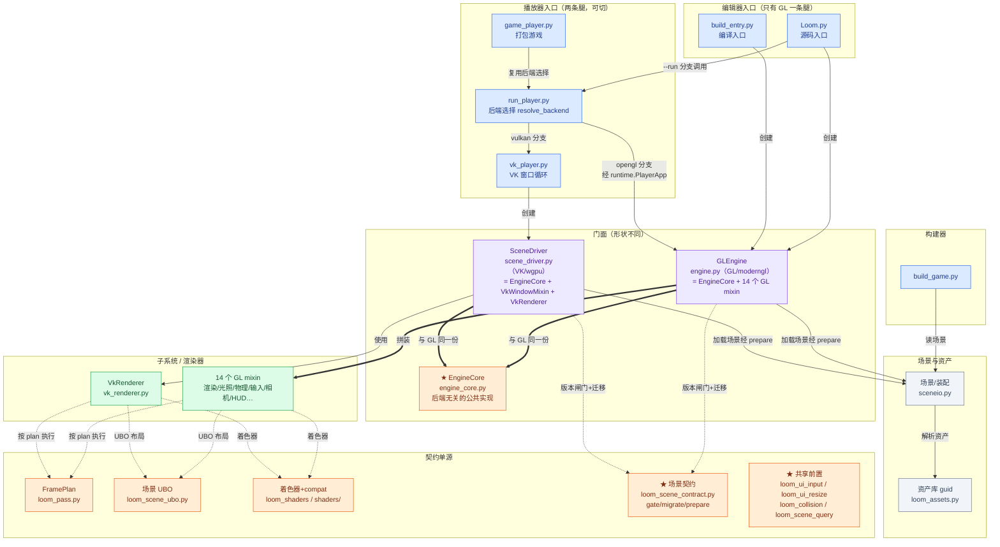

> **这张图 v1 画错过**：原来把 `run_player.py` 画在入口层中间、还画了一条 `run_player → game_player`，方向反了（是 game_player 调 run_player）。
> 现在按「谁创建谁」重画：编辑器入口直连 GLEngine；播放器入口经 run_player 分叉到 GL（runtime.PlayerApp）或 VK（vk_player → SceneDriver）。

## 图 1.1 谁能选后端、不能选时怎么办（这张表比图更说明问题）

| 场景 | 能选后端吗 | 依据 | 环境不支持时 |
|---|---|---|---|
| **编辑器**（`Loom.py` / `Loom.exe`） | **不能**。编辑器 = `EditorApp(GLEngine)`，只有 GL 一条腿 | `editor.py:159` 继承 `GLEngine` | GL 4.3 不满足 → 明确失败并提示「改用 Vulkan 后端」（但它自己用不了 Vulkan）：`loom_gl_version.py:68` |
| 编辑器里点「播放」 | **不能**。就在编辑器自己的 GL 引擎里跑 | `editor.toggle_play` 只置 `is_playing`，不起外部播放器 | 同上 |
| 独立播放器（`--run`） | **能**：`--backend` > 游戏设置 > 引擎设置 > 默认 vulkan | `run_player.resolve_backend:133` | `auto`：VK 初始化失败 → 诊断+弹窗+**同进程转 GL**，并把用户层 `render_api` 写成 opengl（`run_player.py:415-430`、`_persist_backend:186`）；显式 `--backend vulkan` 失败只报错不改配置 |
| 打包游戏（`game_player.py`） | **能**：同播放器一套逻辑（复用 `run_player`） | `game_player.py:169-235` | 同播放器 |
| 运行期失败（VK 渲染循环内崩） | — | `VkRunError` | **不回退**：打印原因后非零退出（`run_player.py:419`） |

> 编辑器里那个「渲染 API」下拉框（`ui/loom_gui.py:3686-3707`）写的是**游戏设置**，即「下次启动播放器/打包游戏用哪个」，
> 不是「编辑器自己用哪个」。`guiloader.py:47` 的注释也这么写：`播放器/发布游戏默认渲染 API (编辑器选)`。
> 所以同一个键 `render_api` 在编辑器里是「替别人设的」，在播放器里是「我自己用的」—— 这是你看出怪的地方，是真实的不对称。

---

# 图 2 两个门面是怎么拼出来的（一个类 = 十几个文件）

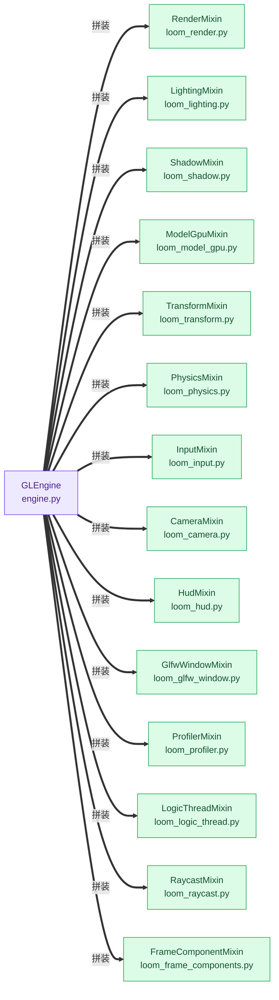

> 读法：这一张图说明「引擎」不是一个类，而是 **14 个文件拼成的同一个对象** —— 所以任何 mixin 都能读写别人的字段。

## 图 2b SceneDriver 是怎么拼出来的（VK 侧 = 3 个文件，与 GL 形状不同）

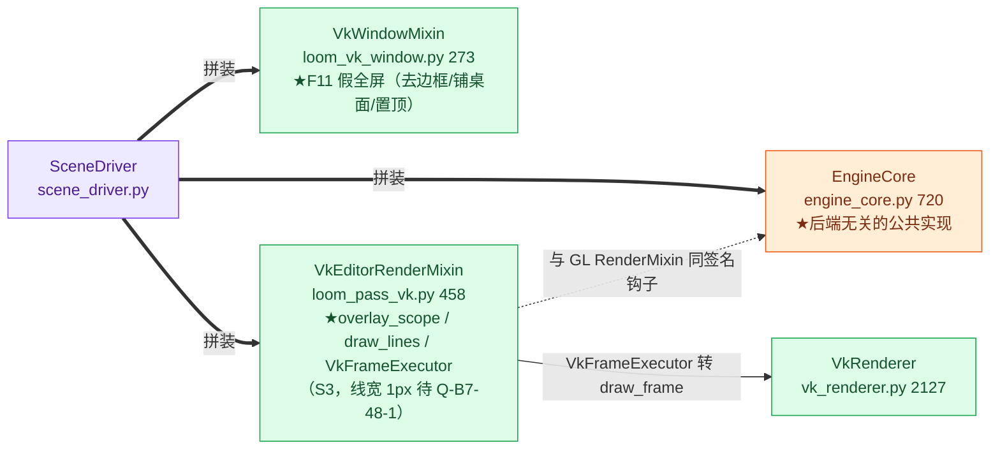

> **为什么形状不同**（这是本仓库最重要的一条架构事实）：
> - `GLEngine` = **14 个 GL 专属 mixin** 拼成（渲染/光照/阴影/窗口/输入… 每个都是 GL 实现）；
> - `SceneDriver` = **`EngineCore`（后端无关）+ `VkWindowMixin`（VK 窗口）+ `VkEditorRenderMixin`（S3 叠加层原语/帧执行器钩子）+ 一个渲染器对象**。
>
> 也就是说：**公共语义在 `EngineCore`，后端差异在 mixin/钩子里**。
> 门 `test_user_api_parity.py` 要求两端 97 个用户 API 是**同一个函数对象**（`getattr(GLEngine,n) is getattr(SceneDriver,n)`）。
>
> `loom_vk_window.py` 是 2026-11-19 新增的（Q-B7-32-1）：VK 的窗口由 `rendercanvas` 管，
> 全屏要靠它的私有 `_window` 句柄做「假全屏」三步（去边框 / 铺桌面 / Win32 置顶），
> **语义与 GL `loom_glfw_window._set_fullscreen` 逐项一致**（门 `test_fullscreen_parity.py` 47 条逐像素对拍）。

---

# 图 3 渲染链（功能 → 文件，带关系标注）

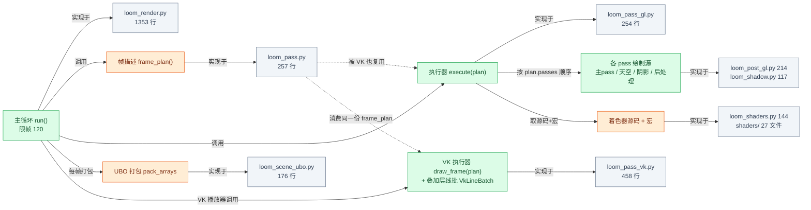

> 读法：绿色=运行时概念，橙色=契约，灰色=真实文件。每条 `实现于` 就是「这个功能写在哪」。
---

# 图 4 场景链（打开一个场景要过哪些文件）

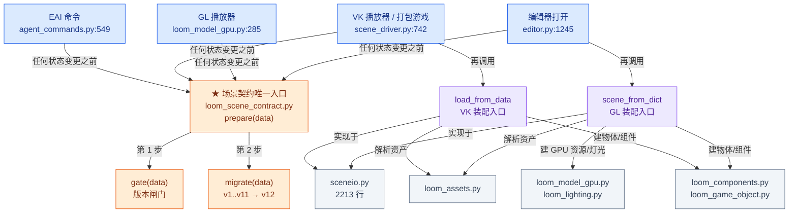

> **这张图 v2 曾经是「版本升级被塞进引擎」的证据**：那时 `migrate()` 挂在 `scene_from_dict` 里面，
> 而 VK 走 `load_from_data`，虚线上写着「只过闸门，不过迁移」→ **v8 老场景在 VK 下相机 yaw 停在 1.5708（弧度当度用）**。
>
> **2026-11-19 已收敛**（B7-16）：版本判定与升级独立成 `loom_scene_contract.py`，**唯一入口 `prepare()`**，
> 4 条打开场景的路径（编辑器 / GL 播放器 / VK 播放器+打包游戏 / EAI 命令）**全部**在「任何状态变更之前」调它。
> 闸门调用点从 **5 处散落收敛到 1 处**（`sceneio.py` 只保留 re-export 别名 + prefab 的 2 处只过 gate 不迁移）。
>
> **设计判据**（值得记住）：场景迁移**只是数据→数据**，不涉及复杂内部操作 → 独立成模块后「特定场景转换有问题时修起来容易」。
> 门：`test_scene_load_parity.py`（76 条）+ `test_scene_contract.py`（39 条，含「契约模块能单独 import、不拉引擎」）。

---

# 图 5 资产链（guid 从哪来、到哪去）

```mermaid
flowchart LR
  P["<项目根>/Assets/assets.json"]:::external
  A["资产库解析<br/>loom_assets.py 1193"]:::file
  S["场景里只写引用<br/>materials[].guid"]:::contract
  M["材质<br/>loom_material.py 135"]:::file
  T["贴图<br/>loom_texture.py 248"]:::file
  C["环境图/天空盒<br/>loom_cubemap.py 238"]:::file
  G["网格<br/>mesh.py 408"]:::file
  U1["GL 装配<br/>sceneio._apply_materials"]:::impl
  U2["VK 装配<br/>scene_driver.build_materials"]:::impl
  P -->|读| A
  A -->|guid → 定义| S
  S -->|按 guid 取| M
  M -->|引用| T
  M -->|引用| C
  M -->|引用| G
  U1 -->|调 ctx.material(guid)| A
  U2 -.->|只读内联字段| M
  classDef external fill:#fef9c3,stroke:#ca8a04,color:#713f12
  classDef impl fill:#dcfce7,stroke:#16a34a,color:#14532d
  classDef contract fill:#ffedd5,stroke:#ea580c,color:#7c2d12
  classDef file fill:#f1f5f9,stroke:#64748b,color:#334155
```

---

# 图 6 三条下沉通道（Python → C）

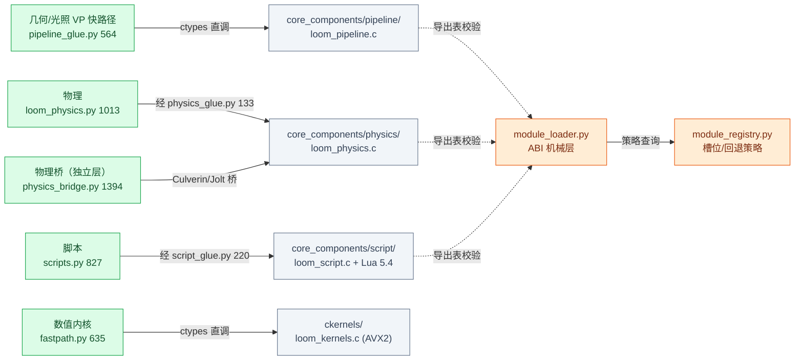

---

# 图 7 UI 链（一套数据模型，三种画法）

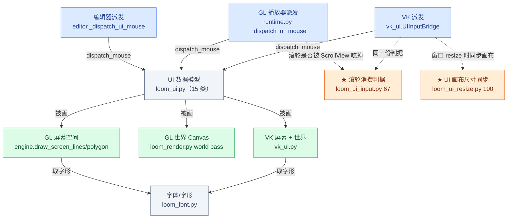

> **v2 曾写「三条派发线是同一件事写三遍」** —— 那时滚轮消费判据有两份同体拷贝（`vk_player` + `vk_ui`），
> GL 侧**完全没有**门控（→ 滚动列表时镜头还在缩放），VK 也**没有** `ui.resize`（窗口拉大后画布不跟随）。
>
> **2026-11-19 已收敛**：
> - `loom_ui_input.py`（P3-1）：滚轮消费判据**唯一实现**，两份拷贝合并、GL 也接上同一份；
> - `loom_ui_resize.py`（Q-B7-41-1）：UI 画布尺寸同步**唯一实现**（含 320×240 下限），VK 帧首在 `begin_frame` **之前**调（与 GL 同序）。
>
> 门：`test_ui_hit_parity.py`（144 条，含 ⑦ resize 三档 + ⑧ 跨帧持按 + ⑥ 坐标系一致性防 Y 轴翻转）。

---

# 图 8 编辑器（一个门面 + 五个附属）

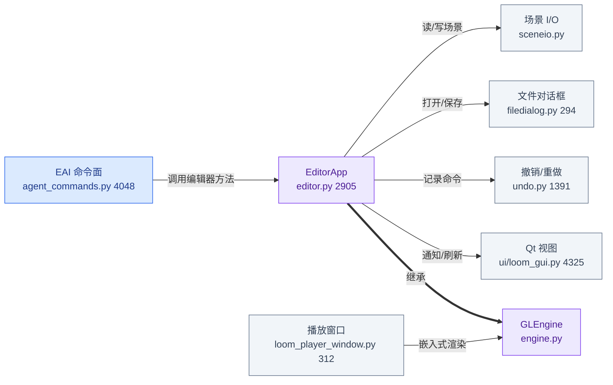

---

# 图 9 配置（三层）

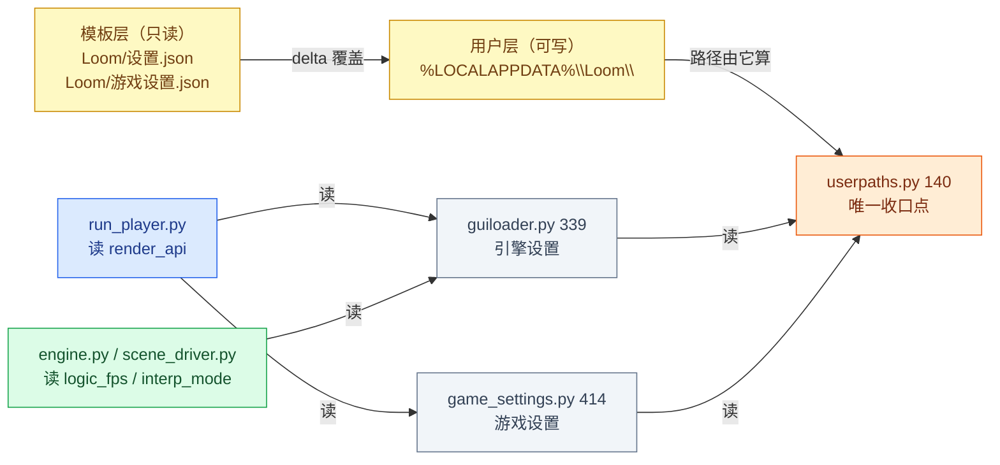

---

# 图 10 构建与发布（工具链文件逐个画）

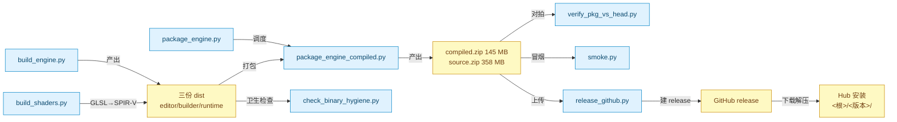
---

# 图 11 打开场景：时序（比流程图更看得出「谁在什么时候调谁」）

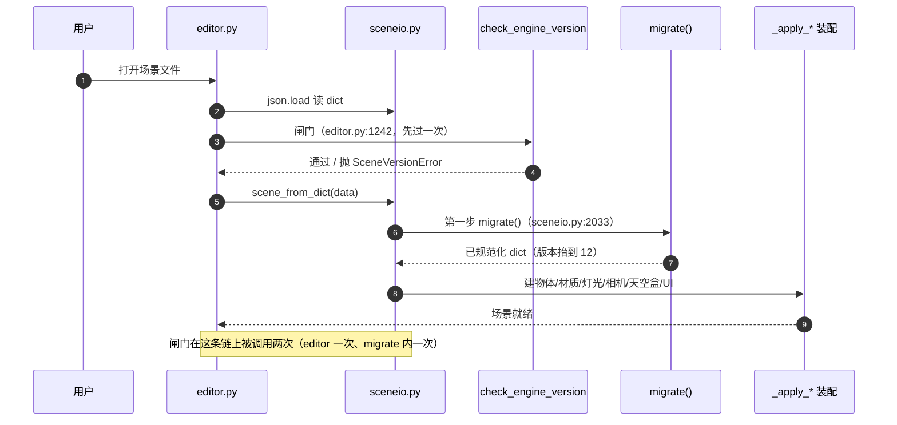

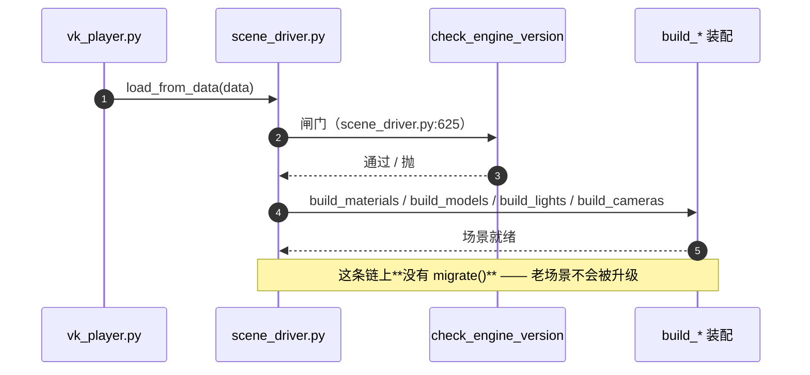

---

# 图 12 一帧：时序（GL 与 VK 对照）

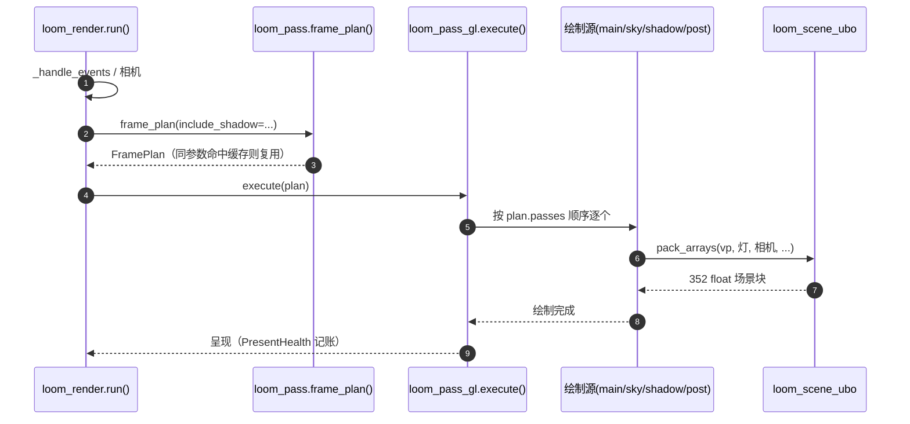

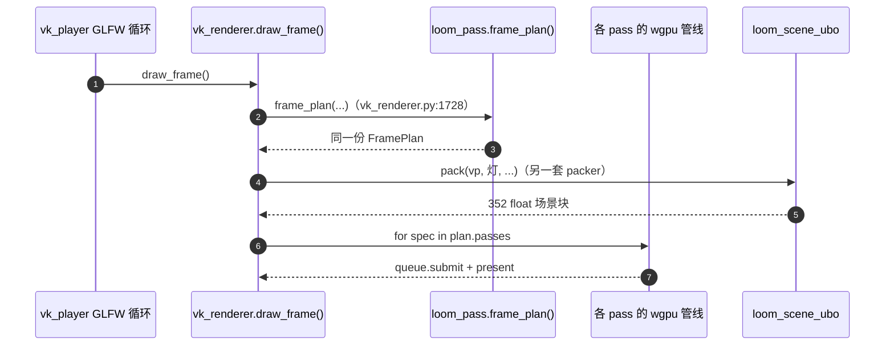

---

# 图 13 文件清单（按功能簇归组，97 个 .py）

图上画不下的全量在这里 —— 这是「功能分布在哪几个文件」的表格版。行数实测。


### A 入口层
| 文件 | 行数 | 职责 |
|---|---|---|
| `Loom.py` | 513 | 入口: 命令行参数 + 数学管线基准 + 启动引擎 |
| `build_entry.py` | 460 | 入口: 命令行参数 + 数学管线基准 + 启动引擎 |
| `run_player.py` | 477 | 播放器渲染 API 选择入口 (2026-08-29 P5) |
| `vk_player.py` | 833 | Vulkan 后端播放器 (wgpu-py + GLFW, 2026-08-29 入口化 |
| `runtime.py` | 309 | Player 运行时 (M17: 引擎/编辑器分层) |
| `game_player.py` | 305 | 纯 Player 游戏入口 (M38, Unity Build 模型) |
| `build_game.py` | 507 | 游戏构建器 (Unity BuildPipeline 对齐, 2026-08-22) |
| `loom_single_instance.py` | 96 | Loom 编辑器单实例锁（2026-10-19） |

### B 引擎门面 + 14 mixin
| 文件 | 行数 | 职责 |
|---|---|---|
| `engine.py` | 1810 | GLEngine: moderngl (OpenGL) 真 GPU 渲染 + pygam |
| `loom_render.py` | 1353 | GLEngine 渲染管线子系统 (主 pass 帧准备 / 绘制 / 帧循环)。 |
| `loom_lighting.py` | 952 | GLEngine 光源/光照上传/阴影 VP 子系统。 |
| `loom_shadow.py` | 118 | GLEngine 的 M29 阴影贴图子系统 (深度 pass)。 |
| `loom_model_gpu.py` | 385 | GLEngine 模型/材质 GPU 资源子系统。 |
| `loom_transform.py` | 438 | GLEngine 变换层次子系统 (模型选择 / 世界矩阵 / 父链层次 / 包围盒)。 |
| `loom_physics.py` | 1014 | GLEngine 的碰撞系统 (M28) + 刚体物理 (M31) 子系统。 |
| `loom_input.py` | 619 | 按键映射与输入动作层（M30b）。 |
| `loom_hud.py` | 337 | GLEngine HUD / 文字渲染子系统。 |
| `loom_font.py` | 207 | 多字体回退链 + 字形缓存（HUD/UI 共用） |
| `loom_camera.py` | 269 | GLEngine 相机控制子系统 (开发者轨道相机 + 键控移动/旋转)。 |
| `loom_glfw_window.py` | 621 | GLEngine 的 GLFW 窗口子系统 (2026-10-18) |
| `loom_profiler.py` | 90 | GLEngine 性能插桩子系统 (LOOM_PROFILE 阶段耗时统计)。 |
| `loom_logic_thread.py` | 143 | GLEngine 逻辑帧线程子系统 (异步逻辑线程启停与主循环)。 |
| `loom_raycast.py` | 328 | 射线检测子系统 (2026-10-18) |
| `loom_frame_components.py` | 128 | GLEngine 每帧组件推进子系统。 |

### C 帧描述 / 契约单源
| 文件 | 行数 | 职责 |
|---|---|---|
| `loom_pass.py` | 258 | 渲染 Pass 描述层（FramePlan / PassSpec），**纯数据，无后端依 |
| `loom_pass_gl.py` | 255 | FramePlan 的 moderngl 执行器（2026-11-10 批次 A / 阶 |
| `loom_pass_vk.py` | 458 | VK 侧执行器 + 叠加层原语（S3，Q-B7-47-1 阶段 3）：VkFrameExecutor 消费同一份 plan、VkLineBatch（draw_lines 的 VK 实现，线宽 1px 待 Q-B7-48-1）、VkEditorRenderMixin（overlay_scope 与 GL 同签名）。 |
| `loom_scene_ubo.py` | 177 | T3c-1：场景参数**单一来源**（字段表 + std140 打包）。 |
| `loom_post.py` | 73 | 后处理链的开关与参数（tonemap + bloom，2026-11-10 阶段 2B2 |
| `loom_post_gl.py` | 215 | GL 侧后处理链（HDR 目标 + bloom + tonemap，2026-11-10 |
| `loom_shaders.py` | 145 | 从 engine.py 抽取的全部 GLSL 着色器源码常量。 |
| `loom_shader_bindings.py` | 80 | T3c 最小落地：post 链绑定号**单点表**（2026-11-11）。 |
| `loom_shader_compat_src.py` | 11 | 读取 shaders/loom_shader_compat.glsl（GL 侧宏层）。 |
| `loom_gl_version.py` | 75 | OpenGL 地板版本门（2026-11-09 批次 A0 / 人类裁决 D1=B）。 |

### D 场景 / 资产 / 数据模型
| 文件 | 行数 | 职责 |
|---|---|---|
| `sceneio.py` | 2379 | 场景/Prefab 序列化 (M18 + M16 + M21) |
| `loom_assets.py` | 1194 | 资产身份层（beta6 B1：项目级 Assets/ + assets.json + g |
| `loom_game_object.py` | 455 | 场景物体 GameObject（M25 组件化容器）。 |
| `loom_components.py` | 1058 | 组件化 (M25) 与资产类。 |
| `loom_scene_entities.py` | 212 | 场景实体状态类。 |
| `loom_material.py` | 136 | 材质资产 (M23)。 |
| `loom_texture.py` | 249 | 纹理资产 (M36 贴图体系第一步)。 |
| `loom_cubemap.py` | 238 | 立方体贴图资产 (M36 贴图体系第5步: 环境反射)。 |
| `mesh.py` | 409 | 顶点/索引缓冲 (Mesh) 与模型生成器 (cube / sphere / obj 导 |
| `loom_ui.py` | 1728 | Canvas/UI 系统数据模型与布局 (2026-10-18) |
| `loom_color.py` | 24 | hex 颜色到 rgba 的转换 + 缓存。 |

### E VK 后端
| 文件 | 行数 | 职责 |
|---|---|---|
| `vk_renderer.py` | 2107 | Vulkan 渲染后端 (wgpu-py, 2026-08-29 性能调优 P4F: 实 |
| `scene_driver.py` | 1642 | 播放器中间层 (纯逻辑, 后端无关; 2026-08-29 用户指示"中间层") |
| `vk_ui.py` | 925 | Vulkan 后端 Canvas UI / HUD 绘制子系统 (2026-11-06) |

### F 运行时系统
| 文件 | 行数 | 职责 |
|---|---|---|
| `physics_bridge.py` | 1395 | B1: Culverin (Jolt) 物理桥 (零 GL, 可独立导入; 无库自动禁用 |
| `physics_glue.py` | 134 | 物理 DLL 接线层（M2a，无模块 docstring） |
| `physics_pipe.py` | 132 | 常驻物理线程 v2 (分离批6 帧内流水线, 2026-09-05) |
| `pipeline_glue.py` | 565 | 基座 ↔ pipeline.dll 接线层 (M2a-3, 2026-09-08) |
| `fastpath.py` | 636 | 组3 公共静态化模块 (numba 可选加速, 未安装自动降级纯 Python). |
| `scheduler.py` | 274 | NgilPool 常驻 nogil 工作池 (调度重构期1, 2026-09-07) |
| `parallel.py` | 537 | CPU 拓扑 / 亲和性 / 脚本专用线程 (2026-08-14 多核优化) |
| `core_clock.py` | 198 | 逻辑帧/渲染帧分离核心时钟 (分离批5 架构重对齐, 2026-09-05) |
| `interp_state.py` | 368 | 逻辑帧双快照 + 渲染帧 numpy 插值 (分离批2, 2026-09-05) |
| `frame_buffer.py` | 345 | 逻辑帧预取缓冲 (TPS 缓冲实验, 2026-09-06) |
| `scripts.py` | 828 | 物体脚本系统 (M27: 从"摆静态场景"跨到"做能动的游戏") |
| `script_glue.py` | 221 | 基座 ↔ script.dll 接线层 (M4, 2026-10-01) |
| `plugin_loader.py` | 836 | Loom 插件加载器 (L1 分级重设计, 2026-08-27) |
| `plugin_sandbox.py` | 269 | 受限沙箱内核 (2026-08-28 渗透靶场 V06 修复; |
| `audio_backend.py` | 245 | 音频双后端适配层 (2026-08-30 B2 换库) |
| `loom_events.py` | 227 | 全局事件总线 (2026-10-18) |
| `layer_tag.py` | 214 | 层与标签配置 (Layer/Tag 系统, 2026-10-18) |
| `loom_net.py` | 266 | 网络助手（HTTP / HTTPS），纯标准库实现。 |
| `crash_reporter.py` | 294 | Loom 崩溃落盘 (dbghelp Minidump + 场景自动备份) |
| `loom_debug.py` | 32 | 崩溃可见性（2026-11-10 编译版「开后处理必崩」排查用）。 |
| `loom_log.py` | 37 | 启动日志开关 (2026-10-19) |
| `loom_backend_guard.py` | 250 | 渲染后端兼容性诊断 + 可见失败（2026-11-09 批次 A / 阶段 1）。 |

### G 编辑器
| 文件 | 行数 | 职责 |
|---|---|---|
| `editor.py` | 2906 | EditorApp: 3D 游戏引擎编辑器 (Unity/Godot 风格) |
| `agent_commands.py` | 4049 | Engine Agent 接口 EAI (2026-08-27) |
| `undo.py` | 1392 | 撤销/重做 (M15, 命令模式) |
| `gui.py` | 586 | 即时模式 GUI (ImGui 风格, moderngl 手写, 零新依赖) |
| `filedialog.py` | 295 | Windows 原生文件对话框 (GetSaveFileNameW / GetOpenF |
| `loom_player_window.py` | 313 | 玩家模式远程兼容窗口（Qt 离屏 GL + QImage 显示）。 |
| `loom_mcp.py` | 993 | MCP 服务面（EAI 的 MCP 封装，无模块 docstring） |

### H 配置与包
| 文件 | 行数 | 职责 |
|---|---|---|
| `guiloader.py` | 340 | Loom / LoomHub 可插拔 GUI 加载器 (2026-08-14) |
| `game_settings.py` | 415 | 单游戏设置 (与 Unity PlayerPrefs / UE GameUserSett |
| `userpaths.py` | 141 | 用户可写配置目录的**唯一**收口点（2026-11-08 用户配置目录契约 §2）。 |
| `game_pack.py` | 138 | 游戏资源包 (2026-08-22 发布链路: Unity Build 对齐) |
| `loom_appearance.py` | 38 | 外观代计数器（组6件1），不依赖 engine。 |

### I 零碎
| 文件 | 行数 | 职责 |
|---|---|---|
| `loom_types.py` | 11 | 引擎基础数据类型。 |
| `matlib.py` | 301 | 4×4 矩阵数学库（行主序，行向量约定） |

### J ui/ 子目录
| 文件 | 行数 | 职责 |
|---|---|---|
| `ui/loom_gui.py` | 4326 | Loom 编辑器 PySide6 原生 Qt 视图 (IEditorView 实现) |
| `ui/editor_ui.py` | 67 | IEditorView 契约: Loom 编辑器 UI 接口标准 (UI 模块化 202 |
| `ui/grid.py` | 104 | 无限网格纯几何 (2026-08-14) |
| `ui/qt_console.py` | 187 | Loom 编辑器内嵌命令行坞 (2026-08-27, EAI P2①) |
| `ui/qt_uitree.py` | 354 | Loom 编辑器 UI 树编辑器 dock (2026-10-18 阶段5) |
| `ui/minimal_editor_view.py` | 110 | MinimalEditorView: Loom 编辑器第二 UI 实现 (极简只读) |
| `ui/__init__.py` | 11 | Loom 编辑器 UI 层 (UI 模块化 2026-08-13) |

### K scripts/ 子目录
| 文件 | 行数 | 职责 |
|---|---|---|
| `scripts/pacman_player.py` | 196 | 2D 吃豆人玩家（网格移动 + 吃豆 + 通关规则）。 |
| `scripts/pacman_ghost.py` | 151 | 2D 吃豆人幽灵：走廊网格移动 + 同伴防重叠。 |
| `scripts/reset_fall.py` | 32 | 游戏脚本 (2026-08-22 教学演示: "游戏脚本目录"机制) |

### L core_components/ 子目录
| 文件 | 行数 | 职责 |
|---|---|---|
| `core_components/module_loader.py` | 418 | Loom 核心组件加载器 (DLL化战役 M1-3, 契约 Python 侧机械层) |
| `core_components/module_registry.py` | 494 | 注册表验证器 + 组装器 (DLL化战役 M1-2, 策略层) |
| `core_components/official_manifest.py` | 37 | 官方件出厂哈希基准 (编译进 exe, 外部改不动). |
| `core_components/boot_check.py` | 112 | 启动自检: 官方件 SHA256 出厂基准校验 (A1). |

共 97 个文件（含 ui/ scripts/ core_components/ 子目录）

---

---

# 图 14 `engine.py` 解剖（为什么它的连线最密）

实测：**1810 行 / 52 个 import（39 本项目 + 3 第三方 + 10 标准库）/ 50 个方法 + 5 个模块级函数**，其中 `__init__` 一个方法就 **409 行**（占全文 22.6%）。

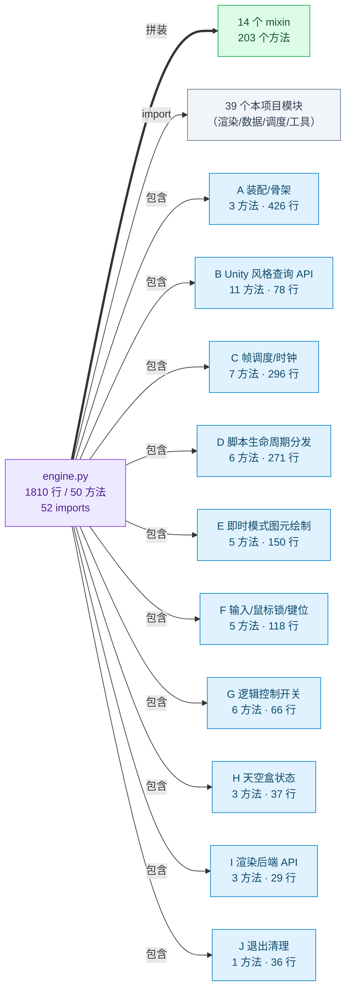

## 14.1 十个功能域（方法数 / 方法体行数）

| 域 | 方法 | 行数 | 说明 |
|---|---|---|---|
| A 装配/骨架 | 3 | **426** | `__init__` 409 行：窗口/GL/阴影/材质/相机/输入/UI/脚本/并行池…一次装完 |
| B Unity 风格查询 API | 11 | 78 | 层/标签注册与查找、`find_by_*`、`SendMessage`、`set_object_layer/tag` |
| C 帧调度/时钟 | 7 | **296** | `_logic_frame`(96) `advance_logic`(70) `_clock_advance`(53) `_logic_prep`(45) + 预取/物理子步 |
| D 脚本生命周期分发 | 6 | **271** | `update_scripts`(144) + FixedUpdate/LateUpdate/Application.quitting/可见性 四个 Unity 对齐钩子 |
| E 即时模式图元绘制 | 5 | 150 | `draw_lines`(63) 世界折线、`draw_screen_lines`(40)/`draw_screen_polygon`(30) 屏幕图元、HUD quad |
| F 输入/鼠标锁/键位 | 5 | 118 | `_poll_mouse_unlock_key`(63) 引擎独占解锁键、键位读写 |
| G 逻辑控制开关 | 6 | 66 | 暂停/单步/TPS/时间比 |
| H 天空盒状态 | 3 | 37 | `effective_skybox` 相机级优先、`reset_sky_state` 哨兵复位 |
| I 渲染后端 API | 3 | 29 | `get/set_render_api`（写游戏配置） |
| J 退出清理 | 1 | 36 | `_stop_parallel` |
| — | **50** | **1507** | 模块级另有 5 个函数（GC 冻结机制，59 行） |

## 14.2 为什么说它「密」：三个数字

| 指标 | engine.py | 全仓第二 |
|---|---|---|
| 本项目模块 import 数（出边） | **39** | `scene_driver.py` 19 |
| 被多少模块 import（入边） | **12** | `sceneio.py` 13 |
| 自身方法数（不含继承来的） | **50** | `scene_driver.py` 58（但它同时是门面+装配器+播放器） |

## 14.3 三个值得注意的点

1. **mixin 已经有 203 个方法，engine.py 自己还留 50 个**，且与 mixin **只有 1 个重名**（`get_action_bindings`）。
   说明这 50 个不是「重复实现」，而是**没被拆出去的第 11~20 个职责** —— 引擎的「其余部分」都住在别的文件里，
   唯独这十类没人认领，于是全堆在门面文件里。
2. **有三个域与已有 mixin 语义重叠但实现不在一起**：输入（`InputMixin` 19 方法 / engine 另有 5）、
   HUD 绘制（`HudMixin` 17 方法 / engine 另有 5 个绘制方法）、逻辑线程（`LogicThreadMixin` 4 方法 / engine 另有 7 个调度方法）。
   即「同一个域，一半在 mixin、一半在门面」。
3. **进程级策略住在门面里**：`gc_play_enter` / `gc_play_exit`（模块级，改的是全局 `gc` 阈值）不属于任何实例，
   却和 `GLEngine` 同文件；类体内还有 `import weakref` + `_LIVE_INSTANCES` 弱引用表（给 `GameObject.parent` 旁路置脏用）。
   这两样都不是「引擎实例的状态」，而是**进程级/全局注册表**，放在这里让 engine.py 同时是「类」和「全局设施」。

---

---

# 图 15 编辑器的三条操作路径（GUI / EAI / 命令行坞）与撤销栈

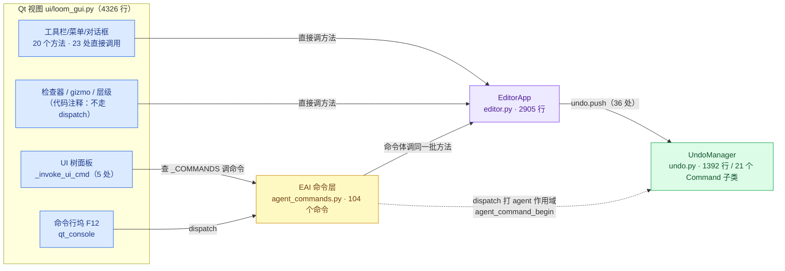

**读法**：GUI 有两条路径（蓝→紫 直接调方法；蓝→黄 走命令），EAI 与命令行坞走黄→紫。
两条路径最终都落到 `EditorApp` 方法，再由方法内部 `undo.push()` 进同一个撤销栈 —— 所以「撤销效果」是统一的，但「操作来源」不统一。

**代码里自己写明了这个分裂**（`agent_commands.py:325-328`）：

> `2026-11-08 批4 (裁决 D10=A): 一条 EAI 命令 = 一个 Agent 命令单位 —— 这里给 UndoManager 打上 "agent 命令作用域"，让批次只吸 EAI 命令产生的写命令。`
> `用户在检查器/gizmo/层级面板上的编辑不走 dispatch, 因此仍是"用户编辑"：不进批、不续租。`

即：**「GUI 绕过 EAI」不是疏忽，是当前裁决（D10=A）的前提**。要让 GUI 全走 EAI，这条裁决必须重写（见 `路线登记_后续版本.md` B7-25）。

---

# 图 16 逻辑帧的段序：两端都是 8 段（2026-11-19 已补齐）

同一个逻辑帧（`_logic_frame(fixed_dt)`）在两端做的事情对比 —— 左列 GL（`engine.py:1225-1320`），右列 VK（`scene_driver.py:796-809`）：

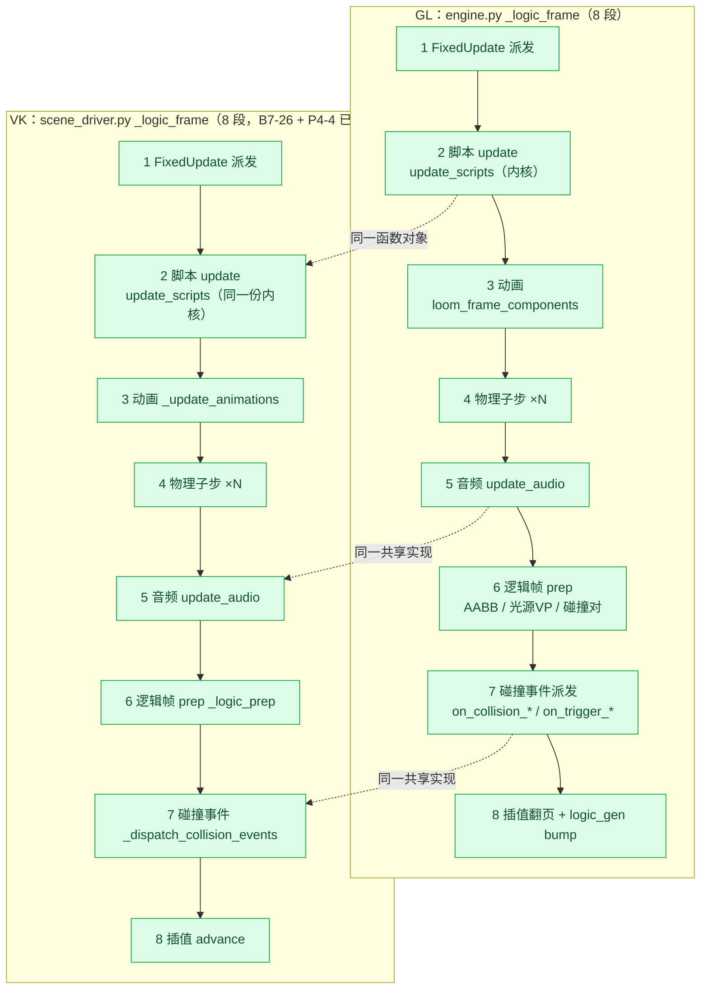

| 段 | GL 实现 | VK 实现 | 状态 |
|---|---|---|---|
| FixedUpdate | `engine.py` | `scene_driver.py` | ✅ 一致 |
| 脚本 update | `update_scripts`（内核 `EngineCore`） | 同一个函数对象 | ✅ 一致 |
| 动画 | `loom_frame_components.update_animations` | `_update_animations` | ✅ 段序一致（实现各一，行为由 P6 门锁） |
| 物理子步 | pipe 或串行 | `_step_physics` | ✅ 同一 `physics_bridge` |
| **音频** | `loom_frame_components.update_audio` | **同一共享实现** | ✅ B7-26 补齐；P4-4 补了**绑死模式**那条路径 |
| **逻辑帧 prep** | `engine._logic_prep` | `_logic_prep` | ✅ B7-26 补齐 |
| **碰撞事件派发** | `loom_physics._dispatch_collision_events` | **同一共享实现** | ✅ B7-26 补齐（修前 VK 全仓 0 命中 → 脚本永不触发） |
| 插值翻页 | `_interp.advance()` | `_interp.advance()` | ✅ 一致 |

> **这张图 v2 曾经是「VK 只有 4 段」的证据**，那是 2026-11-17 的事实。
> **2026-11-19 已全部补齐**：B7-26（逻辑帧 8 段）→ P4-4（绑死模式补音频段）→ 现在两端段序与实现来源都对齐。
> 门：`test_vk_logic_frame_parity.py`（12 条）+ `test_audio_parity.py` ③ 组（段序逐字相同）+ `test_pause_parity.py`（暂停/单步观感）。
>
> **教训**：这张图说明「架构图会过期，而且过期的方向通常是『说某端缺东西』—— 修好后不改图，下一个人会以为还缺」。

---

# 图 17 模块机制：现状三套 vs 目标一套（服务注册表）

## 17.1 现状：三套机制并存，各管一段

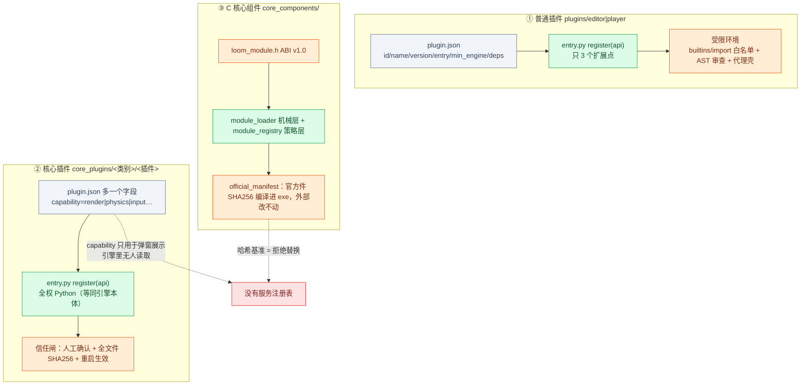

| 机制 | 扩展点 | 隔离 | 能否替换引擎核心 | 证据 |
|---|---|---|---|---|
| ① 普通插件 | 注册脚本类 / 编辑器按钮 / 读插件资产（**3 个**） | 受限环境（有逃逸靶场回归 `test_plugin_sandbox_escape.py`） | ❌ 只能加功能 | `plugin_loader.py:472-518`；未知扩展点只进 `pending` 并打印「L2+ 开放」`:464-470` |
| ② 核心插件 | 同 3 个扩展点，但**全权** | 无沙箱；人工信任闸 + 全文件 SHA256 + 重启生效 + 篡改拒载 | **名义上可以**，实际只能 monkey-patch | `capability` 全仓只用于校验非空（`:365-367`）与弹窗展示（`loom_gui.py:4190`），**引擎里没有任何地方按 capability 找实现** |
| ③ C 核心组件 | ABI 函数表（pipeline/script/physics/ckernels） | 进程内 DLL + ABI 版本门 | 结构上可以 | `loom_module.h` v1.0；`official_manifest.py` 把官方件 SHA256 编译进 exe，**设计目标就是外部改不动** |
| — | — | — | — | `plugins/` 与 `core_plugins/` 只有 README，**0 个真实插件** |

## 17.2 目标：核心 + 服务注册表 + 可替换模块

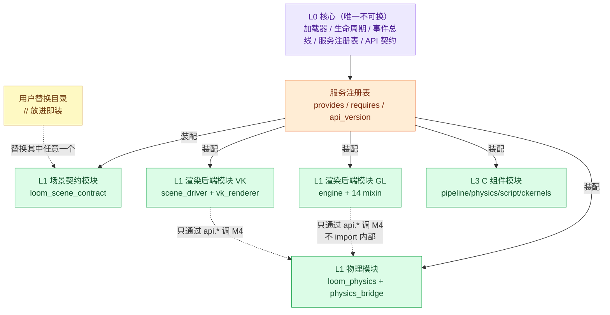

三条必须先说清的约束（否则方案是空想）：

1. **Python 没有 ABI**：进程内「换模块」= 换 `.py` 文件或 `sys.modules` 里的对象。真能换的前提是**调用方只依赖契约**；现状 248 个方法互相直接 import，这个前提不成立 → 必须先做契约化（B7-24 的推广）。
2. **沙箱与「全权替换」本质冲突**：普通插件受限（防投放误用），核心插件全权（能改任何东西）。用户自定义模块只能归「全权 + 信任」，沙箱那条路留给「加功能」。
3. **官方件哈希基准与「可替换」冲突**：`official_manifest` 的设计目标是「外部改不动」；要允许替换，得把它从「拒绝条件」降级为「来源标记（官方/用户/第三方）」并重新定义回退。

# 为什么这么画（排版上的取舍）

| 做法 | 原因 |
|---|---|
| 拆成 14 张小图 | mermaid 的自动布局在 **>15 个节点** 时基本不可读（v1 的 46 节点/76 边就是反例）。一张图只讲一件事，边就不会互相穿越 |
| 每张图只画「这一层的直接依赖」 | 跨层关系用**另一张图**表达（图 1 全景 / 图 11 时序），而不是把所有边塞进一张 |
| 功能节点与文件节点并存 | 你要的「功能分布在哪些文件」：`功能 --实现于--> 文件`，一条线对应一个文件 |
| 线上写字 | 关系种类只有 5 种（调用/实现于/import/共享契约/拼装），写在线上，一眼能看出「谁因为什么依赖谁」 |
| 颜色按角色 | 蓝=入口、紫=门面、绿=实现、橙=契约、灰=文件、黄=产物。同一颜色出现在多张图里含义一致 |
| 时序图讲流程 | 流程图适合讲「结构」，讲「谁先调谁」会变成毛线；图 11/图 12 用时序图 |

# 这份 v2 想请你确认的 3 件事

| # | 问题 | 我现在做的 |
|---|---|---|
| 1 | 14 张图**数量合适**吗？还是想要更少（比如合成 6 张）或更多（每个子系统一张）？ | 按「一件大事一张」拆：全景/装配/渲染/场景/资产/下沉通道/UI/编辑器/配置/构建 + 2 组时序 + 文件清单 |
| 2 | 要不要再加一张**真实 import 依赖图**（文件→文件，边是代码里真实的 import）？ | 现在功能→文件是「实现于」，文件之间的 import 关系没画。要的话我只画核心 30 个文件，否则会很密 |
| 3 | `tests/`（140 个 .py）、`tools/`（21 个）、`LoomHub/`（55 个）要不要各来一张？ | 现在只有 tools 进了图 10；tests 和 Hub 只在 v1 的目录树里 |

> 如果你看渲染效果还有「线看不清」的地方，告诉我是哪张图 —— 单张图我可以改成「只画一个功能的两层（功能→文件）」的极简版。

---

# 图 18 VK 窗口 / 全屏链（rendercanvas 管的窗口，引擎只能间接操作）

```mermaid
flowchart TB
  subgraph HOST["窗口宿主（VK 侧不是引擎建的）"]
    R1["rendercanvas.GlfwRenderCanvas<br/>vk_player.py 创建"]:::external
    R2["canvas._window<br/>★ 私有 GLFW 句柄"]:::external
  end
  subgraph RESOLVE["句柄解析（已有兜底）"]
    P1["_resolve_glfw_window()<br/>getattr(canvas,'_window')<br/>+ glfw.get_window_size 验活"]:::impl
  end
  subgraph ACT["窗口操作"]
    W1["VkWindowMixin<br/>loom_vk_window.py 273"]:::impl
    W2["_set_fullscreen()<br/>去边框 / 铺桌面 / 置顶"]:::impl
    W3["_place_fullscreen_window()<br/>Win32 SetWindowPos + argtypes"]:::impl
  end
  subgraph KERN["内核 F11 步"]
    K1["handle_key_event ①<br/>engine_core.py<br/>getattr(allow_fullscreen)"]:::contract
  end
  R1 -->|持有| R2
  R2 -->|经 P1 解析| P1
  P1 -->|注入 driver._vk_glfw_window| W1
  W1 --> W2
  W2 --> W3
  K1 -->|allow_fullscreen=True 时调| W2
  classDef external fill:#fef3c7,stroke:#d97706,color:#78350f
  classDef impl fill:#dcfce7,stroke:#16a34a,color:#14532d
  classDef contract fill:#ffedd5,stroke:#ea580c,color:#7c2d12
```

> **为什么这张图值得单画**：VK 的窗口**不是引擎建的**，是 `rendercanvas` 建的；引擎只能通过它的**私有** `_window` 间接操作。
> 这是本仓库唯一一处「必须碰第三方私有成员」的地方 —— 所以它有单独的兜底（`getattr` + `get_window_size` 验活）和单独的降级（拿不到句柄 → 打印一次 + `allow_fullscreen=False`，**不静默**）。
>
> **2026-11-19 的教训（Q-B7-32-1 / Q-B7-36-1/2）**：
> - 修前 VK 按 F11 **完全无反应**（`SceneDriver` 根本没有 `allow_fullscreen` 属性 → 内核第①步直接跳过）；
> - 动手前先做了**前置探针**（12 项）确认「窗口 resize 不会打挂交换链」：深度/后处理是 size-keyed 自动重建，阴影/实例/几何/管线与尺寸无关；
> - 顺带发现 **GL 侧两个既有缺陷**：退出全屏**不还原**（`_window_rect` 在 `set_window_pos(0,0)` **之后**才记录）、置顶在 x64 上**静默失效**（`SetWindowPos` 未声明 argtypes → `-1` 被截断）。
>
> 门：`test_fullscreen_parity.py`（47 条，**GL 与 VK 逐像素对拍**：尺寸/位置/DECORATED/TOPMOST/exstyle 全等）。

---

# 图 19 验证体系：两端对拍门覆盖了哪些面（★ 本轮最大产出）

> 为什么架构图要画验证体系：**门覆盖不到的地方就会漏**。
> 本轮六面补门一共修出 **17 个真缺陷**，其中 **1 个是「两端一致地坏」**（P4-1：3D 音效从来没响过）——
> 如果门只做「GL vs VK 对比」，它会全绿。只有「**期望值不取自任何一端**」（手算期望表）才能抓出来。

## 19.1 六面对拍门（653 条断言，全绿）

```mermaid
flowchart TB
  subgraph FACES["被测的六个「用户可感知面」"]
    F1["P1 场景加载/切换<br/>加载失败语义 · 内容一致<br/>v8 迁移 · 相对路径"]:::ok
    F2["P2 鼠标锁定/光标<br/>状态位 · 策略闸门<br/>解锁链 · 增量结算"]:::ok
    F3["P3 UI 命中/焦点<br/>点击命中 · hover · 滚轮<br/>坐标系 · resize"]:::ok
    F4["P4 音频<br/>播放状态机 · 3D 听者<br/>段序 · 绑死模式"]:::ok
    F5["P5 相机<br/>轨道位姿 · 脚本写角度<br/>挂父 · 投影"]:::ok
    F6["P6 暂停/单步<br/>冻结不跳变 · F10 恰好+1<br/>恢复无欠账 · 截图对拍"]:::ok
  end
  subgraph GATES["六条门（run_all 自动收集）"]
    G1["test_scene_load_parity<br/>76"]:::gate
    G2["test_mouse_lock_parity<br/>62"]:::gate
    G3["test_ui_hit_parity<br/>144"]:::gate
    G4["test_audio_parity<br/>105"]:::gate
    G5["test_camera_parity<br/>195"]:::gate
    G6["test_pause_parity<br/>71"]:::gate
  end
  F1 --> G1
  F2 --> G2
  F3 --> G3
  F4 --> G4
  F5 --> G5
  F6 --> G6
  classDef ok fill:#dcfce7,stroke:#16a34a,color:#14532d
  classDef gate fill:#dbeafe,stroke:#2563eb,color:#1e3a8a
```

## 19.2 已有的其它对拍/回归门

| 门 | 断言 | 覆盖什么 |
|---|---|---|
| `test_user_api_parity` | 8 | 两端 97 个用户 API 是**同一个函数对象** |
| `test_engine_api_matrix` | 6 | 公开成员矩阵，**差异只许缩小** |
| `test_host_event_parity` | 14 | 键/文本/退出钩子的事件面 |
| `test_input_chain_parity` | 106 | key_state → script_keys → is_key → 解锁键 |
| `test_vk_logic_frame_parity` | 12 | 逻辑帧 8 段段序 + 碰撞事件序列 |
| `test_clock_settings_propagation` | 13 | 时钟设置传播 |
| `test_beam_light_backend_parity` | 8 | beam 灯像素对拍 |
| `test_fullscreen_parity` | 47 | 全屏窗口几何（GL vs VK 逐像素） |
| `test_ab_gl_vk` | 26 场景 | A/B 像素（MAE≈0） |
| `test_scene_contract` | 39 | 场景契约模块（能单独 import、不拉引擎） |
| `test_fullscreen_vk` | 40 | VK 全屏契约 |

## 19.3 ★ 还没有对拍门的面（缺口，按优先级）

```mermaid
flowchart LR
  subgraph GAP["尚无两端对拍门"]
    N1["物理面<br/>（P6 只当夹具探针）"]:::gap
    N2["动画面<br/>（P6 只当夹具探针）"]:::gap
    N3["编辑器交互时序<br/>（暂停/滚轮/resize）"]:::gap
    N4["打包产物端到端<br/>（B7-29 末尾一次性）"]:::gap
    N5["绑死模式暂停/单步<br/>（logic_fps<=0）"]:::gap
    N6["高 DPI 下 UI 画布<br/>（非 100% 缩放）"]:::gap
  end
  classDef gap fill:#fee2e2,stroke:#dc2626,color:#7f1d1d
```

| 缺口 | 为什么没门 | 处置 |
|---|---|---|
| **物理面** | P6 只把物理当「夹具保真探针」（验刚体真下落），没做两端对拍 | 待立项 |
| **动画面** | 同上（验 animator.time 同值） | 待立项 |
| **编辑器交互时序** | 六面门全走**播放器入口**；编辑器只由既有回归覆盖 | 待立项 |
| **打包产物端到端** | `smoke` 的 [5/7][6/7][7/7] 恒 SKIP（源码模式无产物） | **B7-29**（beta7 末尾做一次） |
| **绑死模式暂停/单步** | P6 文件头自认「未核 ③」 | 待立项（P4 ③-c 已有绑死模式音频段先例可复用） |
| **高 DPI UI 画布** | 本机 100% 缩放，`loom_ui_resize.window_size` 的 fallback 分支与 GL 逻辑像素可能不同 | 待立项 |

## 19.4 三条方法论收获（从本轮六面补门里长出来的）

| # | 收获 | 出处 |
|---|---|---|
| 1 | **只做两端对比会漏「两端一致地坏」** —— 期望值必须**不取自任何一端**（手算 / 用独立纯函数 / 用另一条生产路径当参照） | P4-1：`AudioSystem` 缺 3D 三方法，**两端都缺**，只比 GL vs VK 会全绿 |
| 2 | **门的夹具会自己骗人** —— `glfw.set_cursor_pos` 是**异步**的（物理光标落地晚于 API 返回），不排空就让 10% 假红；而修假红时又可能引入新污染（`settle_cursor` 重落风暴 → 位移泄进被测值） | Q-B7-43-1 + 其修复引入的 P0 |
| 3 | **结构断言不许锁「缺陷态」** —— 标题写「VK 没有任何 X 调用点」的断言，修好后必然翻红 | P4-2 修完必须翻转两条结构断言 |

> **维护纪律**：每补一面门，更新 19.1；每发现一个缺口被补上，从 19.3 划掉并记到 19.2。
