# Loom 引擎结构图 v4（功能 + 文件 + 带关系标注的连线 + 验证体系）

> ★★ **本文件是全仓库唯一的架构台账**（人类 2026-11-18 裁定）。
> 原 AOCI 认知层已**彻底放弃**，架构认知统一以本文件的 Mermaid 图为准。
> 人类原话：「纯文本形式的架构文档对人来说是一种认知负担……直接以 mermaid 图形式存在的架构图
> 相对来说人类更容易直接理解，同时底层仍然是文字也不会对 AI 理解造成障碍。」
> **维护纪律**：改架构/加模块/搬文件后**必须**更新对应小图；一张图 ≤ ~15 节点；
> 节点写真实文件名、边上写关系类型；**不要另起第二份架构文档**。

> **v4 版本说明（2026-11-21，按 HEAD 60ea619 的真实状态统一重画）**：
> v3 是在 B1~B4 六批目录重构**进行中**分批增量改出来的；B1~B4 全部收口（117 个平铺文件 → 20 个语义包）
> 加上此后落地的十几项缺陷修复与三轮审核收口之后，本文件按当前 HEAD **逐张重画**：
> **① 全部节点路径指向重构后的真实路径**（render/ · scene/ · editor/ · gui/ · core/ · kernels/ …，
> 4 个薄门面 engine.py / sceneio.py / scripts.py / undo.py 照实标注）；
> **② 门面拼装图按现状重画**——S2 收口后 `EngineCore` 升格为「10 个共享 mixin 的公共内核」，
> `GLEngine` 只剩 7 个直接基类（图 2 / 2a / 2b 三张取代 v3 的单张图 2）；
> **③ 图 13 文件清单按 20 包新结构重列**（97 个 .py → **157 个 .py / 57890 行**，行数实测）；
> **④ 图 19 验证体系更新到最终状态**（P6 71→70、P7 566→575、S3 18→24、场景契约门 39→48；
> 新增 B7-28 滚轮语义门、审核 1/3 天空盒门 / VK 相机 VP 归一门）。
> 所有行数为 2026-11-21 实测（含模块 docstring 与注释的物理行数）。
>
> **v4 的一句话结论**：目录重构收口后，「公共语义在 `EngineCore`（10 共享 mixin）+ 后端差异在 GL/VK mixin」
> 的形状已经稳定；两端一致性的**证据**（六面 + 编辑器播放态对拍门）全绿；
> 剩下的缺口是**物理面 / 动画面 / 编辑器 resize 时序 / 打包端到端 / 绑死模式暂停 / 高 DPI**（见图 19.3）。
>
> **B7-54 同步（2026-11-21，HEAD 60ea619，代码 commit 09759b9）**：入口后端选择同源收口——
> Loom.py / build_entry.py 的后端选择同走 `run_player.resolve_backend`（--backend 解析唯一实现 `parse_backend_arg:133`），
> 图 1 / 9 / 13 / 19 相应更新；文件清单 157→**158 个 .py**（58267 行；2026-11-22 终审 F-2/F-4 复算后 **58350 行**，口径统一说明见图 13 头）；验证体系新增 B7-54 门。

> **B7-56/B7-57 同步（2026-11-22，HEAD e397c11，代码 commit 7dc6c5b + 757071e + edf1336）**：
> **B7-56-1 GUI 全量命令化**——GUI 面板操作（工具栏/菜单 18+2 处、层级树挂父/改名、检查器数值写、同名族）全部改走
> `main_window._invoke_cmd` → EAI 命令层（与命令行坞/远程共用同一批命令体）；**豁免面**（鼠标拾取/gizmo 拖拽/右键轨道/滚轮/WASDQE
> 连贯性操作）人类裁定保持直调（`agent_commands.py:1436` 原则不变）；dispatch 增 `scope` 参数（GUI 点击=user 作用域，
> F12/远程=agent 批作用域，D10=A 保持）。**B7-57-1 相机挂相机修复**——`mathlib/matlib.py` 新增 `view_basis` 唯一实现；
> `render/vk/driver.py` 退役 4 份与 CameraMixin 逐位重复的覆写（2116→**2073** 行，唯一保留覆写 = `apply_camera` 真后端差异钩子）。
> 图 1/2/2a/2b/4/7/8/11/13/15/16/19 相应更新；文件清单 158→**159 个 .py**（**59649 行**）；
> 验证体系新增 B7-56 门（test_gui_command_unification 83 条）。

> **B7-56-2 扫尾批同步（2026-11-22，终审 P0-1+P1-1+P1-2+P1-3 收口）**：裁定① 无范围条款 —— 检查器 commit_*
> 家族（Layer/Tag/材质/光源/相机/音频类别）、组件开关（碰撞器/触发器/刚体/音频/动画）、组件·脚本·材质·存资产增删、
> 27+1 条 via_cmd=False 数值行（缩放/饱和度/接触材质/音频 3D/脚本变量/灯尺寸强度颜色角度/相机角度 FOV 俯仰限制）、
> 相机预览/激活/fov 锁、资源面板按钮/双击、TPS 暂停/步进、多核并行设置写盘 —— **全部改走 _invoke_cmd 命令层**
> （豁免面只剩鼠标拾取/拖拽、开发者相机连贯移动、渲染循环、_notify 反馈与读侧）；命令表 103→**106 个**
> （新增 logic_pause / logic_step / register_tag 薄壳，公共实现已在 EngineCore/SceneQueryMixin，G 组两端对拍；
> collider/rigidbody 扩参接住触发器与接触材质行；cmd_script_var 修"独立调用从不压撤销"）；P1-1 D10=B 拒批
> toast 退化（"True"）修复。图 4/13/15/19 更新；159 个 .py（**60497 行**，口径不变）；
> 门扩到 **203** 条（A 43 / B 17 / C 19 / D 6 / E 23 / F 85 / G 8 / H 2，扩容前基线 108 实跑）。

> **终审 F-67/F-68/F-69 修复同步（2026-11-22，agent-68）**：cmd_collider 改为「裸 {name} 缺 on = 切换 enabled；
> 带 is_trigger/friction/restitution/rolling_friction 字段时 enabled 不动」（修法 b，命令语义自洽——GUI 触发器
> 按钮/接触材质行只传单字段，旧"缺 on 无条件切换"把 enabled 静默翻转）；门 D1 禁集实数更正 41→**62 名**
> （41 是修前残留命中数，被误写成禁集规模；修前残留 41 处归零不变）；门扩到 **225** 条（F 85→107，新增
> F9 碰撞器 enabled 不变量 22 条，修前红 7 FAIL 留痕）；_spin 旧 via_cmd=False 死分支（edit_model/
> edit_light/edit_camera 快照直调）删除；159 个 .py（**60539 行**，口径不变）。

> **B7-55~59 同步（2026-11-23，HEAD 01ca8a9，代码已全部落地后按实况同步）**：本批 8 项——
> ① Q-B7-55-1 入口执行面同源（LOOM_REMOTE_MODE 三态唯一实现抽到 `hostenv/remote_launch.py`、
> --ui × --backend 执行面唯一决策 `hostenv/editor_launch.py`，Loom.py/build_entry.py 薄转调，四个播放分支全走同一 launch_player）；
> ② Q-B7-57-1 相机父链序列化单点（`scene/camera.py::_link_camera_parents` 合并，VK 删逐行重复副本改 import）；
> ③ Q-B7-29-1 Hub 假绿根因封堵（非守护 Timer os._exit(0) 绕 threading._shutdown→atexit，双保险）+ is_program_files 修复；
> ④ Q-B7-53-1 网格遮挡双根因修复（line_geometry 角点 z 互换 + GL 网格画进场景 pass；grid_in_scene_pass 两端显式能力契约）；
> ⑤ Q-B7-53-3 expand_segment 注释如实化（语义等价非逐位，退化段判据 1e-9 两端同源）；
> ⑥ Q-B7-24-5 形态名统一（VK 旧形态名 5 条全清，契约 §4.3 转正为已裁决，GL 形态名 = 契约名）；
> ⑦ Q-B7-43-2 mouse_rel 裁决 A 落地（VK 无条件喂 + SceneDriver.ui_consumed，契约 §5 登记）；
> ⑧ 台账状态批量更正（10 条）。文件清单 159→**168 个 .py**（**63431 行**，口径不变）；验证体系新增 7 门 + run_all 汇总刷新（图 19）。

> 相对 v1 的三个改动：**① 拆成多张小图**（一张图超过 ~15 个节点必然乱，这是 mermaid 的排版极限，不是画法问题）；
> **② 节点里放进真实文件**，功能与文件之间用 `实现于` 连线；**③ 每条线上写清关系**（调用 / 拼装 / 共享契约 / import）。
> 颜色按角色区分，同一张图里看颜色就知道哪个是门面、哪个是契约、哪个是文件。
>
> **v3 相对 v2 的改动（2026-11-19，六面对拍门 + 17 个修复之后）**：修正 3 张「说某端缺东西」的过时图；
> 新增图 2b（SceneDriver 拼装）、图 18（VK 窗口/全屏链）、图 19（验证体系）。

---

## ★ 先看这三张（找架构问题用）

> 23 张图不必顺序读。**要找「架构上还有没有问题」，看这三张就够**：

| 顺序 | 图 | 回答什么问题 |
|---|---|---|
| **1** | [图 1 全景](#图-1-全景只画层不画文件) | 层与层之间对不对？入口→门面→子系统→契约→数据，有没有跨层直连？ |
| **2** | [图 13 文件清单](#图-13-文件清单按功能簇归组168-个-py) | **168 个 .py 按功能簇归组** —— 哪个文件混了多个功能？哪个簇缺文件？ |
| **3** | [图 19 验证体系](#图-19-验证体系两端对拍门覆盖了哪些面--本轮最大产出) | 哪个面有门、哪个面没门（19.3 缺口表） |

**其它常用**：
- 想知道「两个门面形状为什么不同」→ [图 2 / 2a / 2b](#图-2-glengine-的-gl-侧拼装7-个直接基类)
- 想知道「打开一个场景要过哪些文件」→ [图 4 场景链](#图-4-场景链打开一个场景要过哪些文件)
- 想知道「一帧里谁调谁」→ [图 12 一帧时序](#图-12-一帧时序gl-与-vk-对照)
- 想知道「为什么它这么密」→ [图 14 `render/gl/engine.py` 解剖](#图-14-renderglenginepy-解剖为什么它的连线最密)

---

## 图例

### 颜色（节点角色）

| 颜色 | 角色 | 例 |
|---|---|---|
| 🔵 蓝 | 入口 / 驱动 | `Loom.py`、`run_player.py` |
| 🟣 紫 | 门面 / 装配 | `render/gl/engine.py`(GLEngine)、`render/vk/driver.py`(SceneDriver) |
| 🟢 绿 | 实现 / 子系统 | `render/gl/render.py`、`render/gl/lighting.py` |
| 🟠 橙 | 契约 / 单源 | `render/contract/frame_plan.py`、`render/contract/scene_ubo.py`、`scene/contract.py` |
| ⚪ 灰 | 真实文件（被功能实现的那一个） | `sceneio.py`（薄门面）、`render/vk/renderer.py` |
| 🟡 黄 | 产物 / 外部 | `Loom.exe`、`游戏包.lsc`、GitHub release、`rendercanvas` |
| 🔵 深蓝 | **门**（验证） | `test_scene_load_parity.py` 等六面对拍门 |
| 🔴 红 | **缺口**（还没有门的面） | 物理面、动画面、打包端到端 |

### 线（关系种类）

| 线型 | 标签 | 含义 |
|---|---|---|
| `-->` | 调用 / 实现于 / import | 直接依赖（代码里能 grep 到） |
| `-.->` | 共享契约 / 运行时 | 间接依赖（同一数据格式、动态 import、外部进程） |
| `==>` | 拼装 | 继承 / 多重继承拼进同一个类 |

> 为什么不能一张图画完：v1 试过 46 节点 76 边，mermaid 的自动布局会把边绕成毛线团。下面每张图控制在 8~15 个节点。

---

# 图 1 全景（只画层，不画文件）

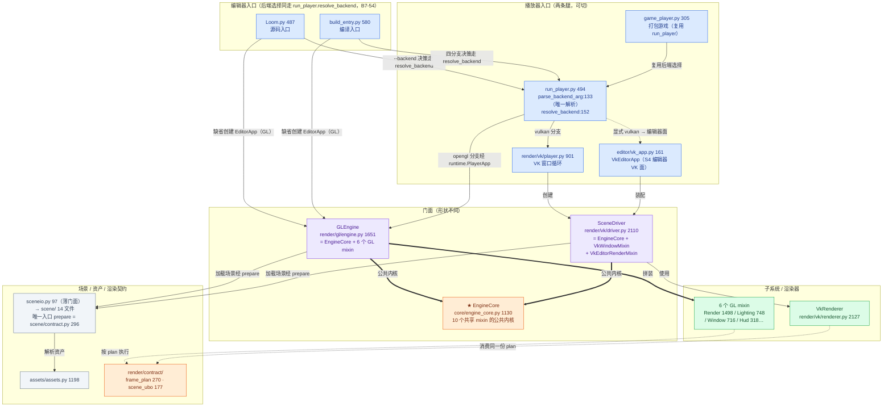

> **读法**：B7-54 后编辑器与编译入口的后端选择**同走一份** `run_player.resolve_backend`（--backend 解析也收敛为
> `run_player.parse_backend_arg:133` 全仓唯一实现）：编辑器入口缺省仍 GL（`EditorApp(_EditorCore, GLEngine)`，editor/app.py 32 行装配壳），
> S4 起显式 `--backend vulkan` 时改走 `VkEditorApp(_EditorCore, SceneDriver)`（真窗口双视口，editor/vk_app.py 161 行）；
> `build_entry.py` 四分支全部经 run_player 后端选择（播放分支 `run_backend` 链路，default/minimal 分支 VK 决策可达）；
> 播放器入口经 run_player 分叉到 GL（runtime.PlayerApp）或 VK（render/vk/player → SceneDriver）。
> 编辑器与播放器的播放组件是**同一份**（_EditorCore 中间基类 + 主 pass 相机/挂父相机/LateUpdate/
> _refresh_play_frame_world 共享实现，「同源不同步」规则 5.5，S5 对拍门 575 条全绿）。
> Q-B7-55-1 后两个入口的**执行面**也同源：LOOM_REMOTE_MODE 三态收口唯一实现 `hostenv.remote_launch`（launch_player），
> --ui × --backend 装配决策唯一实现 `hostenv.editor_launch`（--ui minimal/default + vulkan → 两入口同一条可见报错 EXIT 1）。

## 图 1.1 谁能选后端、不能选时怎么办（这张表比图更说明问题）

| 场景 | 能选后端吗 | 依据 | 环境不支持时 |
|---|---|---|---|
| **编辑器**（`Loom.py` / `Loom.exe`） | **部分能**（S4）：缺省仍 GL（`EditorApp(_EditorCore, GLEngine)`，零变化）；**显式 `--backend vulkan`** → `VkEditorApp(_EditorCore, SceneDriver)` + `editor/viewport/vk_viewport.VkViewport`（QRenderWidget bitmap present） | `Loom.py:441-470` 编辑器分支走 `_editor_backend_choice` 纯决策函数（真调 `run_player.resolve_backend` 单一事实，B7-54 终审 F-2 抽出；`build_entry.py` 编辑器面同规则，门 A④ 双方真调用同一份决策） | VK 不可用 → `VkViewport.init_error` 报错可见（不静默降级，vk_viewport.py:113） |
| 编辑器里点「播放」 | **不能**。就在编辑器自己的 GL 引擎里跑 | `gui/main_window.py:1480` → `_invoke_cmd('play')` → `editor.toggle_play` 只置 `is_playing`，不起外部播放器 | 同上 |
| 独立播放器（`--run`） | **能**：`--backend` > 游戏设置 > 引擎设置 > 默认 vulkan | `run_player.resolve_backend:152` | `auto`：VK 初始化失败 → 诊断+落配置+**同进程转 GL**（`run_player.py:434-449`、`_persist_backend:205`）；显式 `--backend vulkan` 失败只报错不改配置 |
| 打包游戏（`game_player.py`） | **能**：同播放器一套逻辑（复用 run_player，`:170` 调同一 resolve_backend） | `game_player.py:170` | 同播放器 |
| 运行期失败（VK 渲染循环内崩） | — | `VkRunError` | **不回退**：打印原因后非零退出（`run_player.py:438-439`） |
| **运行环境屏幕不可见（远程/无头）** | **env 接管，不手选**：`LOOM_REMOTE_MODE` 三态 off / on / auto（auto = 上屏健康监视失败才转远程） | 三态收口**唯一实现** = `hostenv/remote_launch.py`（151 行；Loom.py / build_entry.py 四个播放分支全走同一 `launch_player`，Q-B7-55-1） | 编辑器面：`--ui minimal/default` + vulkan → 两入口同一条可见报错 EXIT 1（唯一决策 `hostenv/editor_launch.py`，不静默降级 GL） |

> 编辑器里那个「渲染 API」下拉框（`gui/main_window.py:3297-3318`，B4 后归位；原 `ui/loom_gui.py`）写的是**游戏设置**，
> 即「下次启动播放器/打包游戏用哪个」，不是「编辑器自己用哪个」。
> `guiloader.py:47` 的注释也这么写：`播放器/发布游戏默认渲染 API (编辑器选)`（默认值 vulkan）。
> 所以同一个键 `render_api` 在编辑器里是「替别人设的」，在播放器里是「我自己用的」—— 这是真实的不对称。

---

# 图 2 GLEngine 的 GL 侧拼装（7 个直接基类）

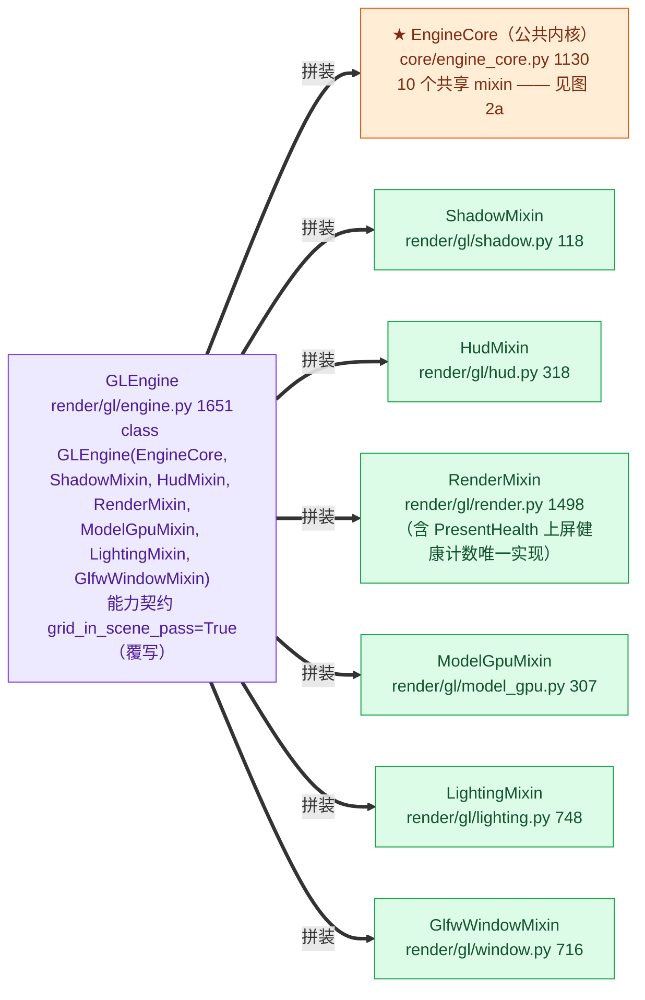

> 读法：S2 收口后「引擎」的公共部分**上移进了 EngineCore**，GL 侧只剩 6 个后端专属 mixin 拼在公共内核外面。
> RenderMixin 里住着 `PresentHealth`（上屏健康计数**唯一实现**，VK 的 renderer.py:39 反向 import 它——阈值不复制）。

# 图 2a EngineCore 公共内核 = 10 个共享 mixin（两端各拼一半）

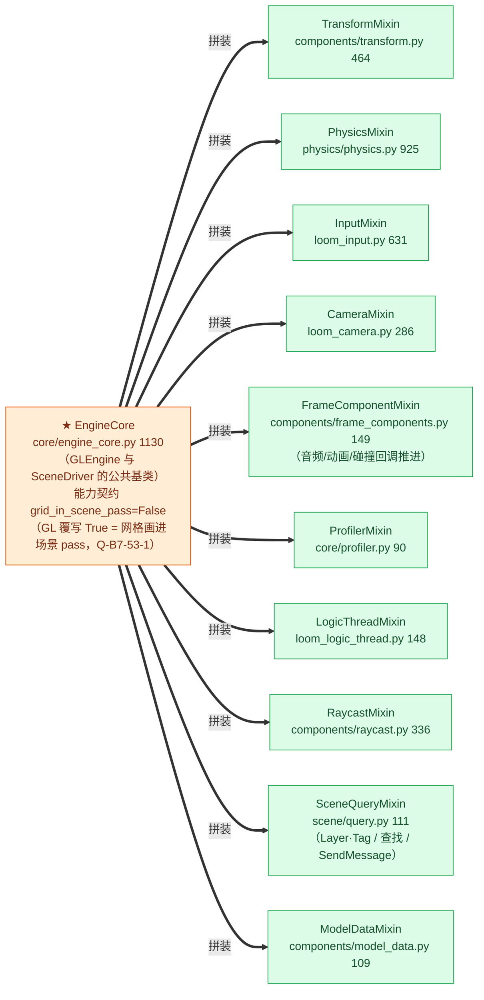

> **为什么形状变了**（这是 v3→v4 最重要的架构事实修正）：v3 画的是「GLEngine = 14 个 GL mixin」，
> S2 收口（2026-11-17）把**两端都要用**的 10 个 mixin 下沉进 `EngineCore`，现在：
> - `GLEngine` = EngineCore + 6 个 GL 专属 mixin（渲染/光照/阴影/窗口/HUD/模型 GPU）；
> - `SceneDriver` = EngineCore + 2 个 VK 专属 mixin（窗口/编辑器渲染）。
> 也就是说：**公共语义在 EngineCore，后端差异在 mixin/钩子里**——这条 v3 就写下的判据，现在是**代码里的真实形状**。
> `_bump_struct` 结构失效键也随 S2-2 上移（SceneDriver 继承内核后同样需要它）。

# 图 2b SceneDriver 是怎么拼出来的（VK 侧，与 GL 形状不同）

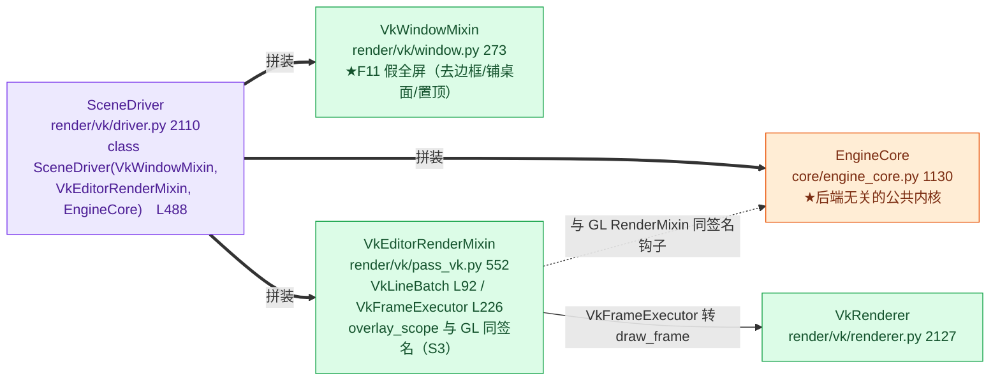

> **为什么形状不同**（本仓库最重要的一条架构事实）：
> - `GLEngine` = **EngineCore + 6 个 GL 专属 mixin**（渲染/光照/阴影/窗口/HUD/模型 GPU，每个都是 GL 实现）；
> - `SceneDriver` = **`EngineCore`（后端无关）+ `VkWindowMixin`（VK 窗口）+ `VkEditorRenderMixin`（叠加层原语/帧执行器钩子）+ 一个渲染器对象**。
>
> 门 `test_user_api_parity.py`（8 条）要求两端**共同公开成员（101 个）是同一个函数对象**
> （`getattr(GLEngine,n) is getattr(SceneDriver,n)`）；GL 独有 13 / VK 独有 9 个成员全部登记为「后端/宿主内部」。
> Q-B7-24-5 后 VK 旧形态名 5 条全清（step 删除；render_pose→compute_frame_view_proj、load_from_data→build_scene_from_data、
> camera_pos→current_camera_position、apply_dev_camera_mouse→apply_editor_camera_mouse，考古结论=全部非同义、后端内部）；
> ui_consumed 已补进 SceneDriver（B7-43-2，UI 拖动不转视角、滚轮不连坐）。
>
> `render/vk/window.py` 的全屏要靠 rendercanvas 的私有 `_window` 句柄做「假全屏」三步（去边框 / 铺桌面 / Win32 置顶），
> **语义与 GL `render/gl/window._set_fullscreen` 逐项一致**（门 `test_fullscreen_parity.py` 47 条逐像素对拍，全绿）。

---

# 图 3 渲染链（功能 → 文件，带关系标注）

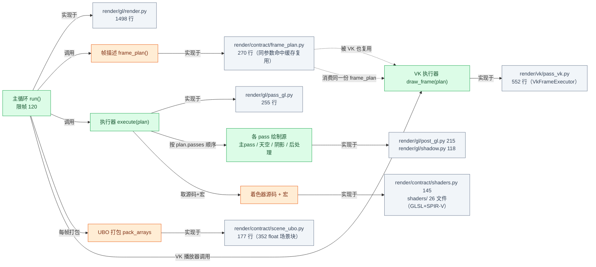

> 读法：绿色=运行时概念，橙色=契约，灰色=真实文件。每条 `实现于` 就是「这个功能写在哪」。
> 粗线的四边形扩宽数学在 `mathlib/line_geometry.py` 231 行（Q-B7-48-1 裁决 B）——GL `engine.draw_lines`
> 与 VK `render/vk/pass_vk.draw_lines` 两端只画三角形，扩宽共享同一份 CPU 侧实现。

---

# 图 4 场景链（打开一个场景要过哪些文件）

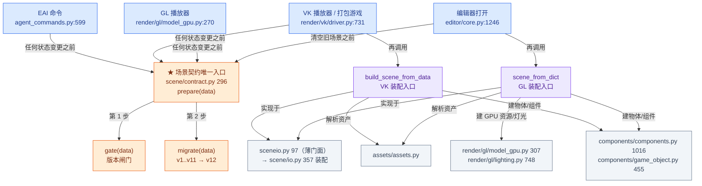

> **设计判据**（值得记住）：场景迁移**只是数据→数据**，不涉及复杂内部操作 → 独立成模块后「特定场景转换有问题时修起来容易」。
> **2026-11-19 已收敛 + B2 归位**：版本判定与升级独立成 `scene/contract.py`（296 行，原 loom_scene_contract.py），
> **唯一入口 `prepare()`**，4 条打开场景的路径（编辑器 / GL 播放器 / VK 播放器+打包游戏 / EAI 命令）**全部**
> 在「任何状态变更之前」调它；闸门内嵌在 prepare 的 migrate 那一步里（「prepare 自己不额外设闸门」，
> `test_scene_contract.py` 48 条钉住）；编辑器还要求「校验通过后才记『上次打开』」（失败加载不得污染状态文件）。
> prefab 的 2 处只过 gate 不迁移（scene/prefab.py 85）。
> 门：`test_scene_load_parity.py`（76 条）+ `test_scene_contract.py`（48 条，含「契约模块能单独 import、不拉引擎」）。

---

# 图 5 资产链（guid 从哪来、到哪去）

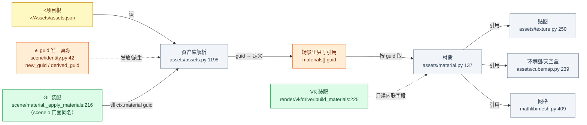

> `scene/identity.py`（Q-B7-49-1 P2 新建）是 uuid4 的**唯一合法调用点**——迁移期用 derived_guid 确定性派生
> （同输入同输出 32 hex），`test_scene_contract.py` G 组钉住「全仓 uuid4 只许 1 处」。

---

# 图 6 三条下沉通道（Python → C）

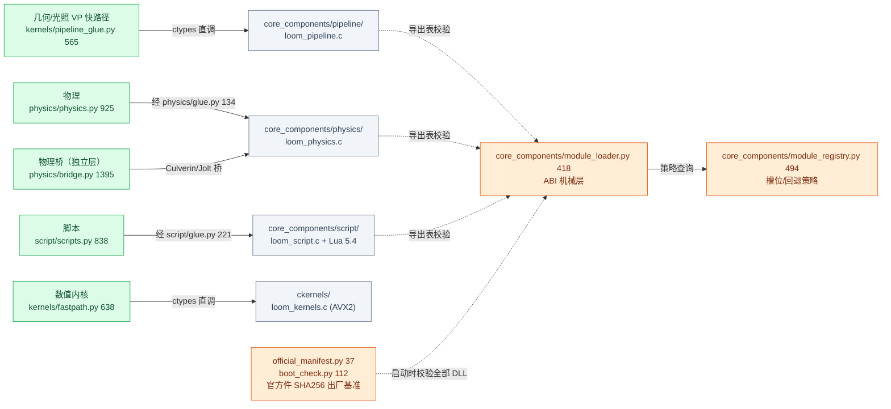

---

# 图 7 UI 链（一套数据模型，三种画法）

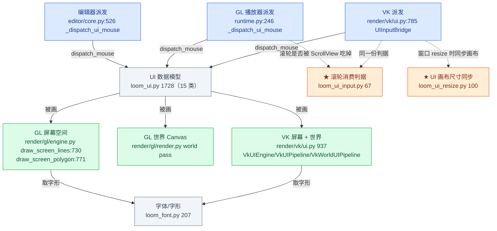

> `loom_ui_input.py`（P3-1）滚轮消费判据**唯一实现**；`loom_ui_resize.py`（Q-B7-41-1）UI 画布尺寸同步
> **唯一实现**（含 320×240 下限），VK 帧首在 `begin_frame` **之前**调（与 GL 同序）。
> 门：`test_ui_hit_parity.py`（144 条，含 resize 三档 + 跨帧持按 + 坐标系一致性防 Y 轴翻转，全绿）；
> B7-28 之后滚轮**语义**另有专门门（`test_editor_wheel_semantics.py` 20 条 / `test_wheel_backend_semantics.py` 31 条）。

---

# 图 8 编辑器（一个门面 + 附属域）

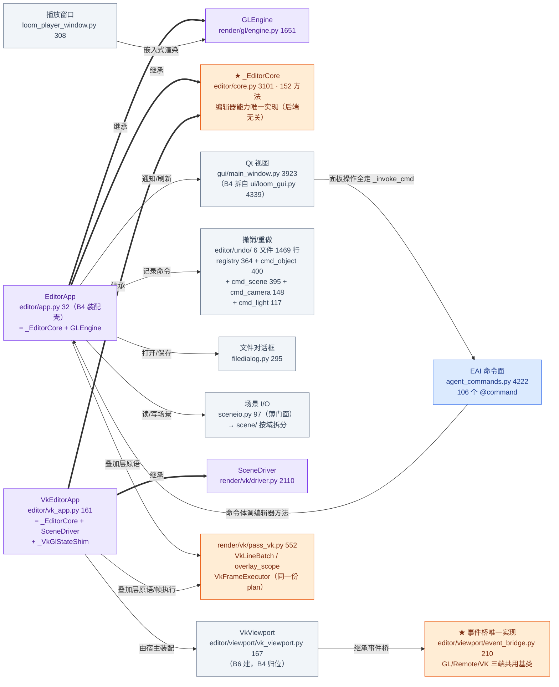

> GL 编辑器与 VK 编辑器的**播放组件同源**：相机策略 / 挂父相机重应用 / LateUpdate 派发 /
> 逻辑位姿矩阵刷新（_refresh_play_frame_world，EngineCore:742 唯一实现）/ 进出播放（toggle_play）都是同一份函数对象；
> 对拍门 = `test_editor_play_parity`（575 条，四面：GL编辑器播放/GL播放器/VK编辑器播放/VK播放器）+
> `test_editor_play_pixel_parity`（17 条，4 时刻逐像素 MAE=0.0）。

---

# 图 9 配置（三层）

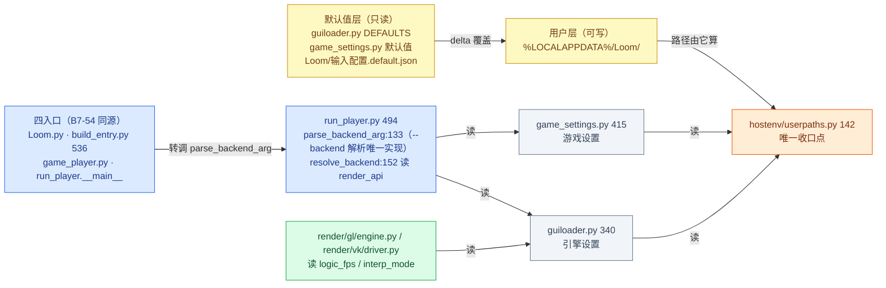

---

# 图 10 构建与发布（工具链文件逐个画）

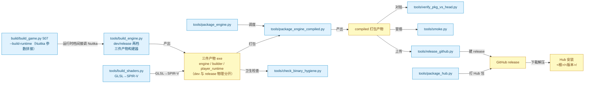

> **v3 的图 10 有两处失真已修正**：工具名按 tools/ 现状重列（v3 把 `build_engine.py` 误写成
> `build_render_gl_engine.py`——那是旧名替换脚本留下的伤）；产物目录按 build_engine.py 头注写实
> （dev/release 两档物理分开，防止拿错）。

---

# 图 11 打开场景：时序（比流程图更看得出「谁在什么时候调谁」）

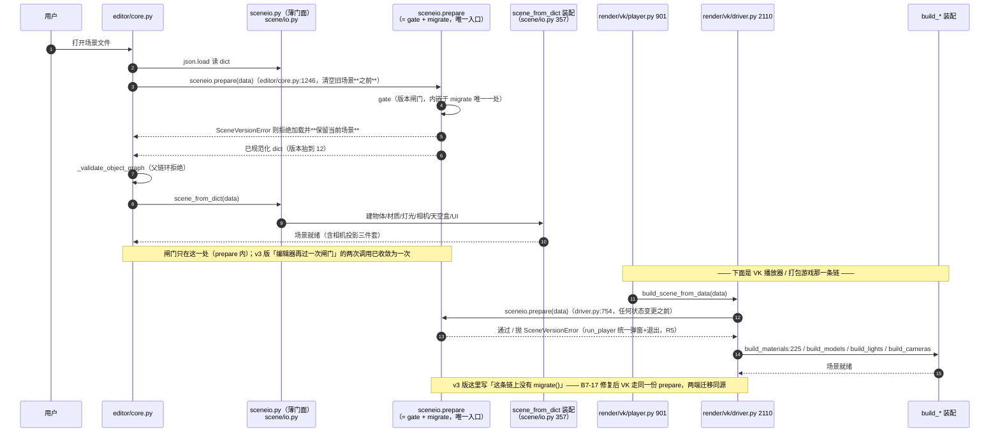

---

# 图 12 一帧：时序（GL 与 VK 对照）

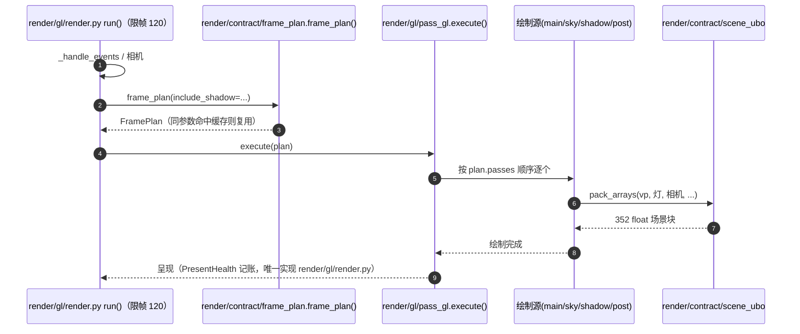

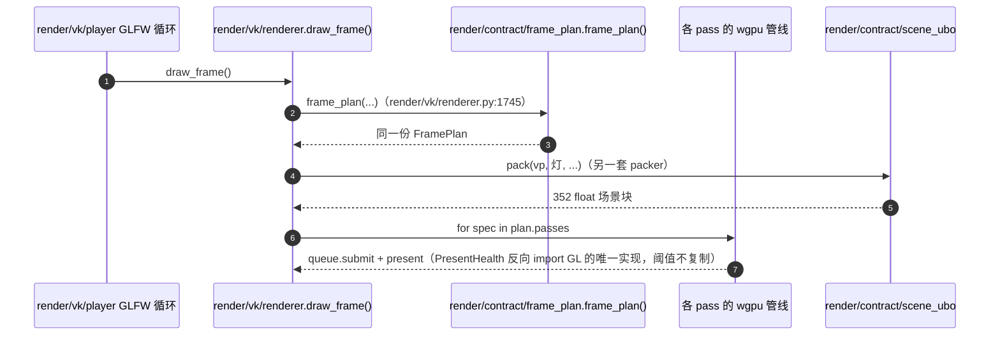

---

# 图 13 文件清单（按功能簇归组，168 个 .py）

图上画不下的全量在这里 —— 这是「功能分布在哪几个文件」的表格版。行数 2026-11-23 实测（物理行；口径 = `len(text.split('\n'))`，与包内 135 文件既有口径一致；终审 F-4 复算时把 2026-11-21 混用的三处行数——Loom.py / build_entry.py / 门文件——统一到同一口径）。
**20 个包共 137 文件 / 47096 行 + 顶层平铺 22 文件 / 12086 行 + tests 门文件 9 / 4249 行 = 168 文件 / 63431 行。**（B7-55~59 批 2026-11-23 实测，口径不变 = `len(text.split('\n'))`）

### A 入口层（顶层平铺）
| 文件 | 行数 | 职责 |
|---|---|---|
| `Loom.py` | 487 | 源码入口：命令行参数 + 数学管线基准 + 编辑器/播放器分叉（后端选择走 run_player.resolve_backend 单一事实，编辑器分支 `:441-470`；`_cli_backend:91` 薄转调 parse_backend_arg（B7-54 解析唯一实现）；`_editor_backend_choice:108` 编辑器决策纯函数（B7-54 终审 F-2 抽出，main 与门 A④ 同一份）；Q-B7-55-1：远程三态与 --ui×backend 执行面薄转调 hostenv.remote_launch / hostenv.editor_launch 唯一实现） |
| `build_entry.py` | 580 | 编译入口：命令行参数 + 数学管线基准 + 启动引擎；B7-54 后四分支全走 run_player 后端选择（`_player_backend_choice:102` / `_editor_backend_choice:113` 纯决策函数，播放分支 `run_backend` 链路，default/minimal 分支 VkEditorApp 可达）；Q-B7-55-1：四个播放分支全走 hostenv.remote_launch.launch_player 同一份 |
| `run_player.py` | 494 | 播放器渲染 API 选择入口（parse_backend_arg:133 全仓唯一 --backend 解析 / resolve_backend:152 / _persist_backend:205 / auto 失败同进程转 GL :434-449） |
| `runtime.py` | 321 | Player 运行时（M17: 引擎/编辑器分层；GL 播放器 _dispatch_ui_mouse:246） |
| `game_player.py` | 305 | 纯 Player 游戏入口（M38，Unity Build 模型；:170 复用 resolve_backend） |
| `core/single_instance.py` | 96 | Loom 编辑器单实例锁（2026-10-19） |
| `build/build_game.py` | 507 | 游戏构建器（Unity BuildPipeline 对齐；--build-runtime 间接调 Nuitka） |

### B 引擎门面 + 拼装
| 文件 | 行数 | 职责 |
|---|---|---|
| `render/gl/engine.py` | 1651 | GLEngine 装配 + 30 个自有方法（图 14 解剖）；grid_in_scene_pass=True 能力契约覆写（B7-58）。 |
| `engine.py`（顶层） | 21 | **薄门面（B3）**：`sys.modules['engine']` 别名到 `render/gl/engine.py` —— 旧导入名换身（engine 有模块级可变状态，读写必须落同一个模块对象，故不用逐名 re-export）。用户游戏脚本 `from engine import Point3D` 照旧（仓内 54 个文件经此门面 import）。 |
| `core/engine_core.py` | 1130 | ★ EngineCore 公共内核：S2 收口后 = 10 个共享 mixin 的拼装点 + 后端无关公共实现（update_scripts:742 / update_audio / LateUpdate:830 / _refresh_play_frame_world:756 / effective_skybox:868 / handle_key_event:141）；grid_in_scene_pass=False 能力声明（B7-58，GL 覆写 True）。 |
| `render/__init__.py` | 13 | 渲染层包（B3）：`render/contract/`（两端共享描述，零后端依赖）+ `render/gl/`（GL 后端）+ `render/vk/`（VK 后端）；刻意不 re-export（import render 本身零 GPU 依赖）。 |

### C render/gl/（GL 后端，10 文件 + __init__）
| 文件 | 行数 | 职责 |
|---|---|---|
| `render/gl/render.py` | 1498 | GLEngine 渲染管线子系统（主 pass 帧准备 / 绘制 / 帧循环 / 限帧 120）+ **PresentHealth 上屏健康计数唯一实现**（VK 反向 import，阈值不复制）+ _draw_grid_in_scene（B7-58：网格画进场景 pass，深度测试才成立）。 |
| `render/gl/lighting.py` | 748 | GLEngine 光源/光照上传/阴影 VP 子系统。 |
| `render/gl/shadow.py` | 118 | M29 阴影贴图子系统（深度 pass）。 |
| `render/gl/model_gpu.py` | 307 | 模型/材质 GPU 资源子系统（GL 播放器场景加载入口 :285）。 |
| `render/gl/pass_gl.py` | 255 | FramePlan 的 moderngl 执行器（`execute(plan)`:82）。 |
| `render/gl/post_gl.py` | 215 | GL 侧后处理链（HDR 目标 + bloom + tonemap）。 |
| `render/gl/window.py` | 716 | GLFW 窗口子系统（`_set_fullscreen` 全屏语义与 VK 逐项一致）。 |
| `render/gl/hud.py` | 318 | HUD / 文字渲染子系统。 |
| `render/gl/version.py` | 75 | OpenGL 地板版本门（2026-11-09 批次 A0，失败必须可见）。 |

### D render/contract/（两端共享契约，8 文件 + __init__）
| 文件 | 行数 | 职责 |
|---|---|---|
| `render/contract/frame_plan.py` | 270 | 渲染 Pass 描述层（FramePlan / PassSpec），**纯数据，无后端依赖**；同参数命中缓存复用。 |
| `render/contract/scene_ubo.py` | 177 | 场景参数**单一来源**（字段表 + std140 打包，352 float 场景块）。 |
| `render/contract/post.py` | 73 | 后处理链的开关与参数（tonemap + bloom）。 |
| `render/contract/shaders.py` | 145 | 从引擎抽取的全部 GLSL 着色器源码常量。 |
| `render/contract/shader_bindings.py` | 80 | post 链绑定号**单点表**。 |
| `render/contract/shader_compat_src.py` | 11 | 读取 shaders/loom_shader_compat.glsl（GL 侧宏层）。 |
| `render/contract/frame_buffer.py` | 345 | 逻辑帧预取缓冲（TPS 缓冲实验）。 |
| `render/contract/appearance.py` | 38 | 外观代计数器（组6件1），不依赖 engine。 |

### E render/vk/（VK 后端，6 文件 + __init__）
| 文件 | 行数 | 职责 |
|---|---|---|
| `render/vk/renderer.py` | 2127 | Vulkan 渲染后端（wgpu-py）；draw_frame 的 frame_plan 调用点 :1745；PresentHealth 反向 import GL 唯一实现 :39。 |
| `render/vk/driver.py` | 2110 | SceneDriver 播放器中间层（`class SceneDriver(VkWindowMixin, VkEditorRenderMixin, EngineCore)`:488；build_scene_from_data:731 走 prepare:754）。B7-57：退役 4 份与 CameraMixin 逐位重复的覆写 + object_world_rotation 死代码，唯一保留覆写 = apply_camera（真后端差异钩子，fov 字段）。B7-55/24-5/43-2/57：link_camera_parents 改 import scene.camera 同一函数对象；旧形态名 5 条全清（step 删 / render_pose→compute_frame_view_proj:1374 / load_from_data→build_scene_from_data:731 / camera_pos→current_camera_position:936 / apply_dev_camera_mouse→apply_editor_camera_mouse:1867）；mouse_rel 无条件喂 + ui_consumed 早退。 |
| `render/vk/player.py` | 901 | VK 播放器窗口循环（rendercanvas.GlfwRenderCanvas 宿主；`_resolve_glfw_window` 句柄解析；每帧写 ui_consumed = not wants_camera()，B7-43-2）。 |
| `render/vk/pass_vk.py` | 552 | VK 侧执行器 + 叠加层原语（S3）：VkLineBatch:92 / VkFrameExecutor:226 / VkEditorRenderMixin:327。 |
| `render/vk/window.py` | 273 | VkWindowMixin：F11 假全屏三步（去边框/铺桌面/Win32 置顶），语义与 GL 逐项一致。 |
| `render/vk/ui.py` | 937 | VK Canvas UI / HUD 绘制（VkUIEngine:155 / VkUIPipeline:428 / VkWorldUIPipeline:672 / UIInputBridge:785）。 |

### F core/（引擎内核，10 文件 + __init__）
| 文件 | 行数 | 职责 |
|---|---|---|
| `core/engine_core.py` | 1130 | ★ 公共内核（见 B 组）。 |
| `core/clock.py` | 198 | 逻辑帧/渲染帧分离核心时钟（分离批5）。 |
| `core/interp.py` | 374 | 逻辑帧双快照 + 渲染帧 numpy 插值（分离批2，单实现双端共享）。 |
| `core/events.py` | 227 | 全局事件总线（跨脚本/跨系统解耦通信）。 |
| `core/profiler.py` | 90 | GLEngine 性能插桩子系统（LOOM_PROFILE 阶段耗时统计）。 |
| `core/primitives.py` | 11 | 引擎基础数据类型（B1 自 `loom_types.py` 改名迁入，避免与 stdlib types 撞名）。 |
| `core/color.py` | 24 | hex 颜色到 rgba 的转换 + 缓存。 |
| `core/debug.py` | 32 | 崩溃可见性（2026-11-10 编译版「开后处理必崩」排查用）。 |
| `core/log.py` | 37 | 启动日志开关（2026-10-19）。 |
| `core/single_instance.py` | 96 | Loom 编辑器单实例锁。 |

### G editor/（编辑器，13 文件 / 5191 行）
| 文件 | 行数 | 职责 |
|---|---|---|
| `editor/core.py` | 3101 | _EditorCore（`class _EditorCore(EngineCore)`:194，编辑器能力唯一实现 + 文件对话框记忆/场景读写：prepare:1246、_dispatch_ui_mouse:526、toggle_play:2116、undo.push 37 处）。 |
| `editor/app.py` | 32 | EditorApp(_EditorCore, GLEngine) GL 装配入口（B4 拆，纯装配壳）。 |
| `editor/vk_app.py` | 161 | VkEditorApp(_EditorCore, SceneDriver) VK 装配 + _VkGlStateShim:153（S4 建，B4 归位）。 |
| `editor/undo/registry.py` | 364 | UndoManager（撤销/重做栈 + agent 批次租约 + 命令作用域支持）。 |
| `editor/undo/cmd_object.py` | 400 | 物体域撤销命令。 |
| `editor/undo/cmd_scene.py` | 395 | 场景域撤销命令。 |
| `editor/undo/cmd_camera.py` | 148 | 相机域撤销命令（快照/撤销按 guid 兜底 find_camera，B7-57）。 |
| `editor/undo/cmd_light.py` | 117 | 光源域撤销命令。 |
| `editor/undo/__init__.py` | 45 | undo 包门面（re-export + 旧名兼容）。 |
| `editor/viewport/event_bridge.py` | 210 | ★ 视口事件桥唯一实现（_ViewportEventBridge 11+1 方法 + Qt 事件翻译常量；GL/Remote/VK 三端共用，B4 收口）。 |
| `editor/viewport/vk_viewport.py` | 167 | VkViewport（_ViewportEventBridge + QRenderWidget；init_error 可见失败 :113）。 |
| `editor/viewport/__init__.py` | 13 | viewport 包。 |
| `editor/__init__.py` | 38 | editor 包门面（re-export EditorApp 等，`from editor import EditorApp` 一行不改）。 |

### H gui/（Qt 视图，7 文件 / 5165 行；B4 新建）
| 文件 | 行数 | 职责 |
|---|---|---|
| `gui/main_window.py` | 3923 | LoomGUI 主窗口（工具栏/层级/检查器/资源浏览器/控制台坞全部面板方法，126 个方法）+ run_loom_gui 入口 + render_api 下拉 :3297（B4 拆自 ui/loom_gui.py 4339；B7-56 后面板操作全走 _invoke_cmd:642，B7-56-2 扫尾后检查器/组件/相机/资源面板/TPS/Tag 残留直调也全部命令化）。 |
| `gui/gl_viewport.py` | 227 | GLViewport（_ViewportEventBridge + QOpenGLWidget，只保留 GL 生命周期四方法）。 |
| `gui/remote_viewport.py` | 246 | RemoteViewport（离屏 GL readback 兜底；事件桥同源）。 |
| `gui/widgets/widgets.py` | 138 | 自定义控件：AssetListWidget / DraggableSpin / DragBlock。 |
| `gui/widgets/__init__.py` | 9 | widgets 包。 |
| `gui/legacy_view.py` | 586 | 即时模式 GUI（原 gui.py，ImGui 风格；仅 2 个测试引用，历史保留）。 |
| `gui/__init__.py` | 36 | gui 包门面。 |

### I scene/（场景域，14 文件 / 3229 行；B2 拆自 sceneio.py 2220 行）
| 文件 | 行数 | 职责 |
|---|---|---|
| `scene/contract.py` | 296 | 场景契约：版本号 / 闸门 gate / 迁移 migrate / 唯一入口 prepare（原 loom_scene_contract.py）。 |
| `scene/identity.py` | 42 | ★ guid 唯一真源：new_guid（全仓唯一 uuid4 调用点）/ derived_guid（迁移期确定性派生）。 |
| `scene/io.py` | 357 | 场景装配（scene_to_dict / scene_from_dict）+ 存盘/读盘 + 混淆编码。 |
| `scene/object.py` | 711 | 对象 <-> dict：发射/装配/父链校验 + Canvas UI 段。 |
| `scene/material.py` | 351 | 材质资产解析/发射（_apply_materials:216；_CUR_BASE_DIR 唯一真源）。 |
| `scene/asset.py` | 259 | 资产身份层：资产上下文 / 资产问题 / 失效引用保留。 |
| `scene/sky.py` | 285 | 天空盒解析/发射。 |
| `scene/camera.py` | 354 | 相机投影归一 + 摄像机实体序列化 + ★ `_link_camera_parents` 相机父链唯一实现（Q-B7-57-1 合并单点：id_map 纳相机 guid / 防环整次拒绝 / 孤儿父脱根+告警；VK driver import 同一函数对象）。 |
| `scene/entities.py` | 210 | 场景实体状态类（LightState / CameraState；CameraState 增 camera_children，B7-57）。 |
| `scene/query.py` | 111 | SceneQueryMixin：Layer·Tag / 查找 / SendMessage。 |
| `scene/prefab.py` | 85 | Prefab 序列化/实例化（2 处只过 gate 不迁移）。 |
| `scene/resource.py` | 75 | 独立资产文件（材质/网格）。 |
| `scene/light.py` | 65 | 光源序列化。 |
| `sceneio.py`（顶层） | 97 | **薄门面**：场景/Prefab 序列化的旧引用面（B2 起只 re-export，实现拆进 scene/ 包；外部 71 文件 365 处引用零改动）。 |

### J components/（物体与组件，8 文件 / 2807 行）
| 文件 | 行数 | 职责 |
|---|---|---|
| `components/components.py` | 1016 | 组件化（M25）与资产类。 |
| `components/game_object.py` | 455 | 场景物体 GameObject（M25 组件化容器）。 |
| `components/transform.py` | 464 | TransformMixin：变换层次（世界矩阵/父链/包围盒；EngineCore 公共 mixin；model_world_matrix/world_rotation_matrix 增 CameraState 分支，B7-57）。 |
| `components/raycast.py` | 336 | RaycastMixin：射线检测（物理 Culverin + 几何 AABB 兜底）。 |
| `components/collision.py` | 262 | ★ 碰撞配对/事件派发共享实现（pairs:176 / dispatch:221；GL PhysicsMixin 与 VK driver:1039 调**同一个函数**）。 |
| `components/frame_components.py` | 149 | FrameComponentMixin：每帧组件推进（音频/动画/碰撞回调；update_audio/sync_audio_listener 共享实现）。 |
| `components/model_data.py` | 109 | ModelDataMixin（模型数据；EngineCore 公共 mixin）。 |

### K physics/（物理，5 文件 / 2598 行）
| 文件 | 行数 | 职责 |
|---|---|---|
| `physics/bridge.py` | 1395 | B1: Culverin (Jolt) 物理桥（零 GL，可独立导入；无库自动禁用）。 |
| `physics/physics.py` | 925 | PhysicsMixin：碰撞系统（M28）+ 刚体物理（M31）；GL 物理子步/管线降级路径。 |
| `physics/pipe.py` | 132 | 常驻物理线程 v2（分离批6 帧内流水线）。 |
| `physics/glue.py` | 134 | 物理 DLL 接线层（M2a）。 |

### L kernels/（下沉加速，5 文件 / 2003 行）
| 文件 | 行数 | 职责 |
|---|---|---|
| `kernels/fastpath.py` | 638 | 组3 公共静态化模块（numba 可选加速，未安装自动降级纯 Python；depths / ancestry_dfs / aabbs_minmax）。 |
| `kernels/pipeline_glue.py` | 565 | 基座 ↔ pipeline.dll 接线层（M2a-3）。 |
| `kernels/parallel.py` | 537 | CPU 拓扑 / 亲和性 / 脚本专用线程（多核优化）。 |
| `kernels/layer_tag.py` | 214 | 层与标签配置（Layer/Tag 系统）。 |

### M assets/（资产，5 文件 / 1839 行）
| 文件 | 行数 | 职责 |
|---|---|---|
| `assets/assets.py` | 1198 | 资产身份层（beta6 B1：项目级 Assets/ + assets.json + guid）。 |
| `assets/texture.py` | 250 | 纹理资产（M36 第一步）。 |
| `assets/cubemap.py` | 239 | 立方体贴图资产（M36 第5步：环境反射）。 |
| `assets/material.py` | 137 | 材质资产（M23）。 |

### N mathlib/（数学与几何，5 文件 / 1004 行）
| 文件 | 行数 | 职责 |
|---|---|---|
| `mathlib/mesh.py` | 409 | 顶点/索引缓冲（Mesh）与模型生成器（cube / sphere / obj 导入）。 |
| `mathlib/matlib.py` | 319 | 4×4 矩阵数学库（行主序，行向量约定）；view_basis 唯一实现（mat4_view_yaw_pitch / camera_world_basis 转调，B7-57）。 |
| `mathlib/line_geometry.py` | 231 | ★ 粗线四边形扩宽**唯一一份**数学（Q-B7-48-1 裁决 B；GL/VK draw_lines 两端共享）；B7-58 修角点 z 互换（同一端点两角点同 z），expand_segment 退化段判据 1e-9 注释如实化（Q-B7-53-3）。 |
| `mathlib/mathutil.py` | 18 | 通用数学小工具。 |

### O script/ + scripts/（游戏脚本，4+3 文件 / 1345+379 行）
| 文件 | 行数 | 职责 |
|---|---|---|
| `script/scripts.py` | 838 | 物体脚本系统（M27；Script 基类 / register / TPS 样本）。 |
| `script/scheduler.py` | 274 | NgilPool 常驻 nogil 工作池（调度重构期1）。 |
| `script/glue.py` | 221 | 基座 ↔ script.dll 接线层（M4）。 |
| `scripts.py`（顶层） | 20 | **薄门面（B6）**：sys.modules 别名 → script/scripts.py（保仓外旧名；script/scripts.py 尾部另有 setdefault 别名兜底）。 |
| `scripts/pacman_player.py` | 196 | 2D 吃豆人玩家（网格移动 + 吃豆 + 通关规则）。 |
| `scripts/pacman_ghost.py` | 151 | 2D 吃豆人幽灵：走廊网格移动 + 同伴防重叠。 |
| `scripts/reset_fall.py` | 32 | 游戏脚本（教学演示：「游戏脚本目录」机制）。 |

### P plugin/（插件系统，3 文件 / 1115 行）
| 文件 | 行数 | 职责 |
|---|---|---|
| `plugin/loader.py` | 836 | Loom 插件加载器（L1 分级重设计；未知扩展点只进 pending 不静默）。 |
| `plugin/sandbox.py` | 269 | 受限沙箱内核（2026-08-28 渗透靶场 V06 修复）。 |

### Q core_components/（C 核心组件 Python 侧，4 文件 / 1061 行）
| 文件 | 行数 | 职责 |
|---|---|---|
| `core_components/module_loader.py` | 418 | 核心组件加载器（DLL化战役 M1-3，契约 Python 侧机械层）。 |
| `core_components/module_registry.py` | 494 | 注册表验证器 + 组装器（M1-2，策略层）。 |
| `core_components/boot_check.py` | 112 | 启动自检：官方件 SHA256 出厂基准校验（A1）。 |
| `core_components/official_manifest.py` | 37 | 官方件出厂哈希基准（编译进 exe，外部改不动）。 |

### R ui/（UI 层遗留 + 契约，8 文件 / 872 行）
| 文件 | 行数 | 职责 |
|---|---|---|
| `ui/loom_gui.py` | 22 | **薄门面（B4）**：sys.modules 别名 → gui/main_window.py（保仓外旧名）。 |
| `ui/vk_viewport.py` | 17 | **薄门面（B4）**：sys.modules 别名 → editor/viewport/vk_viewport.py。 |
| `ui/qt_uitree.py` | 354 | Loom 编辑器 UI 树编辑器 dock（2026-10-18 阶段5）。 |
| `ui/qt_console.py` | 187 | Loom 编辑器内嵌命令行坞（2026-10-27, EAI P2①）。 |
| `ui/minimal_editor_view.py` | 115 | MinimalEditorView：Loom 编辑器第二 UI 实现（极简只读）。 |
| `ui/grid.py` | 104 | 无限网格纯几何。 |
| `ui/editor_ui.py` | 67 | IEditorView 契约：Loom 编辑器 UI 接口标准。 |
| `ui/__init__.py` | 11 | Loom 编辑器 UI 层。 |

### S hostenv/（宿主环境，6 文件 / 941 行）
| 文件 | 行数 | 职责 |
|---|---|---|
| `hostenv/crash_reporter.py` | 295 | Loom 崩溃落盘（dbghelp Minidump + 场景自动备份）。 |
| `hostenv/backend_guard.py` | 250 | 渲染后端兼容性诊断 + 可见失败（2026-11-09 批次 A / 阶段 1）。 |
| `hostenv/userpaths.py` | 142 | 用户可写配置目录的**唯一**收口点。 |
| `hostenv/remote_launch.py` | 151 | ★ LOOM_REMOTE_MODE 三态（off/on/auto）**唯一实现**（Q-B7-55-1）：取值集合 / 归一 / 上屏健康监视 / launch_player；Loom.py 与 build_entry.py 四个播放分支薄转调同一份。 |
| `hostenv/editor_launch.py` | 68 | ★ 编辑器 --ui × --backend 执行面**唯一决策**（Q-B7-55-1）：--ui minimal/default + vulkan → 两入口同一条可见报错 EXIT 1（不静默降级 GL）。 |

### T build/ + audio/ + net/（其余包）
| 文件 | 行数 | 职责 |
|---|---|---|
| `build/build_game.py` | 507 | 游戏构建器（见 A 组）。 |
| `build/game_pack.py` | 138 | 游戏资源包（2026-08-22 发布链路：Unity Build 对齐）。 |
| `audio/backend.py` | 245 | 音频双后端适配层（2026-08-30 B2 换库）。 |
| `audio/system.py` | 103 | AudioSystem 音频门面（原 loom_components.py 尾部，B6 按域拆出；load/play/stop + 3D 三方法纯转发）。 |
| `net/net.py` | 267 | 网络助手（HTTP / HTTPS），纯标准库实现。 |

### U 顶层平铺（其余，与入口/门面外的域文件）
| 文件 | 行数 | 职责 |
|---|---|---|
| `agent_commands.py` | 4222 | Engine Agent 接口 EAI（106 个 @command；HTTP 面 + dispatch(scope) + agent 批次租约；GUI 命令壳共用 _COMMANDS（B7-56；B7-56-2 增 logic_pause/logic_step/register_tag 薄壳 + collider/rigidbody 扩参 + cmd_script_var 撤销修正）；scene_load 走 prepare:599）。 |
| `loom_mcp.py` | 993 | MCP 服务面（EAI 的 MCP 封装）。 |
| `loom_ui.py` | 1728 | Canvas/UI 系统数据模型与布局（15 类：UIElement/Canvas/UIManager/Shape/Panel/Text/Image/Button/Slider/Toggle/ProgressBar/ScrollView/InputField/Dropdown/GridLayout）。 |
| `loom_input.py` | 631 | InputMixin：按键映射与输入动作层（M30b；UNLOCK_ACTION 引擎独占解锁动作）。 |
| `game_settings.py` | 415 | 单游戏设置（与 Unity PlayerPrefs / UE GameUserSettings 对齐）。 |
| `guiloader.py` | 340 | Loom / LoomHub 可插拔 GUI 加载器（DEFAULTS 含 render_api 默认 vulkan :47）。 |
| `filedialog.py` | 295 | Windows 原生文件对话框（GetSaveFileNameW / GetOpenFileNameW）。 |
| `loom_player_window.py` | 308 | 玩家模式远程兼容窗口（Qt 离屏 GL + QImage 显示）。 |
| `loom_camera.py` | 286 | CameraMixin：开发者轨道相机 + 键控移动/旋转（orbit_camera_eye 共享给 VK；视角/视图基函数转调 matlib.view_basis，B7-57）。 |
| `loom_font.py` | 207 | 多字体回退链 + 字形缓存（HUD/UI 共用）。 |
| `loom_logic_thread.py` | 148 | LogicThreadMixin：异步逻辑线程启停与主循环。 |
| `loom_ui_input.py` | 67 | ★ 滚轮消费判据唯一实现（P3-1）。 |
| `loom_ui_resize.py` | 100 | ★ UI 画布尺寸同步唯一实现（Q-B7-41-1）。 |
| `undo.py`（顶层） | 21 | **薄门面（B4）**：sys.modules 别名 → editor/undo（保仓外 `import undo` 旧名）。 |

### V tests/（对拍门文件，只单列入台账的新增门）
| 文件 | 行数 | 职责 |
|---|---|---|
| `tests/test_entry_backend_parity.py` | 350 | B7-54 四入口后端选择同源门（111 条断言：A 四入口决策一致（A④/A④b 编辑器面双方真调用各自入口决策函数，终审 F-2）/ B 解析单源 grep 级 + Loom.py 源码结构断言（终审 F-2）/ C build_entry 决策可达；修前红留痕 089677f + F-2 修前红 27 条 2026-11-22）。 |
| `tests/test_gui_command_unification.py` | 1518 | B7-56 + B7-56-2 + 终审 F-67 GUI 全量命令化门（实跑 225 条：A GUI≡命令行 43 / B 批作用域 17 / C 相机裁定 19 / D 结构 6 / E 相机父链 23 / F 扫尾命令化等价 107（含 F9 碰撞器 enabled 不变量 22）/ G 新命令 JVM 对拍 8 / H 拒批 toast 文案 2）。 |
| `tests/test_entry_execution_parity.py` | 592 | B7-55：入口执行面同源门（57 条：A 远程四态——LOOM_REMOTE_MODE 三态在 Loom.py/build_entry 四播放分支同走 hostenv.remote_launch.launch_player / B --ui×backend——minimal+vulkan 两入口同一条可见报错 EXIT 1 / C 结构唯一）。 |
| `tests/test_camera_parent_serialization.py` | 369 | B7-57：相机父链序列化门（28 条：id_map 纳相机 guid / 防环整次拒绝 / 孤儿父脱根+告警；scene.camera._link_camera_parents is driver.link_camera_parents）。 |
| `tests/test_api_form_name_unification.py` | 276 | B7-24-5：API 形态名统一门（21 条：VK 旧形态名 5 条全清 + 契约 §4.3 转正为已裁决）。 |
| `tests/test_mouse_rel_ui_consumed_parity.py` | 626 | B7-43-2：mouse_rel 裁决 A + ui_consumed 门（45 条：VK 无条件喂 = GL 本帧物理增量语义；UI 拖动不转视角、滚轮不连坐）。 |
| `tests/test_grid_occlusion_parity.py` | 167 | B7-53：网格遮挡真窗口像素对拍（子进程隔离探针：GL/VK 各 8 条 + 父门 13 条；根因1 角点 z 互换 / 根因2 GL 网格画进场景 pass）。 |
| `tests/test_line_depth_plane.py` | 162 | B7-53：粗线四边形角点 z / 深度平面门（6 条：扩宽输出配恒等 VP 逐像素插值深度 == 地面真实深度）。 |
| `tests/test_line_degenerate_segment_parity.py` | 189 | B7-53-3：expand_segment 门（13 条：语义等价非逐位 + 退化段判据 1e-9 两端同源，修前内联实现留痕）。 |

> **共 168 个文件**（20 包 137 + 顶层平铺 22 + tests 门文件 9）。行数为实测物理行，与 `git show HEAD` 状态逐文件一致（B7-56-2 后复测；终审 F-67 批对 3 个改动文件复测）。
> v3 的 97 文件清单里，`loom_types.py`→`core/primitives.py`、`loom_scene_*.py`→`scene/`、`editor.py`→`editor/`、
> `ui/loom_gui.py`→`gui/`、`undo.py`→`editor/undo/`、`loom_components.py` 尾部→`audio/system.py` 等
> 搬迁全部按 B1~B4 后的新路径重列；`components/collision.py`、`components/model_data.py`、`scene/identity.py`、
> `mathlib/mathutil.py` 为重构期新增。

---

# 图 14 `render/gl/engine.py` 解剖（为什么它的连线最密）

实测（2026-11-23）：**1651 行 / 30 个自有方法（`__init__` 一个就 419 行，占全文 25.4%）/ 50 个 import
（39 本项目 + 3 第三方 + 8 标准库）/ 5 个模块级函数**。
S2 收口后 10 个共享 mixin（203+ 方法）已上移 EngineCore，本文件自留 30 方法 + 装配职责。

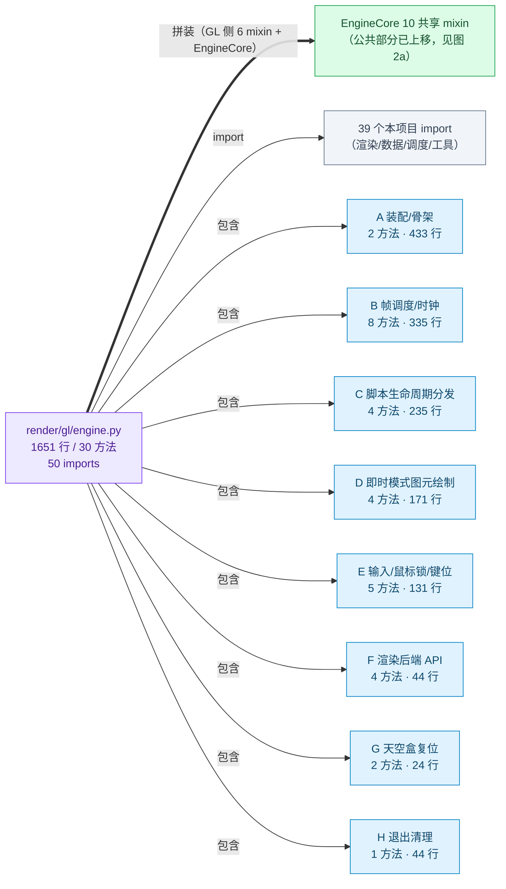

## 14.1 八个功能域（方法数 / 方法体行数，S2 收口后）

| 域 | 方法 | 行数 | 说明 |
|---|---|---|---|
| A 装配/骨架 | 2 | **433** | `__init__` 420 行（L222-641）：窗口/GL/阴影/材质/相机/输入/UI/脚本/并行池…一次装完；+ `_build_hud_quad` 13 |
| B 帧调度/时钟 | 8 | **335** | `advance_logic`(94) `_logic_frame`(97) `_logic_prep`(51) `_clock_advance`(47) `_framebuf_prefetch`(19) `_ensure_split`(11) `_pipe_post`(10) `_physics_frame`(6) |
| C 脚本生命周期分发 | 4 | **235** | `_update_scripts_impl`(152，由 EngineCore.update_scripts:728 公共入口回调) + `_run_scripts`(24) + `_dispatch_application_quit`(31) + `_dispatch_visibility_changed`(28)；update_scripts / update_audio / LateUpdate 公共版在 EngineCore |
| D 即时模式图元绘制 | 4 | 171 | `draw_lines`(68+69 行域) 世界折线（四边形扩宽数学在 `mathlib/line_geometry.py`）、`draw_screen_lines`(40+41) / `draw_screen_polygon`(55) 屏幕图元、`_px_to_ndc`(6) |
| E 输入/鼠标锁/键位 | 5 | 131 | `_poll_mouse_unlock_key`(64) 引擎独占解锁键、`poll_unlock`(21)、`set_action_binding`(30)、`get_action_bindings`(8)、`_warn_unlock_poll_unavailable`(8) |
| F 渲染后端 API | 4 | 44 | `request_game_exit`(11) / `get_render_api`(4) / `get_saved_render_api`(8) / `set_render_api`(21)（写游戏配置） |
| G 天空盒复位 | 2 | 24 | `reset_sky_state`(13) 哨兵复位、`_warn_sky_once`(11)；`effective_skybox` 相机级优先已上移 EngineCore:854 |
| H 退出清理 | 1 | 44 | `_stop_parallel`(44) |
| — | **30** | **1417** | 模块级另有 5 个函数（GC 冻结机制 `gc_play_enter`/`gc_play_exit`/`engine_gc_frozen`/`_gc_enabled` + `_unlock_poll_warn`） |

## 14.2 为什么说它「密」：三个数字

| 指标 | render/gl/engine.py | 全仓第二 |
|---|---|---|
| 本项目模块 import 数（出边） | **39** | `render/vk/driver.py` 19 个 import 行 |
| 被多少模块 import（入边） | **54 个文件经 `from engine import`**（B3 薄门面别名，读写/monkeypatch 都落同一模块对象）；直连 `render.gl.engine` 的只有门面自身与测试探针 | `sceneio.py` 门面（B2 起实现拆进 scene/，外部 71 文件 365 处引用） |
| 自身方法数（不含继承来的） | **30**（S2 收口前 50） | `render/vk/driver.py`（门面+装配器+播放器三合一） |

## 14.3 三个值得注意的点

1. **`__init__` 仍占全文 25.4%**（419/1651）：窗口/GL/阴影/材质/相机/输入/UI/脚本/并行池一次装完。
   S2 收口拆走的是「方法」，装配职责本来就住这里。
2. **公共语义已上移 EngineCore**：update_scripts / update_audio / LateUpdate（两端唯一实现，审核 1/3 P1-1 收口）/
   _refresh_play_frame_world / effective_skybox / _bump_struct 都不再是 GL 独有代码；
   GL 侧 `_update_scripts_impl` 是公共入口的**后端回调**（VK 同理各有 impl）。
3. **进程级策略仍住门面**：`gc_play_enter` / `gc_play_exit`（模块级，改全局 gc 阈值）与
   `_LIVE_INSTANCES` 弱引用表（GameObject.parent 旁路置脏用）不属于任何实例——
   这两样让 render/gl/engine.py 同时是「类」和「全局设施」。

---

# 图 15 编辑器的操作路径（B7-56-2 扫尾后：单一路径 + 豁免面，检查器/组件/相机/资源面板/TPS/Tag 全走命令层）与撤销栈

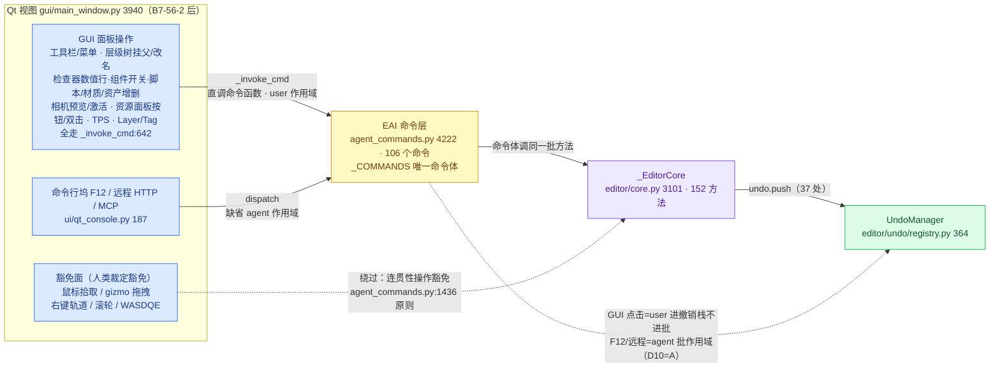

**读法**：B7-56-2 后 GUI 只剩**一条路径**——面板操作（检查器/组件/相机/资源面板/TPS/Tag **全部**命令化，豁免面见下）
→ `main_window._invoke_cmd`（:642，直调命令函数并自带 user 作用域包裹，不经 dispatch）
→ EAI 命令层 → `_EditorCore` 方法；命令行坞 F12 / 远程 HTTP / MCP 走 `dispatch`（缺省 agent 作用域）。
两条入口**共用同一批命令体**（`agent_commands._COMMANDS`，106 个）——GUI 点击 ≡ 命令行（门 A/F 组逐命令对拍）。

**豁免面**（鼠标拾取 / gizmo 拖拽 / 右键轨道 / 滚轮 / WASDQE / 渲染循环 `e.render`/`_update_camera`/`_dispatch_*`/
资源面板**拖拽落场景**、`_notify` 反馈与 `_selected`/`get_tps` 等读侧）按人类裁定**保持直调** `_EditorCore`：
连贯性操作不进命令行（`agent_commands.py:1436` 用户定原则；GUI 命令壳注释 `main_window.py:645` 同款裁定）。
终审 P0-1 复扫（AST，门 D1 禁集 **62 名**，修前残留 41 处归零；agent-66 曾把修前残留命中数 41 误写为禁集
规模，终审 F-68 更正）确认直调残留 = 0（豁免面之外）。

**撤销栈语义照实**：两条入口最终都经方法内 `undo.push()`（37 处）进同一个撤销栈——「撤销效果」统一；
「作用域」由 scope 参数区分（`agent_commands.py:51` 命令作用域注释）：**GUI 点击 = user 作用域**（进撤销栈、**不进** agent 批、不续租）；
**F12/远程 = agent 批作用域**（批次只吸命令产生的写命令，裁决 D10=A 保持）。
GUI 点击会写**等价命令日志**（教学）；检查器数值写从「不进撤销」变为**每条自带一步撤销**。

---

# 图 16 逻辑帧的段序：两端都是 8 段（B7-26 + P4-4 已补齐，维持全绿）

同一个逻辑帧（`_logic_frame(fixed_dt)`）在两端做的 8 件事 —— 段序逐段一致（GL：`render/gl/engine.py:1166`；
VK：`render/vk/driver.py:958`），实现来源分「公共」「各端」两类：

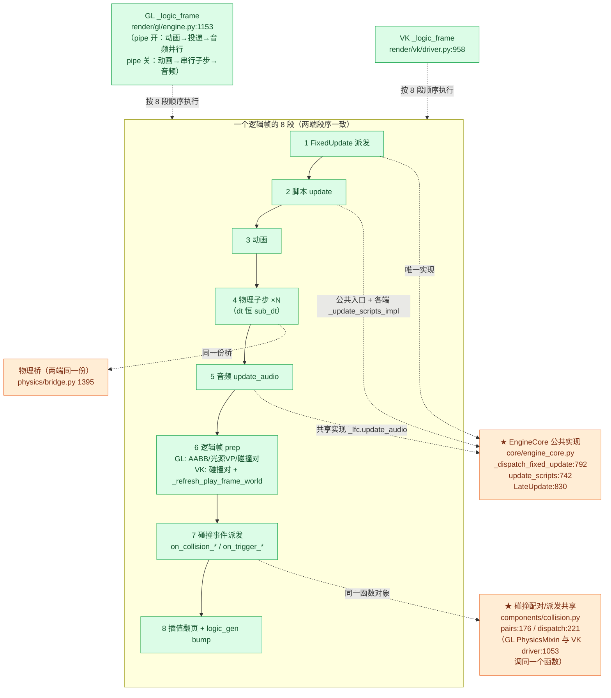

| 段 | GL 实现 | VK 实现 | 状态 |
|---|---|---|---|
| FixedUpdate | `EngineCore._dispatch_fixed_update:778`（两端同一份） | 同左 | ✅ 一致 |
| 脚本 update | `EngineCore.update_scripts:728` → `engine._update_scripts_impl` | 同一公共入口 → `driver._update_scripts_impl`（S4 起 VK 走公共 update_scripts） | ✅ 一致 |
| 动画 | `components/frame_components.update_animations` | `_update_animations`（driver.py:1684） | ✅ 段序一致（实现各一，行为由 P6 门锁） |
| 物理子步 | pipe 并行 或 串行 `_physics_frame` | `_step_physics`（driver.py:1426） | ✅ 同一 `physics/bridge` |
| 音频 | `_lfc.update_audio` 共享实现 | 同一共享实现（driver.py:977） | ✅ B7-26 补齐；P4-4 补了**绑死模式**那条路径 |
| 逻辑帧 prep | `engine._logic_prep:1279`（AABB/光源VP/碰撞对） | `driver._logic_prep:1020`（只算碰撞对 + `_refresh_play_frame_world` 共享；VP 由 VK 渲染侧每帧自算，有意不缓存） | ✅ B7-26 补齐（差异**有意**，注释写明） |
| 碰撞事件派发 | `components/collision.dispatch:221` | 同一个函数（driver.py:1053 转发） | ✅ B7-26 补齐（修前 VK 全仓 0 命中 → 脚本永不触发） |
| 插值翻页 | `_interp.advance(planes)` | `_interp.advance()` | ✅ 一致（`core/interp.py` 374，单实现双端共享） |

> **这张图 v2 曾经是「VK 只有 4 段」的证据**，那是 2026-11-17 的事实；2026-11-19 B7-26 + P4-4 全部补齐。
> 门：`test_vk_logic_frame_parity.py`（12 条）+ `test_audio_parity.py` ③ 组（段序逐字相同）+ `test_pause_parity.py`（70 条暂停/单步观感）。
> **教训**：架构图会过期，而且过期的方向通常是「说某端缺东西」—— 修好后不改图，下一个人会以为还缺。

---

# 图 17 模块机制：现状三套 vs 目标一套（服务注册表）

## 17.1 现状：三套机制并存，各管一段

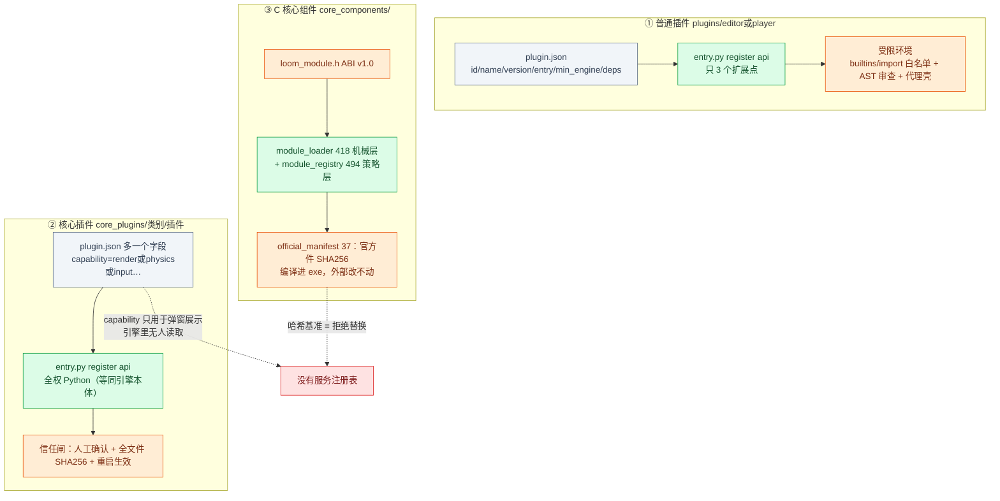

| 机制 | 扩展点 | 隔离 | 能否替换引擎核心 | 证据 |
|---|---|---|---|---|
| ① 普通插件 | 注册脚本类 / 编辑器按钮 / 读插件资产（**3 个**） | 受限环境（有逃逸靶场回归 `test_plugin_sandbox_escape.py`） | ❌ 只能加功能 | `plugin/loader.py`（836 行）；未知扩展点只进 `pending` 并打印「L2+ 开放」 |
| ② 核心插件 | 同 3 个扩展点，但**全权** | 无沙箱；人工信任闸 + 全文件 SHA256 + 重启生效 + 篡改拒载 | **名义上可以**，实际只能 monkey-patch | `capability` 全仓只用于校验非空与弹窗展示（B4 后 `gui/main_window.py`），**引擎里没有任何地方按 capability 找实现** |
| ③ C 核心组件 | ABI 函数表（pipeline/script/physics/ckernels） | 进程内 DLL + ABI 版本门 | 结构上可以 | `loom_module.h` v1.0；`official_manifest.py` 把官方件 SHA256 编译进 exe，**设计目标就是外部改不动** |
| — | — | — | — | `plugins/` 与 `core_plugins/` 只有 README，**0 个真实插件** |

## 17.2 目标：核心 + 服务注册表 + 可替换模块

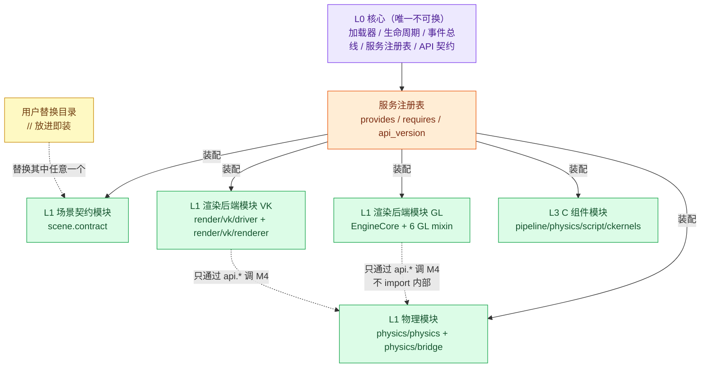

三条必须先说清的约束（否则方案是空想）：

1. **Python 没有 ABI**：进程内「换模块」= 换 `.py` 文件或 `sys.modules` 里的对象。真能换的前提是**调用方只依赖契约**；
   现状 248 个方法互相直接 import，这个前提不成立 → 必须先做契约化（B7-24 的推广）。
2. **沙箱与「全权替换」本质冲突**：普通插件受限（防投放误用），核心插件全权（能改任何东西）。
   用户自定义模块只能归「全权 + 信任」，沙箱那条路留给「加功能」。
3. **官方件哈希基准与「可替换」冲突**：`official_manifest` 的设计目标是「外部改不动」；
   要允许替换，得把它从「拒绝条件」降级为「来源标记（官方/用户/第三方）」并重新定义回退。

# 为什么这么画（排版上的取舍）

| 做法 | 原因 |
|---|---|
| 拆成 20+ 张小图 | mermaid 的自动布局在 **>15 个节点** 时基本不可读（v1 的 46 节点/76 边就是反例）。一张图只讲一件事，边就不会互相穿越 |
| 每张图只画「这一层的直接依赖」 | 跨层关系用**另一张图**表达（图 1 全景 / 图 11 时序），而不是把所有边塞进一张 |
| 功能节点与文件节点并存 | 「功能分布在哪些文件」：`功能 --实现于--> 文件`，一条线对应一个文件 |
| 线上写字 | 关系种类只有 5 种（调用/实现于/import/共享契约/拼装），写在线上，一眼能看出「谁因为什么依赖谁」 |
| 颜色按角色 | 蓝=入口、紫=门面、绿=实现、橙=契约、灰=文件、黄=产物。同一颜色出现在多张图里含义一致 |
| 时序图讲流程 | 流程图适合讲「结构」，讲「谁先调谁」会变成毛线；图 11/图 12 用时序图 |

---

# 图 18 VK 窗口 / 全屏链（rendercanvas 管的窗口，引擎只能间接操作）

```mermaid
flowchart TB
  subgraph HOST["窗口宿主（VK 侧不是引擎建的）"]
    R1["rendercanvas.GlfwRenderCanvas<br/>render/vk/player.py 创建"]:::external
    R2["canvas._window<br/>★ 私有 GLFW 句柄"]:::external
  end
  subgraph RESOLVE["句柄解析（已有兜底）"]
    P1["_resolve_glfw_window<br/>注入句柄 → canvas._window<br/>+ glfw.get_window_size 验活"]:::impl
  end
  subgraph ACT["窗口操作"]
    W1["VkWindowMixin<br/>render/vk/window.py 273"]:::impl
    W2["_set_fullscreen<br/>去边框 / 铺桌面 / 置顶"]:::impl
    W3["_place_fullscreen_window<br/>Win32 SetWindowPos + argtypes"]:::impl
  end
  subgraph KERN["内核 F11 步"]
    K1["handle_key_event ①<br/>core/engine_core.py:141<br/>getattr allow_fullscreen"]:::contract
  end
  R1 -->|持有| R2
  R2 -->|经 P1 解析| P1
  P1 -->|注入 driver 窗口句柄| W1
  W1 --> W2
  W2 --> W3
  K1 -->|allow_fullscreen=True 时调| W2
  classDef external fill:#fef3c7,stroke:#d97706,color:#78350f
  classDef impl fill:#dcfce7,stroke:#16a34a,color:#14532d
  classDef contract fill:#ffedd5,stroke:#ea580c,color:#7c2d12
```

> **为什么这张图值得单画**：VK 的窗口**不是引擎建的**，是 rendercanvas 建的；引擎只能通过它的**私有** `_window` 间接操作。
> 这是本仓库唯一一处「必须碰第三方私有成员」的地方 —— 所以它有单独的兜底（注入句柄优先 → `getattr(canvas,'_window')`
> → `get_window_size` 验活）和单独的降级（拿不到句柄 → 打印一次 + `allow_fullscreen=False`，**不静默**）。
> GL 侧的对应实现住 `render/gl/window.py` 716 行（`_set_fullscreen`；修过的两处缺陷：退出全屏**不还原**、
> 置顶在 x64 上**静默失效**（SetWindowPos 未声明 argtypes）—— 均已修）。
> 门：`test_fullscreen_parity.py`（47 条，**GL 与 VK 逐像素对拍**：尺寸/位置/DECORATED/TOPMOST/exstyle 全等）+
> `test_fullscreen_vk.py`（40 条 VK 全屏契约）。

---

# 图 19 验证体系：两端对拍门覆盖了哪些面（★ v4 实测更新）

> 为什么架构图要画验证体系：**门覆盖不到的地方就会漏**。
> v4 更新说明：下表门数全部为 2026-11-21 在 HEAD 60ea619 **实跑重测**的值（不是抄 v3）；
> 与 v3 相比：P6 71→**70**、P7 编辑器四面 566→**575**、S3 叠加层 18→**24**、场景契约门 39→**48**（Q-B7-49-1 G 组扩容）；
> B7-54 新增四入口决策同源门 **94** 条（test_entry_backend_parity；终审 F-2 后实数 111）。
> B7-56 新增 GUI 全量命令化门 **83** 条（test_gui_command_unification，2026-11-22 在 HEAD e397c11 实跑；当时计数口径少计循环展开断言，同 HEAD 独立复跑实为 **108** 条）。
> B7-56-2 扫尾批扩到 **203** 条（A 43 / B 17 / C 19 / D 6 / E 23 / F 85 / G 8 / H 2；2026-11-22 修后实跑两次同值）。
> 终审 F-67 修复再扩到 **225** 条（F 85→107：F9 碰撞器 enabled 不变量 22 条；agent-68；2026-11-22 修前红 7 FAIL → 修后 ALL PASS）。
> B7-55~59 同步（2026-11-23，HEAD 01ca8a9）：新增 7 门（entry_execution 57 / camera_parent_serialization 28 / api_form_name 21 /
> mouse_rel_ui_consumed 45 / grid_occlusion 真窗口（GL/VK 各 8 + 父门 13）/ line_depth_plane 6 / line_degenerate 13）+
> test_hub_update 扩到 **106** 条（Q-B7-29-1 Hub 假绿封堵 + is_program_files 修复）；run_all 汇总刷新见下。

## 19.1 七面对拍门 + 增补门（全绿）

```mermaid
flowchart TB
  subgraph FACES["被测的「用户可感知面」"]
    F1["P1 场景加载/切换<br/>加载失败语义 · 内容一致<br/>v8 迁移 · 相对路径"]:::ok
    F2["P2 鼠标锁定/光标<br/>状态位 · 策略闸门<br/>解锁链 · 增量结算"]:::ok
    F3["P3 UI 命中/焦点<br/>点击命中 · hover · 滚轮<br/>坐标系 · resize"]:::ok
    F4["P4 音频<br/>播放状态机 · 3D 听者<br/>段序 · 绑死模式"]:::ok
    F5["P5 相机<br/>轨道位姿 · 脚本写角度<br/>挂父 · 投影"]:::ok
    F6["P6 暂停/单步<br/>冻结不跳变 · F10 恰好+1<br/>恢复无欠账 · 截图对拍"]:::ok
    F7["P7 编辑器播放态（S5）<br/>GL/VK 编辑器播放 vs 各自播放器<br/>四面逐项相等 · 4 时刻像素 · 叠加层"]:::ok
  end
  subgraph GATES["门（run_all 自动收集；数字为实跑 PASS 数）"]
    G1["test_scene_load_parity 76<br/>+ test_scene_contract 48"]:::gate
    G2["test_mouse_lock_parity 62"]:::gate
    G3["test_ui_hit_parity 144"]:::gate
    G4["test_audio_parity 105"]:::gate
    G5["test_camera_parity 195<br/>+ test_vk_camera_align 85"]:::gate
    G6["test_pause_parity 70"]:::gate
    G7["test_editor_play_parity 575<br/>test_editor_play_pixel_parity 17<br/>+S3/S4：vk_overlay 24 / vk_editor_smoke 16"]:::gate
    G8["B7-28/审核1-3/B7-54~59 增补门<br/>editor_wheel_semantics 20<br/>wheel_backend_semantics 31<br/>skybox_engine_parity 23<br/>entry_backend_parity 111（决策同源）<br/>gui_command_unification 225（GUI≡命令行）<br/>entry_execution_parity 57（执行面同源）<br/>camera_parent_serialization 28<br/>api_form_name_unification 21<br/>mouse_rel_ui_consumed_parity 45<br/>grid_occlusion（真窗口）/line_depth/line_degenerate 3 门"]:::gate
  end
  F1 --> G1
  F2 --> G2
  F3 --> G3
  F3 -.->|滚轮语义| G8
  F4 --> G4
  F5 --> G5
  F5 -.->|VP 归一/天空盒| G8
  F6 --> G6
  F7 --> G7
  classDef ok fill:#dcfce7,stroke:#16a34a,color:#14532d
  classDef gate fill:#dbeafe,stroke:#2563eb,color:#1e3a8a
```

## 19.2 全部对拍/回归门（实测数字）

> run_all 汇总：~170 文件 / 6341~6342 PASS / 0 FAIL / EXIT 0（2026-11-22~23 两次全量实测，HEAD 01ca8a9，B7-55~59 落地后；PASS 计数口径**含文件尾汇总行**——终审 F-74 标注不变；终审 agent-83 实测 6342）。

| 门 | 断言数（实测） | 覆盖什么 |
|---|---|---|
| `test_scene_load_parity` | 76 | P1：两端加载/切换/失败语义逐项相等 |
| `test_scene_contract` | 48 | 场景契约模块（能单独 import、不拉引擎；Q-B7-49-1 guid 派生 G 组） |
| `test_mouse_lock_parity` | 62 | P2：鼠标锁定/光标 |
| `test_ui_hit_parity` | 144 | P3：UI 命中/焦点/滚轮/resize |
| `test_audio_parity` | 105 | P4：音频（含段序 + 绑死模式音频段） |
| `test_camera_parity` | 195 | P5：相机位姿/投影 |
| `test_vk_camera_align` | 85 | 审核 1/3：VK 相机 VP 归一（驱动不硬编码 yaw/pitch 组 VP） |
| `test_pause_parity` | 70 | P6：暂停/单步窗口级观感（v3 记 71，实跑 70） |
| `test_editor_play_parity` | 575 | **P7 四面**：GL/VK 编辑器播放 vs GL/VK 播放器逐项相等（相机/世界矩阵/钩子序/时钟/UI 树/生效天空盒） |
| `test_editor_play_pixel_parity` | 17 | P7 像素面：4 时刻逐像素（MAE=0.0）+ gizmo/选中框叠加层中心线重合 |
| `test_vk_overlay_primitives` | 24 | S3 VK 叠加层原语（线宽像素数两端相等） |
| `test_vk_editor_smoke` | 16 | S4 VK 编辑器视口真窗口冒烟（60 帧 + grab + 选中/拖 gizmo） |
| `test_user_api_parity` | 8 | 两端共同公开成员（101 个）是**同一个函数对象**；GL 独有 13 / VK 独有 9 全部登记（B7-58 后：+grid_in_scene_pass 共同属性、+ui_consumed、-step） |
| `test_engine_api_matrix` | 6 | 公开成员矩阵 v3.8（GL 114 / VK 110 / 共同 101，含 grid_in_scene_pass 能力属性），**差异只许缩小** |
| `test_host_event_parity` | 14 | 键/文本/退出钩子的事件面 |
| `test_input_chain_parity` | 106 | key_state → script_keys → is_key → 解锁键 |
| `test_vk_logic_frame_parity` | 12 | 逻辑帧 8 段段序 + 碰撞事件序列 |
| `test_clock_settings_propagation` | 13 | 时钟设置传播 |
| `test_beam_light_backend_parity` | 8 | beam 灯像素对拍 |
| `test_fullscreen_parity` | 47 | 全屏窗口几何（GL vs VK 逐像素） |
| `test_fullscreen_vk` | 40 | VK 全屏契约 |
| `test_ab_gl_vk` | 26 场景 | A/B 像素（MAE≈0，实跑 26 场景 0 失败） |
| `test_editor_wheel_semantics` | 20 | B7-28：编辑器滚轮语义（视口内缩放/视口外不缩放/暂停态消费） |
| `test_wheel_backend_semantics` | 31 | 滚轮后端语义（GL/VK + run_player 入口恢复） |
| `test_skybox_engine_parity` | 23 | 审核 1/3：天空盒引擎面两端对齐 |
| `test_entry_backend_parity` | 111 | B7-54：四入口（Loom.py / build_entry / game_player / run_player）对同一份 argv+配置产生**同一后端决策**；--backend 解析单源（parse_backend_arg）+ Loom.py 源码结构断言；编辑器面双方真调用 _editor_backend_choice（终审 F-2 补牙，实数 93→111；旧记 94 含汇总行）；build_entry 四分支决策可达 |
| `test_gui_command_unification` | 225 | B7-56 + B7-56-2 + 终审 F-67：GUI 全量命令化（A GUI 点击≡命令行同命令体 43 / B 批作用域 user·agent 17 / C 相机裁定（连贯性操作豁免）19 / D 结构断言（禁集 62 名直调归零；agent-66 曾误写 41=修前残留命中数，F-68 更正）6 / E 相机父链 23 / F 扫尾命令化等价（Layer·Tag·材质·组件·脚本·光源·相机·资源面板·TPS·并行设置 + F9 碰撞器 enabled 不变量 22 条：带字段 collider 命令不翻转 enabled、裸 {name} 缺 on 切换不回归、帮助文本一致）107 / G 新命令 JVM 对拍（logic_pause·logic_step·register_tag）8 / H 拒批 toast 文案 2） |
| `test_entry_execution_parity` | 57 | B7-55：入口执行面同源（A 远程四态：LOOM_REMOTE_MODE 三态在 Loom.py/build_entry 四播放分支同走 hostenv.remote_launch.launch_player；B --ui×backend：minimal+vulkan 两入口同一条可见报错 EXIT 1；C 结构唯一） |
| `test_camera_parent_serialization` | 28 | B7-57：相机父链序列化（id_map 纳相机 guid / 防环整次拒绝 / 孤儿父脱根+告警；scene.camera._link_camera_parents is driver.link_camera_parents） |
| `test_api_form_name_unification` | 21 | B7-24-5：VK 旧形态名 5 条全清（step 删除；render_pose→compute_frame_view_proj / load_from_data→build_scene_from_data / camera_pos→current_camera_position / apply_dev_camera_mouse→apply_editor_camera_mouse；契约 §4.3 转正） |
| `test_mouse_rel_ui_consumed_parity` | 45 | B7-43-2：mouse_rel 裁决 A（VK 无条件喂 = GL 本帧物理增量语义）+ SceneDriver.ui_consumed（player 每帧写 = not wants_camera()；UI 拖动不转视角、滚轮不连坐；契约 §5 登记） |
| `test_grid_occlusion_parity` | 8+8+父13 | B7-53：网格遮挡真窗口像素对拍（子进程隔离探针，GL/VK 各 8 条 + 父门 13 条；根因1 = line_geometry 角点 z 互换 / 根因2 = GL 网格画进屏幕 FBO → 改由 _backend_execute_frame 画进场景目标） |
| `test_line_depth_plane` | 6 | B7-53：粗线四边形角点 z / 深度平面（扩宽输出配恒等 VP，逐像素插值深度 == 地面真实深度，偏差 ≤1e-3） |
| `test_line_degenerate_segment_parity` | 13 | B7-53-3：expand_segment 语义等价非逐位（角点分量差 ≤1e-12）+ 退化段判据 1e-9 两端同源（修前 VK 内联 1e-6 留痕） |
| `test_hub_update` | 106 | B7-29：Hub 假绿根因封堵（非守护 Timer os._exit(0) 绕过 threading._shutdown→atexit；threading._register_atexit + os._exit 包装两条保险）+ is_program_files 修复（env 缺失兜底 / 8.3 短名 / %VAR% / 边界） |

## 19.3 ★ 还没有对拍门的面（缺口，按优先级）

```mermaid
flowchart LR
  subgraph GAP["尚无两端对拍门"]
    N1["物理面<br/>（P6 只当夹具探针）"]:::gap
    N2["动画面<br/>（P6 只当夹具探针）"]:::gap
    N3["编辑器 resize 时序<br/>（滚轮已由 B7-28 落地门）"]:::gap
    N4["打包产物端到端<br/>（B7-29 末尾一次性）"]:::gap
    N5["绑死模式暂停/单步观感<br/>（logic_fps<=0）"]:::gap
    N6["高 DPI 下 UI 画布<br/>（非 100% 缩放）"]:::gap
  end
  classDef gap fill:#fee2e2,stroke:#dc2626,color:#7f1d1d
```

| 缺口 | 为什么没门 | 处置 |
|---|---|---|
| **物理面** | P6 只把物理当「夹具保真探针」（验刚体真下落），没做两端对拍 | 待立项 |
| **动画面** | 同上（验 animator.time 同值） | 待立项 |
| ~~**编辑器滚轮语义**~~ | ~~六面门全走播放器入口~~ | **已落地（B7-28）**：test_editor_wheel_semantics 20 条 + test_wheel_backend_semantics 31 条全绿；**resize 时序仍缺口** |
| **打包产物端到端** | `tools/smoke.py` 的产物段恒 SKIP（源码模式无产物） | **B7-29**（beta7 末尾做一次） |
| **绑死模式暂停/单步** | P4-4 已补绑死模式**音频段**；P6 的暂停/单步观感仍只测常规逻辑帧（logic_fps>0） | 待立项（P4 ③-c 先例可复用） |
| **高 DPI UI 画布** | 本机 100% 缩放，`loom_ui_resize.window_size` 的 fallback 分支与 GL 逻辑像素可能不同 | 待立项 |

## 19.4 三条方法论收获（从六面补门里长出来的）

| # | 收获 | 出处 |
|---|---|---|
| 1 | **只做两端对比会漏「两端一致地坏」** —— 期望值必须**不取自任何一端**（手算 / 用独立纯函数 / 用另一条生产路径当参照） | P4-1：`AudioSystem` 缺 3D 三方法，**两端都缺**，只比 GL vs VK 会全绿 |
| 2 | **门的夹具会自己骗人** —— `glfw.set_cursor_pos` 是**异步**的（物理光标落地晚于 API 返回），不排空就让 10% 假红；而修假红时又可能引入新污染 | Q-B7-43-1 + 其修复引入的 P0 |
| 3 | **结构断言不许锁「缺陷态」** —— 标题写「VK 没有任何 X 调用点」的断言，修好后必然翻红 | P4-2 修完必须翻转两条结构断言 |

> **维护纪律**：每补一面门，更新 19.1；每发现一个缺口被补上，从 19.3 划掉并记到 19.2。
