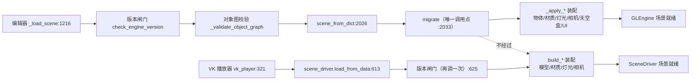
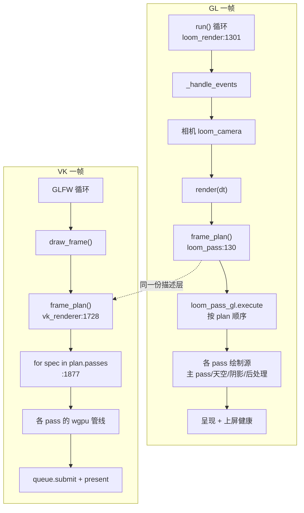
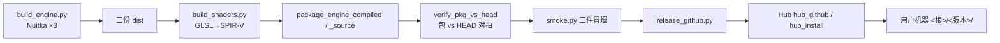

# Loom 引擎结构图（文件组织 + 功能关系）

> 原型 v1（2026-11-17）。两张视图：**① 文件管理器视角的目录树**；**② 人物关系图视角的功能依赖图**。
> 节点 = 功能簇（1~N 个文件），边 = 依赖/调用。所有行数是实测（`py -3.13` 统计）：`Loom/` 共 **97 个 .py / 53 086 行**（排除 `tests/` 与 `player_runtime/` 构建产物）。

---

## 图例

| 记号 | 含义 |
|---|---|
| `A --> B` | A 直接依赖 B（import / 调用 / 数据约定） |
| `A -.-> B` | 间接或运行时依赖（同一数据格式、启动外部进程） |
| 节点标签第 2 行 | 该功能簇的**文件位置** |
| 括号里 `NNN行` | 该文件实测行数 |

---

# 视图 ①：目录树（文件管理器）

## 仓库根

```
WeaveEngine/
├─ Loom/                     ← 引擎（97 个 .py / 53 086 行；根目录 83 个）
├─ LoomHub/                  ← 项目管理器（55 个文件）
├─ tools/                    ← 构建/打包/发布工具（21 个文件，不在产物里）
├─ docs/                     ← 文档（archive/ audit/ design/ guides/ handoff/）
├─ examples/                 ← 示例（吃豆人脚本 + PacMan2D.json）
├─ archive/                  ← 历史归档
├─ _align_tests/             ← 对齐测试材料
├─ 封装测试材料/              ← 打包测试材料
├─ AGENTS.md  README.md  LICENSE
└─ *.txt                     ← 设计/教学/审计文档（14 篇，仓库根散放）
```

## Loom/ 主目录（平铺的 83 个 .py）

```
Loom/
├─ 【入口】
│   ├─ Loom.py                    512行   源码入口（--editor/--run/--open/--bench）
│   ├─ build_entry.py             459行   编译版入口（CLI 与 Loom.py 双写）
│   ├─ run_player.py              477行   后端选择（--backend > 游戏设置 > 引擎设置 > 默认 vulkan）
│   ├─ vk_player.py               833行   VK 播放器窗口循环
│   ├─ runtime.py                 309行   GL 播放器 PlayerApp
│   ├─ game_player.py             305行   打包游戏入口（读 游戏包.lsc）
│   ├─ build_game.py              506行   构建器（打游戏包）
│   └─ loom_single_instance.py     95行   编辑器单实例锁
│
├─ 【引擎门面 + 子系统（GLEngine 的 14 个 mixin）】
│   ├─ engine.py                 1809行   GLEngine 门面（多重继承拼装）
│   ├─ loom_render.py            1353行   渲染管线/主循环（RenderMixin）
│   ├─ loom_lighting.py           951行   光照/阴影 VP（LightingMixin）
│   ├─ loom_shadow.py             117行   阴影贴图（ShadowMixin）
│   ├─ loom_model_gpu.py          384行   几何/材质 GPU 资源（ModelGpuMixin）
│   ├─ loom_transform.py          437行   父链/世界矩阵/包围盒（TransformMixin）
│   ├─ loom_physics.py           1013行   碰撞+刚体（PhysicsMixin）
│   ├─ loom_input.py              618行   按键/动作/鼠标锁（InputMixin）
│   ├─ loom_hud.py                336行   HUD/文字（HudMixin）
│   ├─ loom_camera.py             268行   轨道相机/键控（CameraMixin）
│   ├─ loom_glfw_window.py        620行   GLFW 窗口（GlfwWindowMixin）
│   ├─ loom_profiler.py            89行   阶段耗时插桩（ProfilerMixin）
│   ├─ loom_logic_thread.py       142行   异步逻辑线程（LogicThreadMixin）
│   ├─ loom_raycast.py            327行   射线检测（RaycastMixin）
│   └─ loom_frame_components.py   127行   每帧组件推进（FrameComponentMixin）
│
├─ 【帧描述 / 渲染契约（跨后端单源）】
│   ├─ loom_pass.py               257行   FramePlan/PassSpec/TargetDecl/DepthState/RasterState
│   ├─ loom_pass_gl.py            254行   FramePlan 的 moderngl 执行器
│   ├─ loom_scene_ubo.py          176行   场景 UBO 字段表 + pack/pack_arrays + glsl_block()
│   ├─ loom_post.py                72行   后处理语义单源（tonemap/bloom 阶段与目标名）
│   ├─ loom_post_gl.py            214行   GL 后处理实现
│   ├─ loom_shaders.py            144行   GLSL 源码常量（拼宏）
│   ├─ loom_shader_bindings.py     79行   post 链绑定号单点表
│   ├─ loom_shader_compat_src.py   10行   读取 shaders/loom_shader_compat.glsl
│   └─ loom_gl_version.py          74行   GL 4.3 地板门（失败可见）
│
├─ 【场景 / 资产 / 数据模型】
│   ├─ sceneio.py                2378行   场景+Prefab 序列化/迁移/装配（职责最多）
│   ├─ loom_assets.py            1193行   资产身份层（Assets/assets.json + guid）
│   ├─ loom_game_object.py        454行   GameObject（组件容器）
│   ├─ loom_components.py        1057行   组件 10 类 + 资产类
│   ├─ loom_scene_entities.py     211行   LightState/CameraState
│   ├─ loom_material.py           135行   Material
│   ├─ loom_texture.py            248行   Texture
│   ├─ loom_cubemap.py            238行   Cubemap（环境反射/天空盒）
│   ├─ mesh.py                    408行   顶点/索引 + cube/sphere/obj
│   ├─ loom_ui.py                1727行   Canvas/Element 树（15 类）
│   └─ loom_color.py               23行   hex→rgba
│
├─ 【VK 后端（与 GL 平行的一套）】
│   ├─ vk_renderer.py            2106行   wgpu 渲染后端（pass 执行 + 后处理 + UI 管线）
│   ├─ scene_driver.py           1641行   播放器中间层（自带模型/材质/灯光/相机装配）
│   └─ vk_ui.py                   924行   VK 的 Canvas/HUD 绘制
│
├─ 【运行时系统】
│   ├─ physics_bridge.py         1394行   Culverin(Jolt) 物理桥（零 GL 可独立导入）
│   ├─ physics_glue.py            133行   物理 DLL 接线
│   ├─ physics_pipe.py            131行   常驻物理线程
│   ├─ pipeline_glue.py           564行   基座 ↔ pipeline.dll 接线（几何/光照 VP 快路径）
│   ├─ fastpath.py                635行   numba 可选加速（AABB/深度/ancestry）
│   ├─ scheduler.py               273行   nogil 工作池
│   ├─ parallel.py                536行   CPU 拓扑/亲和性/脚本线程
│   ├─ core_clock.py              197行   逻辑帧时钟（FixedStepClock）
│   ├─ interp_state.py            367行   双快照插值
│   ├─ frame_buffer.py            344行   逻辑帧预取缓冲（GL 侧实验，VK 无）
│   ├─ scripts.py                 827行   Python 物体脚本系统
│   ├─ script_glue.py             220行   基座 ↔ script.dll（Lua）接线
│   ├─ plugin_loader.py           835行   插件加载（清单/分层/min_engine）
│   ├─ plugin_sandbox.py          268行   受限 import 沙箱
│   ├─ audio_backend.py           244行   音频双后端适配
│   ├─ loom_events.py             226行   全局事件总线
│   ├─ layer_tag.py               213行   层/标签
│   ├─ loom_net.py                265行   HTTP/HTTPS（纯标准库）
│   ├─ crash_reporter.py          293行   minidump + 场景备份
│   ├─ loom_debug.py               31行   faulthandler 开关
│   ├─ loom_log.py                 36行   启动日志开关
│   └─ loom_backend_guard.py      249行   后端兼容诊断 + 可见失败
│
├─ 【编辑器】
│   ├─ editor.py                 2905行   EditorApp(GLEngine)
│   ├─ agent_commands.py         4048行   EAI：147 个命令（跨全部子系统）
│   ├─ undo.py                   1391行   撤销/重做（24 个 Command 类）
│   ├─ gui.py                     585行   即时模式 GUI（遗留视图）
│   ├─ filedialog.py              294行   Windows 原生文件对话框
│   ├─ loom_player_window.py      312行   Qt 离屏 GL 播放窗口（远程兼容）
│   └─ loom_mcp.py                992行   MCP 服务面
│
├─ 【配置】
│   ├─ guiloader.py               339行   引擎设置 + GUI 视图选择
│   ├─ game_settings.py           414行   单游戏设置（键位/鼠标锁/render_api）
│   ├─ userpaths.py               140行   用户可写目录唯一收口点
│   ├─ game_pack.py               137行   游戏包 .lsc / 插件包 .lpc
│   └─ loom_appearance.py          37行   外观代计数器
│
├─ 【零碎】
│   ├─ loom_types.py               10行   Point3D 等基础类型
│   └─ matlib.py                  300行   4×4 矩阵（行主序/行向量）
│
└─ 【非 .py 目录】
    ├─ shaders/            27 个文件：10 个 GLSL 源 + 对应 .spv（main/shadow/sky/ui/post_*/mip_*）+ loom_shader_compat.glsl
    ├─ ckernels/            5 个文件：loom_kernels.c(32 KB) + .dll + .lib/.exp + build 脚本
    ├─ core_components/    C 模块层：loom_module.h(ABI) + pipeline/ physics/ script/(内嵌 Lua 5.4 源码) + 3 个负例模块
    ├─ ui/                  7 个 .py / 5 152 行：loom_gui(4 325) + qt_uitree/qt_console/grid/editor_ui/minimal_editor_view
    ├─ scripts/             3 个 .py / 376 行：吃豆人示例脚本（游戏脚本目录）
    ├─ plugins/ core_plugins/  只有 README.txt（0 个真实插件）
    ├─ player_runtime/      723.6 MB 构建产物（Nuitka dist，.gitignore）
    ├─ tests/               140 个 .py（139 个 test_*.py / 39 908 行）+ 57 个探针/夹具脚本
    ├─ assets/ Projects/    样例资产与样例项目
    └─ 设置.json 解释器.json 输入配置.default.json  layer_tag.json  manifest.json
```

## 仓库根其余目录

```
tools/                        构建发布链（不进产物）
├─ build_engine.py            Nuitka 三次编译（editor/builder/runtime）
├─ build_shaders.py           GLSL → SPIR-V（glslang）
├─ package_engine.py          统一打包入口
├─ package_engine_compiled.py 编译包 zip
├─ package_hub.py             Hub 安装包（NSIS）
├─ verify_pkg_vs_head.py      包 vs HEAD 对拍
├─ smoke.py                   三件冒烟
├─ release_github.py          建 release / 传资产 / 更新说明
├─ check_binary_hygiene.py    二进制卫生（版本资源/onedir）
├─ measure_engine.py          性能测量（--min-fps 门）
├─ loom_lint_except.py        静默 except 扫描
├─ migrate_scene_assets_v11.py 一次性场景迁移脚本
└─ installer.iss              Inno Setup 脚本

LoomHub/                      项目管理器（Nuitka 打包，独立进程）
├─ LoomHub.py                 入口
├─ hub_controller.py          控制器（43 KB）
├─ hub_config.py              解释器/项目配置（48 KB）
├─ hub_install.py             引擎 zip 安装（<根>/<版本>/）
├─ hub_update.py              Hub 自更新（Setup.exe + runas）
├─ hub_github.py              GitHub release 拉取 + 镜像下载
├─ hub_commands.py            Hub 命令面（35 KB）
├─ hub_view_tk.py / LoomHubGUI.py / GUI/  Tk 与两种 GUI 皮肤
└─ 版本.json 设置.json interpreters.json projects.json
```
---

# 视图 ②：功能关系图

## 2.1 总览（谁依赖谁）

```mermaid
flowchart TB
  subgraph ENTRY["入口层"]
    E1["源码入口<br/>Loom.py"]
    E2["编译入口<br/>build_entry.py"]
    E3["后端选择<br/>run_player.py"]
    E4["VK 播放器<br/>vk_player.py"]
    E5["GL 播放器<br/>runtime.py"]
    E6["打包游戏<br/>game_player.py"]
    E7["构建器<br/>build_game.py"]
    E8["Hub<br/>LoomHub/"]
  end
  subgraph CORE["引擎核心（GL 门面 + 子系统）"]
    C1["GLEngine 门面<br/>engine.py"]
    C2["渲染管线/主循环<br/>loom_render + loom_pass_gl"]
    C3["帧描述 FramePlan<br/>loom_pass.py"]
    C4["后处理<br/>loom_post + loom_post_gl"]
    C5["着色器<br/>loom_shaders + shaders/"]
    C6["光照/阴影<br/>loom_lighting + loom_shadow + loom_scene_ubo"]
    C7["几何/材质 GPU<br/>loom_model_gpu + mesh + loom_texture/cubemap"]
    C8["变换/层次<br/>loom_transform"]
    C9["相机<br/>loom_camera"]
    C10["输入/窗口<br/>loom_input + loom_glfw_window"]
    C11["HUD/字体<br/>loom_hud + loom_font"]
    C12["时钟/插值<br/>core_clock + interp_state + logic_thread + frame_buffer"]
    C13["插桩/日志<br/>loom_profiler + loom_log + loom_debug"]
  end
  subgraph VKB["VK 后端（平行一套）"]
    V1["VkRenderer<br/>vk_renderer.py"]
    V2["SceneDriver<br/>scene_driver.py"]
    V3["VK UI<br/>vk_ui.py"]
  end
  subgraph SCENE["场景与资产"]
    S1["场景序列化/迁移/装配<br/>sceneio.py"]
    S2["资产库 guid<br/>loom_assets.py"]
    S3["实体/组件<br/>loom_game_object + loom_components + scene_entities"]
    S4["UI 数据模型<br/>loom_ui.py"]
  end
  subgraph SYS["运行时系统"]
    P1["物理<br/>loom_physics + physics_bridge/glue/pipe"]
    P2["C 快路径<br/>pipeline_glue + core_components/pipeline"]
    P3["数值内核<br/>fastpath + ckernels/"]
    P4["C 模块加载<br/>module_loader + module_registry + official_manifest"]
    A1["脚本<br/>scripts + script_glue + core_components/script"]
    A2["插件<br/>plugin_loader + plugin_sandbox"]
    A3["音频<br/>audio_backend"]
    A4["事件/层标签<br/>loom_events + layer_tag"]
    A5["并行/调度<br/>parallel + scheduler"]
    A6["射线<br/>loom_raycast"]
    A7["网络<br/>loom_net"]
    A8["崩溃/诊断<br/>crash_reporter"]
  end
  subgraph EDITOR["编辑器"]
    D1["EditorApp<br/>editor.py"]
    D2["Qt 视图<br/>ui/"]
    D3["撤销/重做<br/>undo.py"]
    D4["EAI 命令面<br/>agent_commands.py"]
    D5["MCP<br/>loom_mcp.py"]
    D6["文件对话框<br/>filedialog.py"]
    D7["播放窗口<br/>loom_player_window.py"]
  end
  subgraph CFG["配置与包"]
    F1["引擎设置<br/>guiloader.py"]
    F2["游戏设置<br/>game_settings.py"]
    F3["用户路径<br/>userpaths.py"]
    F4["游戏包格式<br/>game_pack.py"]
  end
  E1 --> D1
  E2 --> D1
  E3 --> E4
  E3 --> E5
  E5 --> C1
  E4 --> V2
  E6 --> E3
  E6 --> F4
  E7 --> S1
  E7 --> F4
  E7 --> A2
  E8 -.->|安装/启动| E2
  D1 --> C1
  D1 --> D2
  D1 --> D3
  D1 --> S1
  D4 --> D1
  D5 --> D4
  D1 --> D6
  D7 --> C1
  C1 --> C2
  C2 --> C3
  C2 --> C4
  C4 --> C3
  C2 --> C5
  C3 --> C5
  C2 --> C6
  C6 --> C5
  C2 --> C7
  C1 --> C8
  C1 --> C9
  C1 --> C10
  C1 --> C11
  C1 --> C12
  C1 --> C13
  C1 --> S1
  C1 --> S3
  C1 --> S4
  C1 --> P1
  C1 --> A1
  C1 --> A2
  C1 --> A3
  C1 --> A4
  C1 --> A5
  C1 --> A6
  C1 --> P2
  C1 --> A8
  S1 --> S2
  S1 --> S3
  S1 --> C7
  S1 --> S4
  P1 --> P3
  P2 --> P4
  A1 --> P4
  V2 --> S1
  V2 --> S2
  V2 --> S3
  V2 --> P1
  V2 --> C12
  V1 --> C3
  V1 --> C5
  V1 --> C6
  V1 --> C7
  V1 --> C4
  V3 --> S4
  E3 --> F1
  E3 --> F2
  F1 --> F3
  F2 --> F3
  A5 --> P3
```



> 图里最刺眼的一点：**`C1`（GLEngine）向 20 个节点出边，`V2`（SceneDriver）另有一整套指向 S1/S2/S3/P1 的边** ——
> 同一个「场景 → 运行对象」的转换因此有两条完全不同的路径。

## 2.2 主链路 A：打开一个场景



## 2.3 主链路 B：一帧怎么走完



## 2.4 主链路 C：打包与发布


---

# 视图 ③：节点表（功能 → 文件 → 连接数）

「出」= 它依赖几个节点；「入」= 有几个节点依赖它。数字由上面那张图的边自动统计，不是估的。

| 节点 | 功能 | 代码位置（行数） | 出 | 入 |
|---|---|---|---|---|
| `E1` | 源码入口 | `Loom.py`（512） | 1 | 0 |
| `E2` | 编译入口 | `build_entry.py`（459） | 1 | 0 |
| `E3` | 后端选择 | `run_player.py`（477） | 4 | 1 |
| `E4` | VK 播放器 | `vk_player.py`（833） | 1 | 1 |
| `E5` | GL 播放器 | `runtime.py`（309） | 1 | 1 |
| `E6` | 打包游戏 | `game_player.py`（305） | 2 | 0 |
| `E7` | 构建器 | `build_game.py`（506） | 3 | 0 |
| `E8` | Hub | `LoomHub/ (55 文件)` | 0 | 0 |
| `C1` | GLEngine 门面 | `engine.py`（1809） | 19 | 3 |
| `C2` | 渲染管线/主循环 | `loom_render + loom_pass_gl`（1607） | 5 | 1 |
| `C3` | 帧描述 | `loom_pass.py`（257） | 1 | 3 |
| `C4` | 后处理 | `loom_post + loom_post_gl`（286） | 1 | 2 |
| `C5` | 着色器 | `loom_shaders + shader_bindings + shaders/`（223） | 0 | 4 |
| `C6` | 光照/阴影 | `loom_lighting + loom_shadow + loom_scene_ubo`（1244） | 1 | 2 |
| `C7` | 几何/材质 GPU | `loom_model_gpu + mesh + loom_texture + loom_cubemap + loom_material`（1413） | 0 | 3 |
| `C8` | 变换/层次 | `loom_transform.py`（437） | 0 | 1 |
| `C9` | 相机 | `loom_camera.py`（268） | 0 | 1 |
| `C10` | 输入/窗口 | `loom_input + loom_glfw_window`（1238） | 0 | 1 |
| `C11` | HUD/字体 | `loom_hud + loom_font`（542） | 0 | 1 |
| `C12` | 时钟/插值 | `core_clock + interp_state + loom_logic_thread + frame_buffer`（1050） | 0 | 2 |
| `C13` | 插桩/日志 | `loom_profiler + loom_log + loom_debug`（156） | 0 | 1 |
| `V1` | VkRenderer | `vk_renderer.py`（2106） | 5 | 0 |
| `V2` | SceneDriver | `scene_driver.py`（1641） | 5 | 1 |
| `V3` | VK UI | `vk_ui.py`（924） | 1 | 0 |
| `S1` | 场景序列化/迁移/装配 | `sceneio.py`（2378） | 4 | 4 |
| `S2` | 资产库 guid | `loom_assets.py`（1193） | 0 | 2 |
| `S3` | 实体/组件 | `loom_game_object + loom_components + loom_scene_entities`（1722） | 0 | 3 |
| `S4` | UI 数据模型 | `loom_ui.py`（1727） | 0 | 3 |
| `P1` | 物理 | `loom_physics + physics_bridge + physics_glue + physics_pipe`（2671） | 1 | 2 |
| `P2` | C 快路径 | `pipeline_glue + core_components/pipeline/`（564） | 1 | 1 |
| `P3` | 数值内核 | `fastpath + ckernels/`（635） | 0 | 2 |
| `P4` | C 模块加载 | `module_loader + module_registry + official_manifest + boot_check` | 0 | 2 |
| `A1` | 脚本 | `scripts + script_glue + core_components/script/`（1047） | 1 | 1 |
| `A2` | 插件 | `plugin_loader + plugin_sandbox`（1103） | 0 | 2 |
| `A3` | 音频 | `audio_backend.py`（244） | 0 | 1 |
| `A4` | 事件/层标签 | `loom_events + layer_tag`（439） | 0 | 1 |
| `A5` | 并行/调度 | `parallel + scheduler`（809） | 1 | 1 |
| `A6` | 射线 | `loom_raycast.py`（327） | 0 | 1 |
| `A7` | 网络 | `loom_net.py`（265） | 0 | 0 |
| `A8` | 崩溃/诊断 | `crash_reporter.py`（293） | 0 | 1 |
| `D1` | EditorApp | `editor.py`（2905） | 5 | 3 |
| `D2` | Qt 视图 | `ui/ (7 文件 / 5152 行)`（5152） | 0 | 1 |
| `D3` | 撤销/重做 | `undo.py`（1391） | 0 | 1 |
| `D4` | EAI 命令面 | `agent_commands.py`（4048） | 1 | 1 |
| `D5` | MCP | `loom_mcp.py`（992） | 1 | 0 |
| `D6` | 文件对话框 | `filedialog.py`（294） | 0 | 1 |
| `D7` | 播放窗口 | `loom_player_window.py`（312） | 1 | 0 |
| `F1` | 引擎设置 | `guiloader.py`（339） | 1 | 1 |
| `F2` | 游戏设置 | `game_settings.py`（414） | 1 | 1 |
| `F3` | 用户路径 | `userpaths.py`（140） | 0 | 2 |
| `F4` | 游戏包格式 | `game_pack.py`（137） | 0 | 2 |

## 3.1 被依赖最多（谁是这个工程的「地基」）

| 名次 | 节点 | 功能 | 入边 | 谁依赖它 |
|---|---|---|---|---|
| 1 | `C5` | 着色器 | 4 | C2、C3、C6、V1 |
| 2 | `S1` | 场景序列化/迁移/装配 | 4 | E7、D1、C1、V2 |
| 3 | `C1` | GLEngine 门面 | 3 | E5、D1、D7 |
| 4 | `C3` | 帧描述 | 3 | C2、C4、V1 |
| 5 | `C7` | 几何/材质 GPU | 3 | C2、S1、V1 |
| 6 | `S3` | 实体/组件 | 3 | C1、S1、V2 |
| 7 | `S4` | UI 数据模型 | 3 | C1、S1、V3 |
| 8 | `D1` | EditorApp | 3 | E1、E2、D4 |
| 9 | `C4` | 后处理 | 2 | C2、V1 |
| 10 | `C6` | 光照/阴影 | 2 | C2、V1 |

## 3.2 出边最多（谁是这个工程的「枢纽」，也是耦合最重的地方）

| 名次 | 节点 | 功能 | 出边 |
|---|---|---|---|
| 1 | `C1` | GLEngine 门面 | 19 |
| 2 | `C2` | 渲染管线/主循环 | 5 |
| 3 | `V1` | VkRenderer | 5 |
| 4 | `V2` | SceneDriver | 5 |
| 5 | `D1` | EditorApp | 5 |
| 6 | `E3` | 后端选择 | 4 |

## 3.3 没有被任何节点指向的（孤岛 / 只被外部调用）

`E1` 源码入口、`E2` 编译入口、`E6` 打包游戏、`E7` 构建器、`E8` Hub、`V1` VkRenderer、`V3` VK UI、`A7` 网络、`D5` MCP、`D7` 播放窗口

> 孤岛大多是合理的（入口层、被动态 import 的诊断模块）；`A7 网络`、`A6 射线` 这类要看是否真被谁用 —— 这是「设计对不对」的判断，留给你。

---

# 这份原型想请你确认的 4 件事

| # | 问题 | 我的默认做法 |
|---|---|---|
| 1 | **粒度**：节点停在「功能簇」（现在 46 个）够不够？还是要细到「单个 .py」（96 个）或「函数级」？ | 功能簇 + 节点表里列全文件 |
| 2 | **目录树要不要带行数/体积**？现在每个文件都标了行数 | 保留（便于判断体量分布） |
| 3 | **图要不要画「文件→文件」的 import 边**？现在是「功能簇→功能簇」 | 需要的话我加一张文件级依赖图（会很大，建议只画核心 30 个） |
| 4 | 要不要把 `tests/`、`tools/`、`LoomHub/` 也画进关系图？现在只在目录树里出现 | 建议单独一张「工具链图」，不和引擎图混 |


