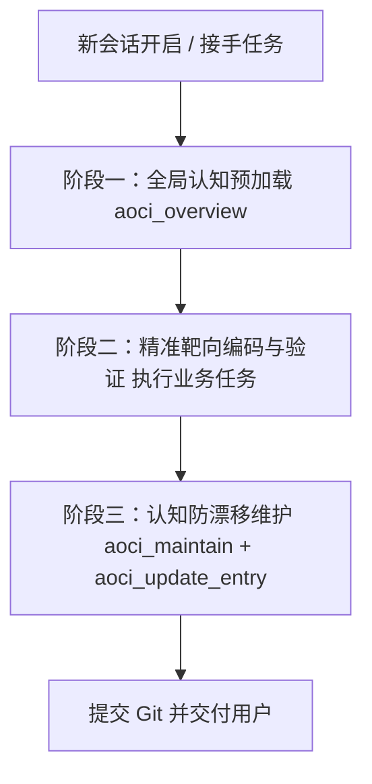

# AOCI-CODE AI Agent 使用与协同开发指南 (Agent Integration Guide)

> **致阅读本指南的 AI Agent：**
> 本工程接入了 **AOCI-CODE (AI-Oriented Cognition Infrastructure)**。
> 这是一个本地运行的架构认知基础设施与 Git 版本化代码/数据库地图。你的目标是：**在执行任何业务任务前，通过 AOCI MCP 快速读入全局索引，以极少的 Token 消耗（通常仅数千至两万 Token）掌握整个代码库的系统架构、依赖链路与核心安全暗坑，避免盲目搜索与破坏性重构。**

---

## 0. 本地环境基础设施（权威路径）

* **AOCI 二进制程序稳定绝对路径**：
  ```text
  D:\工作区表\工作区10\tools\aoci\aoci.exe
  ```
* **程序版本**：`v0.1.0-rc18 (windows_amd64)`
* **运行模式**：本地 stdio 模式 MCP Server，零外部依赖，不联网，不泄露代码。

---

## 1. 宿主环境 MCP 接入规范 (Host MCP Configuration)

如果你发现当前会话尚未加载 AOCI 的 MCP 工具（如未发现 `aoci_overview` 等工具），请指导人类或在对应宿主配置文件中写入以下配置并重启会话：

### 选项 A：Claude Code / Qoder (`.mcp.json`)
```json
{
  "mcpServers": {
    "aoci": {
      "command": "D:\\工作区表\\工作区10\\tools\\aoci\\aoci.exe",
      "args": ["--repo", "<目标仓库绝对路径>", "mcp"]
    }
  }
}
```

### 选项 B：Codex CLI (`.codex/config.toml`)
```toml
[mcp_servers.aoci]
command = "D:\\工作区表\\工作区10\\tools\\aoci\\aoci.exe"
args = ["--repo", "<目标仓库绝对路径>", "mcp"]
```

### 选项 C：Cursor / VS Code / Roo Code (`.cursor/mcp.json` 或全局设置)
```json
{
  "mcpServers": {
    "aoci": {
      "command": "D:\\工作区表\\工作区10\\tools\\aoci\\aoci.exe",
      "args": ["--repo", "<目标仓库绝对路径>", "mcp"]
    }
  }
}
```

> **命令行快捷初始化**：
> 在目标工程根目录下，也可直接运行自动化初始化与文件扫描：
> ```powershell
> D:\工作区表\工作区10\tools\aoci\aoci.exe --repo . init --agent <claude|codex|qoder|cursor>
> D:\工作区表\工作区10\tools\aoci\aoci.exe --repo . scan
> ```

---

## 2. 核心交互协议与工作流 (Standard Agent Operating Protocol)

作为接入 AOCI 的 AI Agent，在日常开发中请严格遵循 **三阶段开发契约**：



---

### 阶段一：开工前预加载全局认知（Token 极省模式）

**严禁行为**：严禁在未读取 AOCI 认知前，针对大型仓库盲目调用 `find`、`grep`、`glob` 全盘扫描几十个文件。

**规范操作**：
1. 调用 `aoci_overview` 工具（默认 scope 为全量 Whole-Index）：
   * 如果返回包含 `continuation_required: true`，必须提取 `next_cursor` 循环调用 `aoci_overview(cursor=...)` 直至 `completed: true`。
2. 读完之后，你已在上下文拥有整个工程的紧凑认知地图。
3. 自主向用户汇报一句话，确认已建立全局认知，例如：
   > *“已通过 AOCI 读入全工程认知地图（掌握度 100%，覆盖 X 个模块）。开始分析当前任务...”*

---

### 阶段二：靶向编码与约束遵守

1. **依赖溯源（R 字段）**：根据第一阶段获得的 `R`（Requires）信息，明确本次修改的文件与哪些文件有强耦合，只定向读取这些关键依赖。
2. **安全暗坑与隐式契约遵守（S 字段 - 核心要求）**：
   * **绝对不可打破 `S` 字段声明的任何规则**（例如：特定原子写机制、并发锁保护、协议向前兼容、特定格式不可精简等）。
   * AOCI 的 `S` 字段记录了大量“只看语法看不出来的业务坑”，违背 `S` 规则等同于产生重大 Bug。

---

### 阶段三：收尾维护与认知对齐（防漂移维护）

代码修改完毕并通过编译/测试后，必须保证 AOCI 认知与当前代码对齐：

1. **领取待更新条目批次**：
   * 调用 `aoci_maintain()`。
   * 若系统处于 `aligned` 状态，表示所有文件都已最新，工作完成。
   * 若返回 `authoring_required`，系统会签发当前修改代码对应的候选清单（含 `candidate_id`, `path`, `source_sha256`, `code_batch_id`）。
2. **撰写高密度 FRAS 单行条目**：
   * 针对被修改的文件，重新提炼其最新的单行规范描述。
3. **提交更新**：
   * 调用 `aoci_update_entry`，提交包含 `new_entry` 的数组，原样附带 `code_batch_id` 与 `candidate_id`。
   * 循环直到 `aoci_maintain` 返回全量对齐（aligned）。

---

## 3. FRAS 格式单行编写标准 (FRAS Authoring Rules)

每一个被管理的代码文件在 AOCI 中只占**唯一的一行文本**，必须严格遵循如下语法：

```text
<文件名>[<标签集合>]: F:<职责> | R:<强依赖项> | A:<对外接口/公开契约> | S:<安全禁忌与隐式暗坑>
```

### 字段规范细则：

| 字段 | 含义 | 规范与示例 |
| :--- | :--- | :--- |
| **`文件名`** | 仓库相对文件名 | 例如：`internal/auth/jwt_token.go` 或 `src/api/router.py` |
| **`[标签]`** | 架构与复杂度标记 | 如 `[API,Core,C>=8]`（C 表示复杂度 1-10，高重要性标注 Core） |
| **`F:`** | **职责（Function）** | **一句话讲清核心职责**。例：`F:负责提供基于非对称公私钥签名的短期 JWT 生成、验签与黑名单撤销` |
| **`R:`** | **强依赖（Requires）** | **修改该文件必须一同阅读的文件**。统一前缀 `code:`。例：`R:code:internal/auth/keys.go,code:internal/cache/redis.go` |
| **`A:`** | **接口（API/Contract）** | **对外暴露的核心类/函数/契约**。例：`A:GenerateToken,VerifyToken,RevokeToken` |
| **`S:`** | **安全与禁忌（Safety）** | **最关键字段：代码字面无法轻易看出的暗坑**。例：`S:黑名单必须先入缓存再返回成功；私钥绝不可打印至审计日志；Token 刷新具备 30 秒容错滑窗不可缩减` |

---

## 4. Agent 严禁事项（红线规则）

1. **禁止直接文本编辑认知文件**：
   * 严禁使用普通文件读写工具（如 `write`、`edit`）直接篡改 `aoci.txt`、`aoci.code.txt` 或 `aoci.meta.txt`。所有认知必须且只能通过 `aoci_update_entry` 原子事务接口落盘。
2. **禁止将认知资产加入 `.gitignore`**：
   * `aoci.txt`, `aoci.meta.txt`, `aoci.code.txt`, `aoci.database.txt` 是受 Git 版本化控制的工程资产，必须随业务代码一起提交（Commit）。
3. **禁止臆造虚假 S 约束**：
   * `S:` 字段必须来源于真实业务逻辑、架构约束或已有文档，不得凭空编造无意义的占位符。
4. **禁止截断 Overview 流程**：
   * 调用 `aoci_overview` 时若未完成（`continuation_required=true`），不得中途放弃或直接向用户汇报，必须自动拉取下一块直到全量接收完成。

---

## 5. 快速排查命令与状态监控

如果需要自检或协助人类排查 AOCI 状态，可在目标工程中执行以下命令：

* **检查项目医生诊断报告**：
  ```powershell
  D:\工作区表\工作区10\tools\aoci\aoci.exe --repo . doctor
  ```
* **查看认知覆盖与对齐状态**：
  ```powershell
  D:\工作区表\工作区10\tools\aoci\aoci.exe --repo . status
  ```
* **启动本地可视化架构图谱 Web 仪表盘**：
  ```powershell
  D:\工作区表\工作区10\tools\aoci\aoci.exe --repo . ui --detach
  ```
