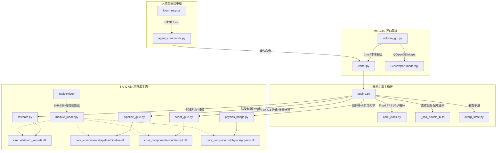

# Loom 引擎 AOCI 全局架构表与认知资产台账 (AOCI Architecture Matrix)

> **工程定位**：Loom 3D 游戏引擎（DLL 化全量生产级架构 / M5 阶段）  
> **认知标准**：AOCI-CODE v0.1.0-rc18 (AI-Oriented Cognition Infrastructure)  
> **审计体系**：多观察点立体审计规范（废除主观百分比进度，全量二值原子命中判定）  
> **开发契约**：JevAgent 二文件驱动规范（`<module>.spec.<lang>.dsl` ↔ `<module>.<ext>`）  
> **实验隔离**：当前工作区为镜像目录 `D:\my-project`，严格隔离主机原目录 `D:\my-project`

---

## 一、AOCI 基础设施与治理规范概述

本工程已完整接入 **AOCI-CODE (AI-Oriented Cognition Infrastructure)** 认知基础设施，作为跨会话的 Git 版本化代码/架构地图。

### 1. 核心运行配置与资产定位
* **AOCI 二进制程序绝对路径**：`D:\工作区表\工作区10\tools\aoci\aoci.exe` (`v0.1.0-rc18 windows_amd64`)
* **运行模式**：本地 stdio 模式 MCP Server，零外部网络依赖，零代码资产外泄。
* **卷轴体系 (Volumes v1)**：
  - `aoci.txt`：根清单卷轴（Root Manifest），声明元数据与代码卷轴依赖。
  - `aoci.meta.txt`：元数据定义卷轴，钉扎对象协议、FRAS 纪律、标签字典与 S 字段配额。
  - `aoci.code.txt`：代码认知卷轴，承载全量代码文件的高密度 FRAS 单行条目。
  - `.aoci/`：治理配置目录，包含 `config.json`、`baseline.json` 与安全白名单。

### 2. FRAS 单行语法纪律 (FRAS Authoring Rules)
本工程各核心模块在 AOCI 架构表中遵循严格的 FRAS 紧凑格式：
```text
<文件名>[<标签集合>]: F:<职责> | R:<强依赖项> | A:<对外接口/公开契约> | S:<安全禁忌与隐式暗坑>
```
* **标签字典语法**：紧凑格式 `A+B+C+[D]+E`
  - **A (分层 Layer)**：`C`-共享基础, `E`-入口边界, `A`-应用编排, `D`-领域逻辑, `K`-算法计算, `M`-中间件, `P`-持久化, `I`-集成适配, `R`-运行基础, `L`-库与SDK, `F`-声明配置, `O`-运维交付, `T`-测试验证, `S`-文档规范
  - **B (模块 Module)**：`G`-跨域通用, `U`-用户交互, `B`-核心业务, `D`-数据状态, `I`-身份权限, `N`-网络协议, `M`-消息事件, `S`-安全隐私, `C`-配置策略, `O`-可观测性, `R`-可靠性恢复, `P`-性能资源, `W`-流程调度, `A`-分析智能, `V`-构建发布, `Q`-质量保障
  - **C (重要性 Importance)**：`9`-最高核心, `8`-很高, `7`-高, `6`-较高, `5`-中等
  - **E (规模 Scale)**：`L`-大>400行, `M`-中200-400行, `S`-小100-200行, `T`-微<100行
* **S 字段准入铁律**：只记录**代码字面无法轻易推断、且能切实防止破坏性重构与安全崩溃**的隐式暗坑。严禁臆造无意义占位符。

---

## 二、Loom 引擎 AOCI 核心架构全景总表 (FRAS 单行条目矩阵)

### 板块 1：C ABI 底座、模块契约与自愈体系 (M1 系列)

```text
Loom/core_components/loom_module.h[CR9T]: F:定义Loom通用C-ABI契约规范与模块生命周期宏 | R:- | A:LOOM_MODULE_EXPORT,LoomModuleInfo,LoomTensor,LoomLifecycleAPI | S:结构体必须采用#pragma pack(push, 8)对齐，LoomModuleInfo严格对齐至104字节、LoomTensor对齐至48字节，ABI魔数LOOM_MODULE_MAGIC=0x4D4F4F4C不可篡改
Loom/core_components/registry.json[FC9T]: F:官方C核心动态库元数据注册表与SHA256指纹钉扎清单 | R:code:Loom/core_components/loom_module.h | A:components,official,provides,depends,sha256 | S:任何C动态库代码或构建脚本变更后必须通过脚本重新计算并钉扎SHA256，未钉扎或指纹不匹配的库将被加载器静默拒载
Loom/core_components/module_loader.py[IR8M]: F:C动态库底层加载器，实施PE魔数校验与ABI七生命周期函数绑定 | R:code:Loom/core_components/loom_module.h | A:ModuleLoader,LoadedModule,load_c_module,check_pe_architecture | S:仅允许在主线程执行ctypes.CDLL加载；加载失败时必须捕获OSError与WindowsError并执行降级，严禁直接抛出未捕获异常导致宿主进程崩溃
Loom/core_components/module_registry.py[IR8M]: F:核心模块拓扑排序装配器与自愈降级中枢 | R:code:Loom/core_components/registry.json,code:Loom/core_components/module_loader.py | A:ModuleRegistry,get_module,pop_and_fallback,topological_sort | S:组件槽位加载失败时必须自动触发第一道自愈闸（静态剔除坏库标记enabled:false）与第二道自愈闸（运行时SEH异常捕获回退至官方参考实现），确保引擎主循环不中断
Loom/crash_reporter.py[OR8S]: F:Windows SEH非托管异常拦截与dbghelp MiniDump内存转储中枢 | R:- | A:install_crash_handler,uninstall_crash_handler,write_dump | S:必须动态加载dbghelp.dll；转储写入目录崩溃日志/必须在捕获异常前预先创建；不可在异常处理回调内分配大量Python堆内存以防二次崩溃
Loom/build_all.bat[OV8T]: F:MSVC x64一键增量构建全部核心C-DLL并自动刷新注册表SHA256门禁脚本 | R:code:Loom/core_components/registry.json | A:build_all | S:锁定VS2022 Community MSVC工具链与/Brepro确定性构建标志；构建完毕后必须串行运行tests/_tmp/全量回归探针，有一项失败则整体非零退出
```

### 板块 2：几何计算与宽相碰撞 C 内核 (M2-ckernels 系列)

```text
Loom/ckernels/loom_kernels.h[KB9T]: F:定义AABB批量归约与一维轴向投影碰撞对筛选C接口 | R:code:Loom/core_components/loom_module.h | A:loom_aabbs_minmax,loom_aabbs_minmax_par,loom_collide_pairs | S:所有指针入参必须以restrict修饰；输出数组内存必须由调用方预分配且保证连续，C内核内部零malloc
Loom/ckernels/loom_kernels.c[KB9M]: F:几何计算与SAP宽相重叠筛选纯C实现（含Win32原生多线程分块） | R:code:Loom/ckernels/loom_kernels.h | A:loom_aabbs_minmax,loom_aabbs_minmax_par,loom_collide_pairs | S:采用纯标量升序累加，数值与Numba f64逐位全等；规避OpenMP运行时以防在精简系统环境引发动态库加载缺失；Win32线程池分块边界必须处理整除余数
Loom/fastpath.py[KB8M]: F:几何计算与碰撞筛选的ctypes直调分派与Numba/纯Python降级胶水层 | R:code:Loom/ckernels/loom_kernels.h | A:compute_aabbs,filter_collision_pairs,has_ckernels | S:优先直通loom_kernels.dll并释放GIL；当环境变量LOOM_NO_CKERNELS=1或动态库不可用时必须无缝降级至Numba/NumPy慢路径，对外计算结果误差必须严格<=1e-12
```

### 板块 3：渲染前置计算、矩阵合成与图遍历管线 (M2/M3-pipeline 系列)

```text
Loom/core_components/loom_pipeline.h[KB9T]: F:渲染前置Prep链、矩阵批量计算与场景图DFS遍历C接口规范 | R:code:Loom/core_components/loom_module.h | A:loom_pipeline_light_vps,loom_pipeline_world_matrices,loom_pipeline_interp_pose,loom_pipeline_pack_bucket_instances,loom_pipeline_dirty_mask,loom_pipeline_local_matrices,loom_pipeline_depths,loom_pipeline_ancestry_dfs | S:世界矩阵乘法链与深度升序完全绑定；局部矩阵乘法序必须严格对齐TRS展开标准；材质桶打包跨步步长必须严格匹配64B/96B实例显存对齐
Loom/core_components/pipeline/loom_pipeline.c[KB9L]: F:渲染管线前置计算全量入C高性能内核实现 | R:code:Loom/core_components/loom_pipeline.h | A:loom_pipeline_light_vps,loom_pipeline_world_matrices,loom_pipeline_interp_world,loom_pipeline_pack_bucket_instances,loom_pipeline_depths,loom_pipeline_ancestry_dfs | S:interp_world姿态平铺于C栈，消除Python-C往返；显式栈DFS防环截断爬链，递归深度超出64层强制熔断；材质打包直接写入显存映射区，严禁np.take二次拷贝
Loom/pipeline_glue.py[IB8M]: F:pipeline.dll在Python侧的高性能胶水封装与逃生门降级管理 | R:code:Loom/core_components/pipeline/loom_pipeline.h | A:pack_bucket_instances,dirty_mask,local_matrices,depths,ancestry_dfs | S:封装必须维持入参连续性检查（np.ascontiguousarray）；环境变量LOOM_NO_PIPELINE_DLL=1时平滑降级至纯Python慢路径
Loom/interp_state.py[DB8M]: F:渲染帧关键帧姿态插值与小角跨越平滑算法状态容器 | R:- | A:InterpState,advance,get_interpolated_pose | S:角度插值必须处理2*PI周期跨越翻转，禁止简单的算术线性相加；逻辑步进与渲染帧率非整数倍时alpha严格限制在[0.0, 1.0]闭区间内
```

### 板块 4：主循环调度与物理级解耦 (Decoupling 系列)

```text
Loom/ui/loom_gui.py[EU8L]: F:PySide6原生Qt编辑器视图基座、视口驱动与1ms高精度混合等待时钟 | R:code:Loom/engine.py,code:Loom/editor.py | A:LoomGUI,GLViewport,_wait_until,_init_winmm_timer | S:必须调用winmm.timeBeginPeriod(1)将Windows系统时钟锁死在1ms；_wait_until大段等待走释放GIL的time.sleep，末段<0.4ms微自旋，严禁死循环忙等霸占GIL；paintGL内禁止同步调用advance_logic
Loom/engine.py[AB9L]: F:Loom 3D游戏引擎核心编排器，驱动场景图、渲染管线、物理与脚本主循环 | R:code:Loom/fastpath.py,code:Loom/pipeline_glue.py,code:Loom/interp_state.py | A:GLEngine,advance_logic,render,step_logic_once,_soa_double_bufs | S:慢路径快照必须使用连续预分配SoA乒乓双缓冲_soa_double_bufs，消灭帧内tuple构造；异步管线仅在_external_ctx=True(Qt宿主)下激活，单线程探针保持确定性单步以根除卡死
Loom/core_clock.py[RP8T]: F:高精度固定步长逻辑时钟（Fixed TPS）与时间累加器 | R:- | A:CoreClock,tick,reset,set_tps | S:时间步长采用固定累加算法，逻辑步进次数必须设最大防螺旋膨胀上限（max_substeps<=5），防止低性能设备进入死亡追赶死循环
Loom/scheduler.py[RW8M]: F:多线程异步任务调度器与跨线程安全消息信箱 | R:- | A:Scheduler,post_task,drain_main_thread_tasks | S:跨线程向主线程提交UI更新必须通过信箱队列并由Qt主事件循环安全消费，严禁在后台子线程直接操作PySide6控件
Loom/frame_buffer.py[RP8M]: F:双缓冲/三缓冲渲染帧队列容器与掉帧补偿控制器 | R:- | A:FrameBufferQueue,push_frame,pop_latest_frame | S:渲染线程取帧必须采用无锁或极简自旋读取，当渲染滞后于逻辑帧时自动执行跳帧消费，保证最新姿态呈现在屏幕上
```

### 板块 5：脚本与运动核心组件 (M4-script 系列)

```text
Loom/core_components/script/loom_script.h[KB9T]: F:定义C原生批量运动计算与Lua 5.4嵌入式虚拟机C-ABI接口 | R:code:Loom/core_components/loom_module.h | A:loom_script_batch_rotate,loom_script_batch_move,loom_lua_init,loom_lua_load_string,loom_lua_step_vm | S:所有Lua C API必须严格剥离io/os/debug等危险库，构建纯安全沙箱；Lua状态机在C侧独立持有，严禁跨线程并发重入同一个lua_State
Loom/core_components/script/loom_script.c[KB9M]: F:批量自转/平移纯C-SIMD内核及嵌入式Lua 5.4虚拟机胶水层 | R:code:Loom/core_components/script/loom_script.h | A:loom_script_batch_rotate,loom_script_batch_move,loom_lua_init,loom_lua_step_vm | S:自转与平移在纯C循环内直出，天然释放Python GIL；向Lua暴露的10大运动API（move, rotate, get/set_position等）直接操作C内部缓存，完全规避Python反射开销
Loom/script_glue.py[IB8M]: F:脚本系统C-DLL与Lua虚拟机在Python宿主侧的调度与逃生门封装 | R:code:Loom/core_components/script/loom_script.h | A:batch_rotate,batch_move,load_lua_script,step_lua_script | S:环境标LOOM_NO_SCRIPT_DLL=1时无缝降级回Python反射解释；脚本调用报错时必须记录详细堆栈并不中断主引擎循环
Loom/scripts.py[DB8M]: F:游戏脚本基类体系、动态注解注册器与Lua脚本类型自动生成器 | R:code:Loom/script_glue.py | A:Script,register,make_lua_script_class,load_all_scripts | S:Lua脚本统一通过make_lua_script_class动态包装为合规Script类，实现编辑器检查器挂载、参数序列化与纯C高效驱动双轨合一
Loom/scripts/rotate.lua[DB7T]: F:官方示例纯Lua自转脚本（M4轻量级示范） | R:- | A:on_start,update | S:纯Lua运行，帧更新只调用loom.rotate(sx*dt, sy*dt, sz*dt)，零Python参与
Loom/scripts/wasd_move.lua[DB7T]: F:官方示例纯Lua WASD键盘移动脚本 | R:- | A:on_start,update | S:通过loom.get_action映射动作状态，依据位移矢量调用loom.move计算
Loom/scripts/camera_follow.lua[DB7T]: F:官方示例纯Lua第三人称相机跟随脚本 | R:- | A:on_start,update | S:调用loom.get_position获取目标坐标后通过loom.set_camera_target原子同步
```

### 板块 6：物理动力学组件 (Physics 系列)

```text
Loom/core_components/physics/loom_physics.c[KB9M]: F:Jolt物理后端C-ABI标准化封装与多子步闭环推进内核 | R:code:Loom/core_components/loom_module.h | A:loom_physics_pre_step,loom_physics_post_step,loom_physics_substep_loop | S:重力累加、库仑滚动阻尼指数衰减、残速死带清除与休眠残速归零彻底在C闭环推进，单步推进期间释放GIL；休眠阈值lin_sq<1e-4且ang_sq<1e-4时速度强制清零
Loom/physics_bridge.py[IB8M]: F:Python场景刚体与C物理动态库/Jolt之间的高性能数据桥接器 | R:code:Loom/core_components/physics/loom_physics.c | A:PhysicsBridge,step,sync_transforms,apply_forces | S:物理脏检测与局部矩阵构建已完全切入pipeline.dll的C内核；数据传输使用批量连续内存指针，严禁逐物体逐属性单次ctypes往返
Loom/physics_glue.py[IB8M]: F:物理动力学C动态库的加载、符号绑定与降级逃生门 | R:code:Loom/core_components/physics/loom_physics.c | A:init_physics_module,c_substep_loop,is_physics_c_active | S:当环境变量LOOM_NO_PHYSICS_DLL=1时平滑降级至纯Python原生物理步进，数值误差严格对齐
Loom/physics_pipe.py[IB8M]: F:独立物理线程动力学解算流水线管理 | R:code:Loom/physics_bridge.py | A:PhysicsPipeline,start_thread,stop_thread,step_async | S:动力学解算本体在loom-physics子线程运行并释放GIL；与逻辑主线程的同步采用双缓冲互锁，严禁锁持有期间调用重度计算
```

### 板块 7：MCP 标准协议与大模型实战驱动 (MCP 系列)

```text
Loom/loom_mcp.py[EN9M]: F:Anthropic MCP标准协议服务实现，提供Unity工作流对齐与全维度诊断工具集 | R:code:Loom/agent_commands.py | A:LoomMCPServer,TOOLS_DEF,handle_request,stdio_loop | S:遵循Anthropic MCP 2024-11-05规范；stdio模式下stdout只能输出合法JSON-RPC 2.0单行文本，所有调试日志严禁写stdout必须定向至stderr
Loom/agent_commands.py[EN8M]: F:无Qt依赖的标准库EAI命令解释器，执行场景生成与组件配置 | R:code:Loom/engine.py | A:execute_command,COMMAND_REGISTRY,write_port_file | S:所有增删查改命令原子执行；通过.agent_port.json写入端口与随机Token认证，杜绝未授权访问与端口竞争冲突
```

### 板块 8：M5 GUI 界面与视口基座 (GUI 系列)

```text
Loom/editor.py[AU8L]: F:编辑器核心应用逻辑、命令历史、撤销重做栈与Gizmo变换轴拾取驱动 | R:code:Loom/engine.py,code:Loom/undo.py | A:EditorApp,edit_model,commit_model,toggle_play,select_object | S:所有状态变更必须由命令封装进入撤销栈，严禁视图层绕过命令直接篡改模型；播放态下直接消费C原生interp_world姿态产物，彻底消灭每帧重复计算
Loom/ui/editor_ui.py[EU8M]: F:PySide6检查器属性面板、层级树、材质与物理参数编辑控件集 | R:code:Loom/editor.py | A:InspectorWidget,HierarchyTreeWidget,create_dock_widgets | S:遵循GUI基座保留Python/PySide6定案红线；大场景树刷新必须采用增量批量构建，禁止逐节点频繁清空重绘造成界面掉帧
Loom/ui/qt_console.py[EU7S]: F:编辑器内置交互控制台与实时日志流收集面板 | R:- | A:QtConsoleWidget,append_log,redirect_stdio | S:截获引擎stdout/stderr时必须防止自引用递归触发栈溢出；日志缓冲行数严格限制在1000行以内，超额自动丢弃老记录
```

### 板块 9：编译发布与独立拆装体系 (M6 系列)

```text
Loom/build_game.py[OV8M]: F:纯物理游戏独立打包器，将场景、材质与.py/.lua脚本打包为.lsc混淆包 | R:code:Loom/core_components/registry.json | A:build_game_package,bundle_core_dlls | S:随包自动分发core_components中4大官方C-DLL并校验指纹；打包后清除明文源码，彻底剥离Qt/PySide6界面依赖
Loom/game_player.py[ER8M]: F:纯物理独立游戏轻量级运行播放器（无编辑器开销） | R:code:Loom/engine.py,code:Loom/runtime.py | A:GamePlayer,run | S:内存占用极小，零加载PySide6与GUI控件；直接启动moderngl无边框视口全速渲染
Loom/runtime.py[RR8M]: F:运行时基础设施，负责资产加载、混淆解包与独立运行时环境配置 | R:- | A:RuntimeContext,load_package,unpack_asset | S:解密与解包过程在内存流中完成，禁止在磁盘生成临时明文文件
Loom(编译版)/Loom/Loom.exe[ER9L]: F:由Nuitka编译的官方独立无依赖二进制可执行发布版本 | R:code:Loom/core_components/registry.json | A:Loom.exe | S:镜像目录隔离构建；20/30 TPS下实测稳定在160+ FPS，消灭历史58-61 FPS性能倒挂
```

---

## 三、JevAgent 二文件 DSL 规范纳管全景台账

本工程严格践行 **JevAgent 二文件驱动规范**（`<module>.spec.<lang>.dsl` 驱动代码），以下为当前已完成 100% 纳管与对齐的核心模块清单：

| 模块基路径 | DSL 特化描述文件 | 驱动源码文件 | 块结构集合 | 审计对齐状态 |
|:---|:---|:---|:---|:---:|
| `Loom/ui/loom_gui` | `loom_gui.spec.python.dsl` | `loom_gui.py` | `imports`, `wait_until` | **【已对齐 (PASS)】** |
| `Loom/engine` | `engine.spec.python.dsl` | `engine.py` | `imports`, `transform_snapshot`, `update_scripts`, `pack_bucket_instances` | **【已对齐 (PASS)】** |
| `Loom/fastpath` | `fastpath.spec.python.dsl` | `fastpath.py` | `imports`, `c_graph_dispatch` | **【已对齐 (PASS)】** |
| `Loom/pipeline_glue` | `pipeline_glue.spec.python.dsl` | `pipeline_glue.py` | `imports`, `pack_bucket_instances`, `dirty_mask`, `local_matrices`, `depths`, `ancestry_dfs` | **【已对齐 (PASS)】** |
| `Loom/interp_state` | `interp_state.spec.python.dsl` | `interp_state.py` | `imports`, `advance` | **【已对齐 (PASS)】** |
| `Loom/script_glue` | `script_glue.spec.python.dsl` | `script_glue.py` | `imports`, `glue_functions`, `lua_glue` | **【已对齐 (PASS)】** |
| `Loom/scripts` | `scripts.spec.python.dsl` | `scripts.py` | `imports`, `lua_loader`, `RotateScript` | **【已对齐 (PASS)】** |
| `Loom/physics_bridge` | `physics_bridge.spec.python.dsl` | `physics_bridge.py` | `imports`, `local_matrices_batch`, `dirty_mask_batch` | **【已对齐 (PASS)】** |
| `Loom/physics_glue` | `physics_glue.spec.python.dsl` | `physics_glue.py` | `imports`, `setup`, `glue_functions`, `status_fn` | **【已对齐 (PASS)】** |
| `Loom/loom_mcp` | `loom_mcp.spec.python.dsl` | `loom_mcp.py` | `imports`, `constants`, `engine_client`, `mcp_definitions`, `mcp_handler`, `stdio_loop` | **【已对齐 (PASS)】** |
| `Loom/build_game` | `build_game.spec.python.dsl` | `build_game.py` | `imports`, `assemble_player` | **【已对齐 (PASS)】** |
| `core_components/pipeline/loom_pipeline` | `loom_pipeline.spec.c.dsl` | `loom_pipeline.c` | `imports`, `pack_bucket_instances`, `dirty_mask`, `local_matrices`, `depths`, `ancestry_dfs` | **【已对齐 (PASS)】** |
| `core_components/script/loom_script` | `loom_script.spec.c.dsl` | `loom_script.c` | `imports`, `batch_rotate`, `batch_move`, `lua_vm` | **【已对齐 (PASS)】** |
| `core_components/physics/loom_physics` | `loom_physics.spec.c.dsl` | `loom_physics.c` | `imports`, `pre_step`, `post_step`, `substep_loop`, `module_abi` | **【已对齐 (PASS)】** |

* **铁律约束**：任何后续代码重构必须通过 JevAgent 驱动，且每次修改后必须通过 `check_alignment` 校验，确保双方块定义与逻辑 100% 同步。

---

## 四、核心系统依赖链路与拓扑调用关系



---

## 五、接手施工必守铁律与自愈防御矩阵

1. **镜像目录安全铁律**：
   - 当前工作区为实验镜像目录 `D:\my-project`，**严防任何代码或文件写入主机原目录 `D:\my-project`**！
2. **多观察点二值判定红线**：
   - 坚守客观物理事实判定，仅使用【已命中】与【未命中】判定，彻底杜绝主观百分比模糊汇报。
3. **无损探针永久固化**：
   - 任何新增功能与回归测试必须固化于 `tests/_tmp/` 目录下，严禁在执行后 unlink 删除。
4. **JevGuard 防破坏性篡改**：
   - 核心代码受 JevGuard 强保护，严禁绕过两文件模型进行无 DSL 约束的裸代码修改。
